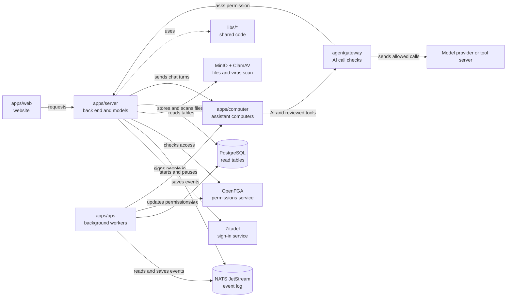

# OpenCrane 2

## What this is

OpenCrane gives every employee a personal AI assistant with its own safe computer,
kept under company control. The assistant can read files, browse, run code and use
approved tools. The company chooses the [models](GLOSSARY.md#model-and-model-provider),
[tool rules](GLOSSARY.md#tool-rule-allow-ask-block), approvals and [budgets](GLOSSARY.md#budget).
Each customer's private installation is called a [silo](GLOSSARY.md#silo).

People use the website, and the website talks to the server. The server saves
every change as an [event](GLOSSARY.md#event) in the [event log](GLOSSARY.md#event-log-event-store),
the one true record. Background workers copy those events into [read tables](GLOSSARY.md#read-table-projection)
so screens load fast. They also start each assistant's [computer](GLOSSARY.md#computer)
when it is needed. A personal assistant has one computer across its chats. A
[shared group assistant](GLOSSARY.md#shared-assistant-group-assistant) also has one
computer, shared by the members who use it.

## Where it fits

This repository holds all of OpenCrane's code: the website, the server, the background
workers, the recipe for each assistant's computer, and the code they share. On the
[dev stack](GLOSSARY.md#dev-stack), most services run directly on the developer's
machine or in Docker [containers](GLOSSARY.md#container-and-pod). The assistant computers run in
[Kubernetes](GLOSSARY.md#kubernetes), a system that runs and looks after containers.
The [planned cluster design](docs/architecture/target.md) describes the intended
customer installation.

### Layers and folders

The table shows each folder, its layer and what it does. The
[event core](GLOSSARY.md#event-core) is the shared code that records changes and
builds data from them. [Tool servers](GLOSSARY.md#mcp-server-tool-server) are small
programs that give assistants named actions, such as looking up an order. They use
MCP, a shared standard for describing and calling tools.

| Layer | Folder | What it does |
| --- | --- | --- |
| Browser app | [apps/web](apps/web/README.md) | Sign in, chat, watch the assistant's screen and manage organisation settings. |
| Back end | [apps/server](apps/server/README.md) | Check access, record changes and send work to computers. It also runs the [models process](GLOSSARY.md#models-process), a separate program that checks AI spending and starts [agentgateway](GLOSSARY.md#agentgateway-ai-gateway), the AI gateway. |
| Tool servers | [apps/demo-mcp](apps/demo-mcp/README.md) | Offer a synthetic quote and delivery slot for credential-free tool demos. |
| Tool servers | [apps/odoo-mcp](apps/odoo-mcp/README.md) | Read Odoo draft sales orders for standalone tests; no product application calls it yet. |
| Background workers | [apps/ops](apps/ops/README.md) | Keep the read tables and permissions up to date, start and pause computers, and rebuild data from the event log. |
| Assistant computers | [apps/computer](apps/computer/README.md) | Build each assistant's isolated computer, where [Codex](GLOSSARY.md#codex), the AI agent, does the work. |
| Event core | [libs/events](libs/events/README.md) | Define each kind of event and the data it carries. |
| Event core | [libs/event-store](libs/event-store/README.md) | Save changes in the event log and read them in order. |
| Event core | [libs/projections](libs/projections/README.md) | Turn events into read tables in PostgreSQL, the database. |
| Event core | [libs/handlers](libs/handlers/README.md) | Run background work in response to events. |
| Shared libraries | [libs/protocol](libs/protocol/README.md) | Define the messages the website and server share. |
| Shared libraries | [libs/auth](libs/auth/README.md) | Handle sign-in, keep people signed in, and issue short-lived [passes](GLOSSARY.md#access-token) that prove who is asking. |
| Shared libraries | [libs/authz](libs/authz/README.md) | Check and update who may do what, using OpenFGA, the permissions service. |
| Shared libraries | [libs/models](libs/models/README.md) | Choose models and check budgets, tool rules and approvals through the AI gateway. |
| Shared libraries | [libs/observability](libs/observability/README.md) | Write logs that leave out private data, and optional traces that follow one request across services. |
| Infrastructure | [infra/devbox](infra/devbox/README.md) | Set up a fresh Ubuntu developer machine. |
| Infrastructure | [infra/dev-stack](infra/dev-stack/README.md) | Start a developer copy of OpenCrane and check it from start to finish. |
| Infrastructure | [infra/nats](infra/nats/README.md) | Configure [NATS JetStream](GLOSSARY.md#nats), the service that keeps and carries events. |
| Infrastructure | [infra/clamav](infra/clamav/README.md) | Run the virus scanner for uploads. |
| Infrastructure | [infra/odoo](infra/odoo/README.md) | Run a test copy of Odoo, a business system, for a planned link between assistants and Odoo. |
| Infrastructure | [infra/package](infra/package/README.md) | Try an OpenCrane install with Helm on a spare dev stack, ahead of the customer installer. |
| Developer tools | [tools/fleet](tools/fleet/README.md) | Help the AI coding agents run tasks, and check that no passwords or keys are committed. |
| Developer tools | [scripts](scripts) | Run repository checks, capture screenshots and download tools. |
| Design notes | [docs](docs) | Describe the product, architecture, decisions and intended screens. |
| Early experiments | [spikes](spikes) | Keep the experiments that tested the main design choices. |

### Today's system

Arrows show calls made while the system runs. The dotted arrow shows shared code.
The files box groups storage and virus scanning to keep the map small.
The server box includes the separate models process.



NATS JetStream keeps the event log, the lasting record of each change. PostgreSQL,
the database, holds read tables: copies of the events arranged so screens load quickly.
Workers can throw them away and rebuild them from the log.
OpenFGA answers permission questions. [Zitadel](GLOSSARY.md#zitadel-sign-in-service)
handles company sign-in.
MinIO stores files, and ClamAV scans them for viruses.
agentgateway checks every AI model call and calls to reviewed, [published](GLOSSARY.md#publication) MCP tools
before forwarding them. The current chat connection offers reviewed tools that need
no account credentials, on personal assistants. Local shell and file tools run inside
the computer and do not pass through the gateway. Routing all browser and other
outside traffic through it remains planned. Tests can use a fake model provider.

## What it is responsible for

- Give personal and shared group assistants one computer each, with files that survive restarts.
- Save every change, such as a new member or a chat message, as an event, and build the tables the screens read from those events.
- Check who may read conversations, use models and tools, or see a computer's screen.
- Set money aside from the budget before each AI call, then charge the real cost once the gateway reports what the call used.
- Ask the person for approval when a tool rule says Ask, and let that approval cover only that exact action.
- Scan uploaded files before the assistant can use them.
- Keep passwords and keys out of computers, and give computers only access passes (tokens) that expire quickly.

### What works today

The dev stack supports company sign-in, personal chat, streamed replies, file uploads,
PDF reading, screenshots and live viewing. Group chats and private sessions with
shared group assistants are also available. Admins can register tool servers, set tool
rules and set monthly budgets in organisation settings. Admins can connect a model
provider, check its key and choose which models people may use in Models & providers.
Owners and admins manage members, groups, invitations and ownership in People & groups.
People can see, save and forget their own [memory facts](GLOSSARY.md#memory-fact)
in chat when private memory storage is configured. The server also implements personal
memory recall for assistants, but memory is still disabled in ordinary assistant turns.

Live viewing still fails sometimes when the system is busy. Three things still need
work: starting every tool server reliably, letting a person take control of the
assistant's screen, and sending all of a computer's outside traffic through the
gateway. Each must also be proven on a fresh installation. Some file previews and
browsers have not been tried on real devices.
Read the [changelog](CHANGELOG.md) for current limits.

Not built yet:

- A customer installer using [Helm](GLOSSARY.md#helm); the local package is an installation trial.
- Memory during assistant turns, including team chats, until private work is proven isolated; correcting facts through the assistant also remains planned.
- Letting assistants use Odoo with only the rights of the person who asked.
- Completing scheduled assistant work and handing a conversation to another assistant. Parts exist, but the full product journeys still need to be connected and proven.

## Processes it handles

### Ask an assistant for work

1. A person signs in with their company account through Zitadel and opens the website.
   The server checks that they are signed in and belong to this company.
2. The person sends a message to their assistant. The server saves it as an event.
   Background work wakes the assistant's computer if it is asleep. The server then passes
   the message to the [bridge](GLOSSARY.md#bridge), the small program on the computer
   that hands work to Codex and reports progress.
3. The assistant calls an AI model. The call goes through agentgateway, which asks the
   [models process](GLOSSARY.md#models-process) in `apps/server` two things: is the
   call allowed, and is there enough budget? If so, the models process sets that money
   aside. Calls to reviewed MCP tools also pass through the gateway, which checks
   the tool's [rule](GLOSSARY.md#tool-rule-allow-ask-block): Allow, Ask or Block.
4. If the tool's rule is Ask, the action waits in the chat until the person approves
   it. The assistant then tries again. The approval works once, and only for exactly
   the action the person approved.
5. The person reads the reply as it arrives. The bridge sends progress to the server,
   which saves it as events and streams it to the website. Workers update the read
   tables. The models process charges the real cost, using what the gateway reports
   each call used.

### Use a file or watch the screen

A person uploads a file in chat. The server scans it with ClamAV, stores it in MinIO,
then sends it to the computer. The computer gets the file, but never the keys to the
file store.

A person opens the live viewer from a conversation. The server checks their access and
forwards screen updates from the computer. It keeps checking access while the viewer
is open.

### Manage or rebuild the installation

An admin or owner manages tool rules, monthly budgets, model providers, people and
groups in organisation settings.

An operator, the person who runs the installation, can rebuild read tables or
permissions. The tools in `apps/ops` read the event log again from the start. This
works because the saved events are the one true record, and everything else is a copy
built from them.

## How to run or test it

Use Node 22. Install dependencies and run the repository checks at lower CPU priority:

```sh
nice -n 10 npm ci
nice -n 10 npm run lint
```

Typed lint shares one TypeScript program across Node packages and keeps three for the
website. This avoids loading the same library types in each package.
The dependency check also rejects tests that import another application’s source
directly; integration tests use small helpers in the application being tested.

Follow the [dev stack guide](infra/dev-stack/README.md) to set up the required
services and computer cluster. Start the stack once those prerequisites are ready:

```sh
infra/dev-stack/up.sh
```

## Where to read more

- [Glossary](GLOSSARY.md): plain meanings of the words used across the project.
- [Current plan](plan.md): remaining work and recorded decisions.
- [Changelog](CHANGELOG.md): changes people can use and known limits.
- [Architecture](docs/architecture): the event catalogue and the upload API.
- [Planned customer installation](docs/architecture/target.md): parts still to build or prove.
- [Why OpenCrane 2 was redesigned](docs/background/2026-09-30-architecture-thread-brief.md): the architecture review that started this version.
- [Design decisions](docs/adr/README.md): why the main components were chosen.
- [Product contract](docs/product/product-contract.md): the intended user experience.
- [User stories](docs/product/user-stories-workspace-and-conversations.md): the work people need to do.

OpenCrane is licensed under [GNU AGPL v3.0 or later](LICENSE).
Customer installations use only open-source parts under licences approved by the Open
Source Initiative (OSI), and only operating-system packages from Debian's main section.
The [licence rules](AGENTS.md#licences) give the detail.
