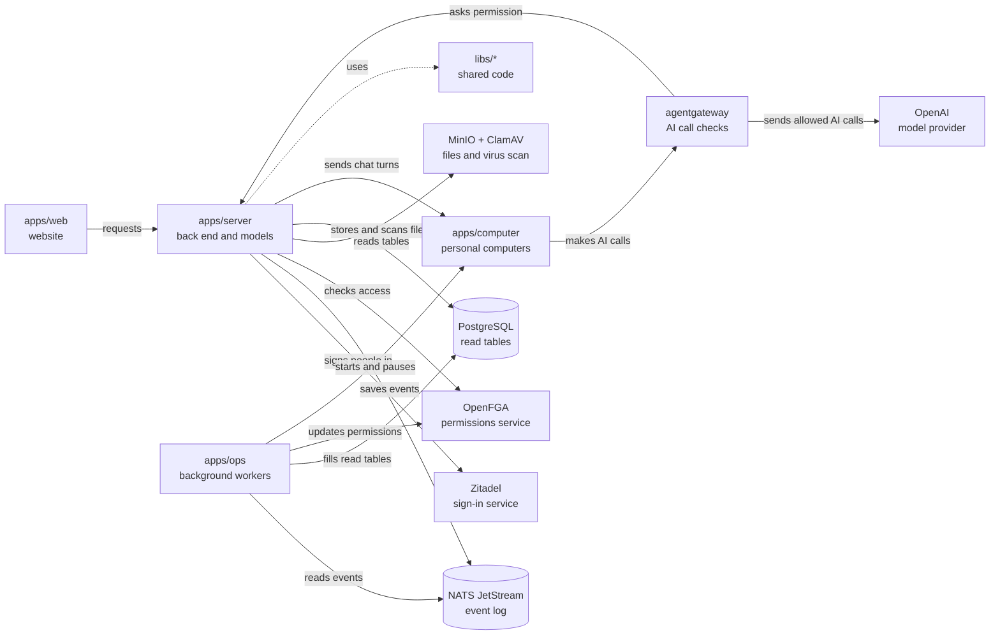

# OpenCrane 2

## What this is

OpenCrane gives every employee a personal AI assistant with its own safe computer,
kept under company control. The assistant can read files, browse, run code and use
approved tools. The company chooses the models, tool rules, approvals and spending limits.
Each customer's private installation is called a [silo](GLOSSARY.md#silo).

## Where it fits

This repository holds the website, server, workers and computer image, plus their
shared code. The developer stack runs services on the host and in Docker, and runs
personal computers in Kubernetes, a system for running containers.
The [planned cluster design](docs/architecture/target.md) describes the intended
customer installation.

### Layers and folders

Use these layer names when describing a package's place in the system.

| Layer | Folder | What it does |
| --- | --- | --- |
| Browser app | [apps/web](apps/web/README.md) | Sign in, chat, watch the assistant's screen and manage organisation settings. |
| Back end | [apps/server](apps/server/README.md) | Check access, record changes and send work to computers. Its separate models process checks AI spending and starts the gateway. |
| Background workers | [apps/ops](apps/ops/README.md) | Build read tables, update permissions, start and pause computers, and rebuild data. |
| Personal computers | [apps/computer](apps/computer/README.md) | Build each person's isolated computer, where Codex, the AI agent, does the work. |
| Event core | [libs/events](libs/events/README.md) | Define each kind of event and the data it carries. |
| Event core | [libs/event-store](libs/event-store/README.md) | Save changes in the event log and read them in order. |
| Event core | [libs/projections](libs/projections/README.md) | Turn events into PostgreSQL tables for reading. |
| Event core | [libs/handlers](libs/handlers/README.md) | Run background work in response to events. |
| Shared libraries | [libs/protocol](libs/protocol/README.md) | Define the messages the website and server share. |
| Shared libraries | [libs/auth](libs/auth/README.md) | Handle sign-in, session cookies and short-lived access tokens. |
| Shared libraries | [libs/authz](libs/authz/README.md) | Check and update permissions through OpenFGA. |
| Shared libraries | [libs/models](libs/models/README.md) | Choose models and check budgets, tool rules and approvals through the AI gateway. |
| Shared libraries | [libs/observability](libs/observability/README.md) | Write safe logs and optional traces that follow work between services. |
| Infrastructure | [infra/devbox](infra/devbox/README.md) | Set up a fresh Ubuntu developer machine. |
| Infrastructure | [infra/dev-stack](infra/dev-stack/README.md) | Start a developer copy of OpenCrane and check it from start to finish. |
| Infrastructure | [infra/nats](infra/nats) | Configure the service that keeps and carries events. |
| Infrastructure | [infra/clamav](infra/clamav/README.md) | Run the virus scanner for uploads. |
| Infrastructure | [infra/odoo](infra/odoo/README.md) | Run a test business system for a future connector. |
| Developer tools | [tools/fleet](tools/fleet) | Run tasks and secret checks for the coding team. |
| Developer tools | [scripts](scripts) | Run repository checks, capture screenshots and download tools. |
| Design notes | [docs](docs) | Describe the product, architecture, decisions and intended screens. |
| Early experiments | [spikes](spikes) | Keep the experiments that tested the main design choices. |

### Today's system

Arrows show calls made while the system runs. The dotted arrow shows shared code.
The files box groups storage and virus scanning to keep the map small.
The server box includes the separate models process.



NATS JetStream keeps the event log, the lasting record of each change. PostgreSQL
holds read tables built from those events; workers can rebuild them from the log.
OpenFGA answers permission questions. Zitadel handles company sign-in.
MinIO stores files, and ClamAV scans them for viruses.
agentgateway checks AI calls before sending them to a model provider;
the dev stack can use a fake model provider for tests.

## What it is responsible for

- Give each person an assistant and a private computer that keeps its files across restarts.
- Record business changes as events and build readable data from them.
- Check who may read conversations, use models and tools, or see a computer's screen.
- Hold money before an AI call, then settle the charge from its reported use.
- Ask for approval when a tool rule requires it, and bind approval to that exact action.
- Scan uploaded files before the assistant can use them.
- Keep secrets out of computers and use short-lived tokens for access.

### What works today

The dev stack supports company sign-in, personal chat, streamed replies, file uploads,
PDF reading, screenshots and live viewing. Admins can manage tool servers, models and
monthly budgets in organisation settings. The server also supports members, groups
and ownership changes; their website pages are not built yet.

Live viewing still has failures under load. Complete tool startup, computer takeover
and control of all outgoing computer traffic still need work and fresh-install checks.
Some file previews and browser combinations have not been checked on real devices.
Read the [changelog](CHANGELOG.md) for current limits.

Not built yet:

- Install a customer silo with Helm, the Kubernetes package installer.
- Remember, correct and forget shared knowledge through a memory service.
- Use the planned Odoo connector with a person's own business-system permissions.
- Run shared team assistants, scheduled work and delegated conversations as a complete product.

## Processes it handles

### Ask an assistant for work

1. Sign in through Zitadel and open the website. The server checks the session and
   whether you belong to this company.
2. Send a message to your assistant. The server saves it as an event; background work
   wakes the computer if needed, and the server sends the chat turn to its bridge.
   The bridge is the small program that passes work to Codex and reports progress.
3. Let the assistant call a model. The call goes through agentgateway, which asks the
   models process in `apps/server` to check permission and hold enough money.
   Supported tool routes also check the tool's Allow, Ask or Block rule.
4. Approve an action if its tool rule is Ask. The call waits for approval in the chat;
   only a retry with the approved arguments may use that approval once.
5. Read the reply as it arrives. The bridge sends progress to the server, which saves
   it as events and streams it to the website. Workers update the read tables,
   and the models process settles spending from the gateway's usage records.

### Use a file or watch the screen

Upload a file in chat. The server scans it with ClamAV and stores it in MinIO before
sending it to the computer. The computer receives the file, without storage credentials.

Open the live viewer from a conversation. The server checks your access and forwards
screen updates from the computer. It keeps checking access while the viewer is open.

### Manage or rebuild the installation

Set model, tool and budget rules in organisation settings as an admin or owner.
Membership roles do not give access to someone else's private conversations.

Rebuild read tables or permissions as an operator. The tools in `apps/ops` read the
event log again, so the saved events remain the source of business state.

## How to run or test it

Use Node 22. Install dependencies and run the repository checks at lower CPU priority:

```sh
nice -n 10 npm ci
nice -n 10 npm run lint
```

Follow the [developer stack guide](infra/dev-stack/README.md) to set up the required
services and computer cluster. Start the stack once those prerequisites are ready:

```sh
infra/dev-stack/up.sh
```

## Where to read more

- [Glossary](GLOSSARY.md): plain meanings of the words used across the project.
- [Current plan](plan.md): remaining work and recorded decisions.
- [Changelog](CHANGELOG.md): changes people can use and known limits.
- [Architecture](docs/architecture): the event catalogue and service rules.
- [Planned customer installation](docs/architecture/target.md): parts still to build or qualify.
- [Design decisions](docs/adr/README.md): why the main components were chosen.
- [Product contract](docs/product/product-contract.md): the intended user experience.
- [User stories](docs/product/user-stories-workspace-and-conversations.md): the work people need to do.

OpenCrane is licensed under [GNU AGPL v3.0 or later](LICENSE).
Customer installations use only OSI-approved open-source application components and
Debian main operating-system packages, under the [licence rules](AGENTS.md#licences).
