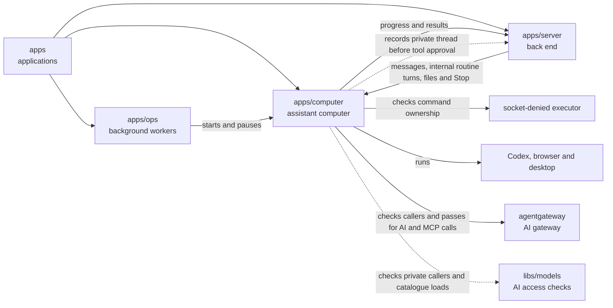

# Assistant computers

## What this is

This package builds the private cloud computer where an assistant works, with an AI
agent, a browser and a desktop. Each assistant has one computer across its chats,
including a group's shared assistant, whose members share that computer.

## Where it fits

This is the assistant computers layer. [apps/ops](../ops/README.md), the background
workers, starts and pauses computers in [Kubernetes](../../GLOSSARY.md#kubernetes).
[apps/server](../server/README.md), the back end, sends
[chat turns](../../GLOSSARY.md#turn-chat-turn) and files and forwards the desktop view.



## What it is responsible for

- Builds the computer image with [Codex](../../GLOSSARY.md#codex), the AI agent,
  a browser, a remote desktop and document tools.
- Runs the [bridge](../../GLOSSARY.md#bridge) that receives messages and reports progress.
- Keeps the assistant's files when its computer pauses and starts again.
- Runs the assistant, file tools and desktop as separate Linux users to limit their access.
- Sends AI model calls and reviewed [tool server](../../GLOSSARY.md#mcp-server-tool-server)
  calls through agentgateway. Shell and file tools run locally inside the computer.
- Runs a [private turn](../../GLOSSARY.md#private-turn) on a shared computer in a fresh,
  short-lived Codex process with no tools. Memory stays disabled until isolation is proven live.
  The proxy can now check a separate caller for each turn. Private process launches
  still need to be connected to these checks before they provide isolation.
  Each tool call checks the caller against the pass it will send, including after
  approval. Ordinary and private turns cannot share a bound thread.
  An internal loader can discover a reviewed memory tool list for one fresh private turn.
  It starts the native thread first, so the server can record its real ID and approve
  the tools for that thread. It then loads the approved list on the same thread.
  It checks the same caller, thread, requester, assistant and grant after waiting.
  Copied tool lists have no approval. The private configuration selects the protocol
  that the proxy accepts. Cancellation removes the list. Discovery reads no facts and gives no permission to call tools.
  The server and computer use the same private caller checks from the models library.
  The image includes this small shared file, which uses only Node's built-in functions.
- Checks fixed package and Git requests against the supervisor's record of the tool call.
  Each request must match its executor, silo, person, computer and process.
  Each valid registration can produce only one plan.
  A private store keeps those records in memory and refuses reuse, including retries.
  Replacing a record, losing its connection or retiring its computer generation removes
  permission. Expiry also removes permission, and restarting restores none.
  Prepares checked package files or empty Git folders in a private directory.
  Each plan can prepare files only once, and cleanup removes only its own files.
  Cleanup also removes newly created folders if opening them fails.
  Network execution stays disabled until the call's identity and isolation are proved.
- Checks the image's licences before publishing it.

An internal routine turn keeps its saved input id separate from its execution id.
The journal returns both ids and the spending root when asking the server to start.
Automatic routine execution remains disabled.

## Processes it handles

1. **A computer starts.** It prepares private folders and starts Codex, the desktop
   and the bridge. It reports readiness once the required services respond.
2. **A person sends a message.** The bridge prepares that conversation, loads any
   reviewed tools and runs the request. It sends progress and the result to the server.
3. **A person uploads a file.** The server passes the scanned file to the bridge.
   The bridge puts it in the workspace for the assistant to read.
4. **A computer resumes.** Its files remain on its disk. The bridge resends reports
   that the server has not yet confirmed, without repeating uncertain private work.
5. **The server asks work to stop.** The computer can stop everything the assistant
   is running and check that the work has stopped. Taking control of the desktop
   remains unavailable. Stopping one private turn clears its buffered reply and
   rejects later reply text, while other people's turns keep running. A failed private
   turn or refused tool also clears its reply. Losing the server connection cancels
   all private turns and clears buffered private replies, including completed ones.
   Ordinary memory-free work can still recover after reconnecting.
6. **A command asks for a package or repository.** The executor refuses network
   execution. Ordinary commands still run as a separate user that cannot open sockets.

## How to run or test it

The image commands need Docker and the local cluster from
[infra/devbox](../../infra/devbox/README.md). The build also runs image checks and
updates the saved computer image setting. Missing Linux Codex downloads stop it.
Server integration tests use `test/server.ts` to exercise the bridge and turn runner.

```sh
nice -n 10 npm run build:image -w apps/computer
nice -n 10 npm run test:image -w apps/computer
nice -n 10 npm run typecheck -w apps/computer
```

The image build requires the Linux Codex programs. A missing download stops the build
before image checks begin.

Repository CI builds a separate test image once for the tests that need it.
The [CI test guide](../../scripts/ci/README.md) explains how those files are grouped.
Supervisor tests pause the bridge's Codex process before checking stopped executors.
Its background workers would otherwise change during the process check. The bridge,
executors, private Codex processes and desktop keep running until the test stops them.

Both image commands need Docker and the dev stack's local Kubernetes cluster.
`build:image` also runs the image tests and updates `sandbox-template.json` with the
new image.
The release checks require a stopped reply to report why it ended. This keeps the
saved partial reply distinct from a model failure after the page reloads.

Repository CI builds a separate test image once for the tests that need it.
The [CI test guide](../../scripts/ci/README.md) explains how those files are grouped.

A separate local capture checks native consent on saved Codex threads. It uses a
stub model and a disposable gateway. Missing shell or file requests remain unproven;
the capture does not enable approvals in normal turns. Its saved checks require every
expected request and its matching reply and continuation.

A separate offline check records when native child threads first call the model.
It uses the existing image and local replies. Its saved observations do not enable
delegation; reliable identity for each call and the required timing race remain unproven.

## Where to read more

- [README.robot.md](README.robot.md): image settings, security limits and detailed checks.
- [apps/ops](../ops/README.md): computer starts, pauses and recovery.
- [apps/server](../server/README.md): chat requests and progress reports.
- [Why Codex runs inside each computer](../../docs/adr/0003-harness-codex.md).
- [Why a computer keeps its disk when it sleeps](../../docs/adr/0006-computer-disk-and-live-view.md).
