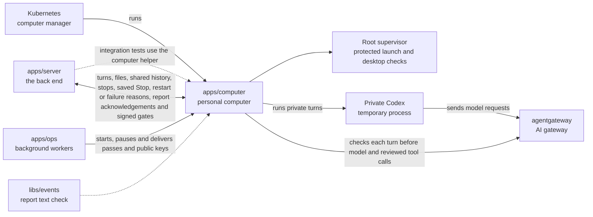

# apps/computer

## What this is

A private cloud computer where each person's assistant does its work. Each computer is a locked-down Linux container. It holds Codex (OpenAI's coding agent), a web browser and a remote desktop. Kubernetes, the system that runs containers, starts one for each person.

Private turns run in a temporary Codex process with no tools. Its files use a memory
volume, which can still be written to disk by swap. The live check covers temporary
processes and their files. Memory features stay off until private replies, memory
tools and access changes also pass their checks.

The computer keeps a server-recorded shared-only label on restricted child turns.
It saves the label with the start report and refuses to run that start again after
a restart. It includes the admitted thread id with child output so the server can
check where each reply came from. It describes earlier shared exchanges as a record
from several people, never as instructions or a private session.

## Where it fits

This is the personal computers layer. `apps/ops` starts and pauses computers. `apps/server` sends chat turns and files and can show a read-only desktop view. The computer sends model requests through agentgateway, the AI gateway in the server's models process.



## What it is responsible for

- Answers each native Codex request once, including after a turn ends.
  Reports refusals during active tool-enabled turns without command or prompt text.

- Builds the container image with Codex, a browser, a remote desktop and document tools.
- Accepts new server passes only through authenticated Kubernetes access as root.
  Check each pass with the supplied public key before saving the key and computer
  identity. Codex can read the key, but cannot use it to sign requests or change it.
  Older deliveries without a key still work; computer-wide stop requests need a key.
- Runs the bridge that receives chat turns and sends progress reports to the server.
  End reports distinguish an interrupted Stop from a restart, model failure or tool refusal.
- Returns a checked root supervisor receipt after stopping local executors. Saved stop
  gates keep executor admission closed after a restart. Desktop control stays unavailable.
- Checks signed computer-wide stop requests against its saved identity and generation
  before stopping any work. Replies immediately on each connection, even while progress
  reports wait to resume, so the server can stop executors without delay.
- Disables Node debugging in trusted processes so local programs cannot use a debugger
  to read their passes or change their access checks.
- Runs each turn with the model the server confirms. Keeps that model when renewing
  the turn's pass. Older servers keep the existing task-based choice.
- Reports when a listed tool call starts or finishes, without its arguments or result.
  Skips invalid names and call ids so later reports can still reach the server.
- Keeps files in the person's workspace when the computer pauses and starts again.
- Lets Codex reach the AI gateway only while the current chat turn holds a valid short-lived pass.
- Removes a stopped turn's passes and tool lists, ends its approval waits and closes
  its local model and tool requests before asking Codex to interrupt it.
- Separates the assistant, file tools and desktop into different Linux users.
  Protects temporary desktop files before those users start.
- Stops executors through a root-only socket. Keeps executor admission closed after
  a stop, including when the supervisor restarts. It checks for unexpected desktop
  processes while keeping the desktop and viewers running. Taking control stays disabled.
- Supplies the Kubernetes files that restrict network access.
- Checks the image's licences before publishing it.

Codex sees only the reviewed, free tools allowed for that chat turn. Each tool
call goes through a local proxy and the gateway's current access checks. When
a new turn begins, the bridge reloads only that conversation's Codex thread.
It keeps the conversation history. Reloading stops any background terminals
from that thread. If reload cannot be confirmed, the reply fails with a clear
message and the person can send it again. The proxy releases the list when the
turn ends. A tool changed from Allow to Ask is refused. Reviewed Ask tools wait
for the requester to approve. The same call then continues once, with a fresh pass.
Denial, Stop and a wait longer than 15 minutes end the call without sending it.
A spending Stop also blocks late passes for that turn before they become usable.
A delayed removal for an old turn leaves the next turn's passes, tools and open
requests alone, even when both use the same Codex thread.
The server and computer can be updated in either order. The computer tells the
server whether it can wait for approval. Older computers receive Allow tools only.

## Processes it handles

1. **A computer starts.** It prepares private folders and starts Codex, the desktop and the bridge. It reports that it is ready when the required services respond.
2. **A person sends a message.** The server sends the turn to the bridge. The bridge loads its reviewed tools, runs it in Codex and sends progress reports back.
3. **A person uploads a file.** The server passes the scanned file to the bridge. The bridge puts it in the workspace for Codex to read.
4. **A computer resumes.** Its files remain on its disk. The bridge sends any reports that the server has not confirmed yet.
   It waits for the server to save small groups of reports before sending more. This keeps
   the connection open for Stop while a long reply is being saved.
   A stopped turn cannot regain access through a late acknowledgement or pass renewal.
5. **A trusted root process stops executors.** The supervisor closes executor connections
   and stops tools and private Codex processes. It checks every worker thread, including
   workers whose main thread has exited, and detached children. It checks each process
   number and start time before and after reading its details. Reused numbers, unreadable
   details, changed process or thread lists, or work that keeps running prevent an
   exit receipt. A task disappearing during the check also refuses the receipt,
   because it may have passed work to a new child. The receipt cannot grant desktop control.

The bridge accepts a short-lived signed stop request only for this computer, Pod and
generation. A missing key or an old or foreign request leaves work running. A valid
request stops bridge work and reports what it has checked. The bridge cannot prove
that executors or browser automation have stopped, so this report cannot grant control.
The server sends this request after saved control intent, including when the computer
is idle. After reconnecting it arrives before report replay. The server checks the
reply and keeps it only for that connection.

The local HTTP listener allows up to 17 minutes to receive a request. This setting
does not limit how long its reply can wait. Approval waits have their own 15-minute limit.

## How to run or test it

Tests share a port picker that keeps listeners away from outgoing connections
and the secondary dev stacks. It tries another port if one is already busy.
Server integration tests use `test/server.ts` to exercise the bridge and turn runner.

```sh
npm run build:image -w apps/computer
npm run test:image -w apps/computer
npm run typecheck -w apps/computer
```

The image build requires the Linux Codex programs. A missing download stops the build
before image checks begin.

Both image commands need Docker and the dev stack's local Kubernetes cluster.
`build:image` also runs the image tests and updates `sandbox-template.json` with the
new image.
The release checks require a stopped reply to report why it ended. This keeps the
saved partial reply distinct from a model failure after the page reloads.

Repository CI builds a separate test image once for the tests that need it.
The [CI test guide](../../scripts/ci/README.md) explains how those files are grouped.

A separate local capture checks native consent on saved Codex threads. It uses a
stub model and a disposable gateway. Missing shell or file requests remain unproven;
the capture does not enable approvals in normal turns. Its saved checks require every
expected request and its matching reply and continuation.

## Where to read more

- [README.robot.md](README.robot.md): image details, settings, security limits and test commands.
- [apps/ops](../ops/README.md) starts and pauses computers.
- [apps/server](../server/README.md) sends turns and receives progress reports.
- [Why Codex runs on each person's computer](../../docs/adr/0003-harness-codex.md).
- [Why a computer keeps its disk when it sleeps](../../docs/adr/0006-computer-disk-and-live-view.md).
- [The shared words used in these guides](../../GLOSSARY.md).
