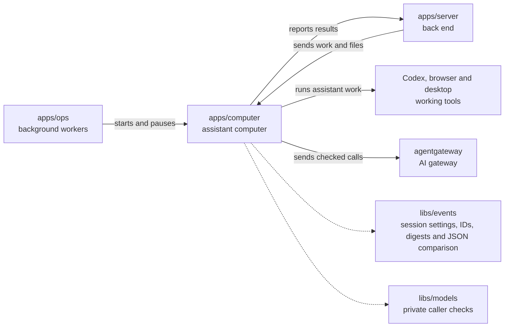

# Assistant computers

## What this is

A private cloud computer where each person's assistant does its work.
It contains an AI agent, browser and desktop.
Each assistant keeps one computer across its chats, including a group's shared assistant.
Its bridge receives work from the server and reports progress and results.

## Where it fits

This package belongs to the personal computers layer.
[apps/ops](../ops/README.md), the background workers, starts and pauses computers in
[Kubernetes](../../GLOSSARY.md#kubernetes).
[apps/server](../server/README.md) sends chat turns and files and forwards the desktop view.
AI and reviewed tool calls go through the gateway.



## What it is responsible for

- Build the computer image with Codex, a browser, desktop and document tools.
- Run the bridge that receives work and reports its progress.
- Keep the assistant's files while its computer sleeps.
- Place scanned uploads in the workspace and report new or changed published files.
- Label recognised commands in plain words and mask private command details.
- Run the assistant, file tools and desktop as separate users with limited access.
- Check short-lived passes and private callers before AI or reviewed tool calls.
- Reuse shared ID checks, file digests and JSON comparison for fixed command arguments.
- Keep waiting tool calls for checked retries without inventing a new request.
- Isolate private turns in temporary processes and clear private replies when work ends.
- Check live process identities and protect private processes from dumps.
- Check the image's licences before publication.

Not built yet:

- Let people take control of the desktop.
- Enable live private memory tools or automatic routines.
- Enable native child tasks or approvals in ordinary turns.
- Allow outside network access for assistant commands.

## Processes it handles

1. **A computer starts.** It prepares private folders and starts the agent, desktop
   and bridge. It reports readiness when the required services respond.
2. **A person sends a message.** The bridge prepares the conversation and reviewed
   tools, then runs the request. It sends progress, results and changed file details
   to the server, which checks files before sharing them.
3. **A person uploads a file.** The server scans it and sends accepted bytes to the
   bridge. The bridge places them in the assistant's workspace.
4. **A computer resumes.** Its disk still holds the assistant's files.
   The bridge resends unconfirmed reports without repeating uncertain private work.
5. **The server asks work to stop.** The computer interrupts the requested work.
   Stopping a private turn clears its buffered reply while other private turns keep
   running; losing the server connection clears all private turns and replies.
6. **A command requests network access.** The executor refuses it.
   Ordinary commands run as a separate user that cannot open network sockets.

## How to run or test it

These commands need Docker and the local cluster from
[infra/devbox](../../infra/devbox/README.md). Run them from the repository root:

```sh
nice -n 10 npm run build:image -w apps/computer
nice -n 10 npm run test:image -w apps/computer
nice -n 10 npm run typecheck -w apps/computer
```

The build needs the Linux Codex downloads. It runs image checks and updates the saved
computer image setting. [README.robot.md](README.robot.md#build-and-check) lists
focused checks and the separate CI test image.

## Where to read more

- [README.robot.md](README.robot.md): security contracts, image settings and test details.
- [apps/ops](../ops/README.md): computer starts, pauses and recovery.
- [apps/server](../server/README.md): chat requests and reports.
- [Why Codex runs inside each computer](../../docs/adr/0003-harness-codex.md).
- [Why a sleeping computer keeps its disk](../../docs/adr/0006-computer-disk-and-live-view.md).
