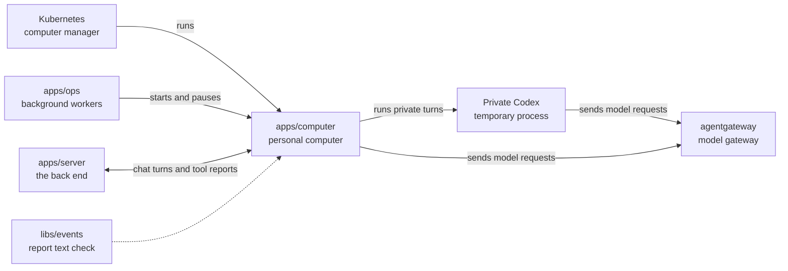

# apps/computer

## What this is

A private cloud computer where each person's assistant does its work. Each computer is a locked-down Linux container. It holds Codex (OpenAI's coding agent), a web browser and a remote desktop. Kubernetes, the system that runs containers, starts one for each person.

Private turns run in a temporary Codex process with no tools. Its files use a memory
volume, which can still be written to disk by swap. Isolation is not yet proven on
a live computer; memory features stay off until it is.

## Where it fits

This is the personal computers layer. `apps/ops` starts and pauses computers. `apps/server` sends chat turns and files and can show a read-only desktop view. The computer sends model requests through agentgateway, the AI gateway in the server's models process.



## What it is responsible for

- Builds the container image with Codex, a browser, a remote desktop and document tools.
- Runs the bridge that receives chat turns and sends progress reports to the server.
- Reports when a listed tool call starts or finishes, without its arguments or result.
  Skips invalid names and call ids so later reports can still reach the server.
- Keeps files in the person's workspace when the computer pauses and starts again.
- Lets Codex reach the AI gateway only while the current chat turn holds a valid short-lived pass.
- Separates the assistant, file tools and desktop into different Linux users.
- Supplies the Kubernetes files that restrict network access.
- Checks the image's licences before publishing it.

## Processes it handles

1. **A computer starts.** It prepares private folders and starts Codex, the desktop and the bridge. It reports that it is ready when the required services respond.
2. **A person sends a message.** The server sends the turn to the bridge. The bridge runs it in Codex and sends progress reports back.
3. **A person uploads a file.** The server passes the scanned file to the bridge. The bridge puts it in the workspace for Codex to read.
4. **A computer resumes.** Its files remain on its disk. The bridge sends any reports that the server has not confirmed yet.

## How to run or test it

```sh
npm run build:image -w apps/computer
npm run test:image -w apps/computer
npm run typecheck -w apps/computer
```

Both image commands need Docker and the dev stack's local Kubernetes cluster.
`build:image` also runs the image tests and updates `sandbox-template.json` with the
new image.

## Where to read more

- [README.robot.md](README.robot.md): image details, settings, security limits and test commands.
- [apps/ops](../ops/README.md) starts and pauses computers.
- [apps/server](../server/README.md) sends turns and receives progress reports.
- [Why Codex runs on each person's computer](../../docs/adr/0003-harness-codex.md).
- [Why a computer keeps its disk when it sleeps](../../docs/adr/0006-computer-disk-and-live-view.md).
- [The shared words used in these guides](../../GLOSSARY.md).
