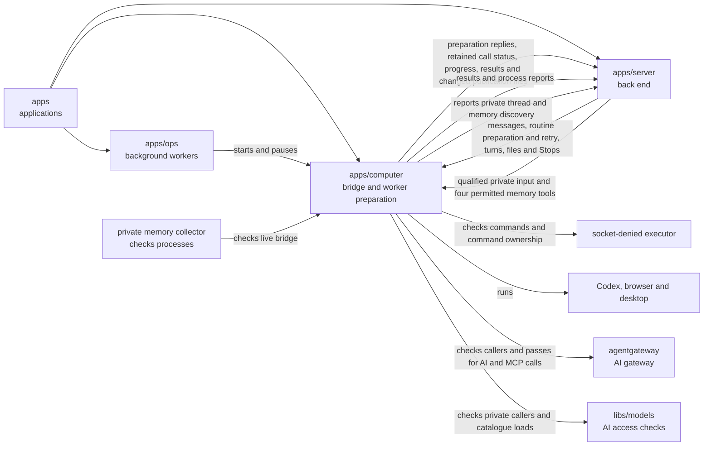

# Assistant computers

## What this is

This package builds the private cloud computer where an assistant works, with an AI
agent, a browser and a desktop. Each assistant has one computer across its chats,
including a group's shared assistant, whose members share that computer.

## Where it fits

This is the assistant computers layer. [apps/ops](../ops/README.md), the background
workers, starts and pauses computers in [Kubernetes](../../GLOSSARY.md#kubernetes).
[apps/server](../server/README.md), the back end, sends
[chat turns](../../GLOSSARY.md#turn-chat-turn) and files and forwards the desktop view.



## What it is responsible for

A Stop can name the expected thread. The computer checks it before clearing any
private reply or removing access, so a delayed Stop cannot affect a replacement.
It also clears an unacknowledged reply when the target has just finished. Repeated
Stops share the same access removal and interruption. The computer confirms that
private reply buffers are cleared before waiting for interruption to finish.
The supervisor waits for the private process to exit, then removes its temporary home.
Closing the process's output alone does not confirm exit.
The computer saves that confirmation without private reply text.

- Builds the computer image with [Codex](../../GLOSSARY.md#codex), the AI agent,
  a browser, a remote desktop and document tools.
- Runs the [bridge](../../GLOSSARY.md#bridge) that receives messages and reports progress.
- Disables bridge process dumps before it receives private work. The bridge answers
  a local protection check inside its computer container. The root entrypoint records
  the bridge process it started so later checks can reject a replacement child.
  A protected test runner checks that record and the live process from inside the
  computer container. This does not qualify private memory on its own.
- Keeps the assistant's files when its computer pauses and starts again.
- Runs the assistant, file tools and desktop as separate Linux users to limit their access.
- Sends AI model calls and reviewed [tool server](../../GLOSSARY.md#mcp-server-tool-server)
  calls through agentgateway. Shell and file tools run locally inside the computer.
- Keeps the original Ask tool call in private memory while its response is waiting.
  It limits the number and size of waiting calls. Stopping the turn or losing the
  computer removes each copy.
- Runs a [private turn](../../GLOSSARY.md#private-turn) on a shared computer in a fresh,
  short-lived Codex process with no tools. Initial personal memory requires deployment checks.
  The server supplies its complete input once; the runner keeps it out of the journal.
  Each private launch gets its own caller, kept in memory. The bridge binds it to
  the native thread before waiting for the server to admit the turn. Stop, expiry
  and connection loss remove it, even while the connection is still opening.
  Cancelled launches release their space for new work. Other processes cannot authorise a launch.
  Each tool call checks the caller against the pass it will send, including after
  approval. Ordinary and private turns cannot share a bound thread.
  An internal loader can discover permitted recall, remember, Correct and Forget definitions
  together for one fresh private turn. It accepts at most four tools in that order.
  Empty lists, duplicates and other tools refuse preparation.
  It starts the native thread first, so the server can record its real ID and approve
  the tools for that thread. It then loads the approved list on the same thread.
  The session permits empty reload and unload checks without closing that process.
  It refuses a second start before sending it to the native process.
  It checks the same caller, thread, requester, assistant and grant after waiting.
  Copied tool lists have no approval. The private configuration selects the protocol
  that the proxy accepts. Cancellation removes the list. Discovery reads no facts and gives no permission to call tools.
  An offline test also makes native Codex call recall and read a test reply through
  the proxy. It checks refusals and cancellation while another private session survives.
  The runner can load the permitted selection of Recall, Remember, Correct and Forget through an
  authenticated bridge request. Each tool can be allowed independently.
  It matches
  the returned thread and a single-use load id, then waits for discovery before accepting
  input or a grant. The server checks the saved turn before sending that tool list.
  These tests do not qualify deployment; live memory access remains disabled.
  The server and computer use the same private caller checks from the models library.
  The image includes this small shared file, which uses only Node's built-in functions.
- Checks fixed package and Git requests against the supervisor's record of the tool call.
  Each request must match its executor, silo, person, computer and process.
  Each valid registration can produce only one plan.
  A private store keeps those records in memory and refuses reuse, including retries.
  Replacing a record, losing its connection or retiring its computer generation removes
  permission. Expiry also removes permission, and restarting restores none.
  Prepares checked package files or empty Git folders in a private directory.
  Each plan can prepare files only once, and cleanup removes only its own files.
  Cleanup also removes newly created folders if opening them fails.
  A checked dispatch path starts one operation only when the trusted caller confirms
  the turn is active and isolation, scanning and egress are ready. A clean process
  exit waits for scanning; a crash or missing exit leaves the result unknown.
  Dispatch closes its open file handles after each launch attempt and keeps the files
  for a later scan or recovery check.
  Network execution stays disabled until the call's identity and isolation are proved.
- Renders checked personal memories as labelled JSON beside the rebuilt private transcript.
  The complete input must fit its limit without shortening the message. Native delivery
  still needs to be connected before this input can start a turn.
- Checks the image's licences before publishing it.

An internal routine turn keeps its saved input id separate from its execution id.
The computer starts an empty private thread and returns its real id before the server
records the routine's spending allowance. It keeps that process for one matching delivery.
A refused or failed preparation leaves other conversations running.
Expiry closes only the unused process. Stop or disconnect also removes unused preparations.
Cancelled preparation can try again with the same turn id before delivery consumes it.
Delayed cleanup from the earlier attempt leaves its replacement alone.
The journal returns the input id, turn id and spending root when asking the server to start.
A saved routine Stop cancels its private turn. Failed cleanup can retry without closing
other chats. If interruption has not ended the turn after ten seconds, the computer
closes that turn's private connection so its existing supervisor can remove the process.
A matched native terminal reply is recorded separately from a connection failure,
including when the turn completes before a saved routine Stop reaches it.
Closing the private connection does not confirm that the process has exited.
Automatic routine execution remains disabled.

Completed replies report new or changed files in the publication folder. The server
pulls those files for checking and shows accepted files in the conversation.
Files left by earlier turns do not use the next turn's file count or size allowance.
The computer compares file metadata before reading changed files.
Turns also finish when the publication folder is absent or has no changed files.

## Processes it handles

1. **A computer starts.** It prepares private folders and starts Codex, the desktop
   and the bridge. It reports readiness once the required services respond.
2. **A person sends a message.** The bridge prepares that conversation, loads any
   reviewed tools and runs the request. It sends progress and the result to the server.
3. **A person uploads a file.** The server passes the scanned file to the bridge.
   The bridge puts it in the workspace for the assistant to read.
4. **A computer resumes.** Its files remain on its disk. The bridge resends reports
   that the server has not yet confirmed, without repeating uncertain private work.
5. **The server asks work to stop.** The computer can stop everything the assistant
   is running and check that the work has stopped. Taking control of the desktop
   remains unavailable. Stopping one private turn clears its buffered reply and
   rejects later reply text, while other people's turns keep running. A failed private
   turn or refused tool also clears its reply. Losing the server connection cancels
   all private turns and clears buffered private replies, including completed ones.
   Ordinary memory-free work can still recover after reconnecting.
6. **A command asks for a package or repository.** The executor refuses network
   execution. Ordinary commands still run as a separate user that cannot open sockets.

## How to run or test it

The image commands need Docker and the local cluster from
[infra/devbox](../../infra/devbox/README.md). The build also runs image checks and
updates the saved computer image setting. Missing Linux Codex downloads stop it.
Server integration tests use `test/server.ts` to exercise the bridge and turn runner.

```sh
nice -n 10 npm run build:image -w apps/computer
nice -n 10 npm run test:image -w apps/computer
nice -n 10 npm run typecheck -w apps/computer
```

The image build requires the Linux Codex programs. A missing download stops the build
before image checks begin.

Repository CI builds a separate test image once for the tests that need it.
The image build retries short network failures when it downloads Debian packages.
If the package server stays unavailable, the build stops instead of waiting for
the whole CI job to end.
The [CI test guide](../../scripts/ci/README.md) explains how those files are grouped.
The CI test image uses saved Debian packages from GitHub's registry when the
recorded digest matches the current build inputs. The first published image is
recorded in the digest file. The CI guide explains how to refresh it after a
package or snapshot change. The package must be public;
the owner sets this on its GitHub page.
Supervisor tests pause the bridge's Codex process before checking stopped executors.
Its background workers would otherwise change during the process check. The bridge,
executors, private Codex processes and desktop keep running until the test stops them.

Both image commands need Docker and the dev stack's local Kubernetes cluster.
`build:image` also runs the image tests and updates `sandbox-template.json` with the
new image.
The release checks require a stopped reply to report why it ended. This keeps the
saved partial reply distinct from a model failure after the page reloads.

Repository CI builds a separate test image once for the tests that need it.
The [CI test guide](../../scripts/ci/README.md) explains how those files are grouped.

A separate local capture checks native consent on saved Codex threads. It uses a
stub model and a disposable gateway. Missing shell or file requests remain unproven;
the capture does not enable approvals in normal turns. Its saved checks require every
expected request and its matching reply and continuation.

A separate offline check records when native child threads first call the model.
It uses the existing image and local replies. Its saved observations do not enable
delegation; reliable identity for each call and the required timing race remain unproven.

## Where to read more

- [README.robot.md](README.robot.md): image settings, security limits and detailed checks.
- [apps/ops](../ops/README.md): computer starts, pauses and recovery.
- [apps/server](../server/README.md): chat requests and progress reports.
- [Why Codex runs inside each computer](../../docs/adr/0003-harness-codex.md).
- [Why a computer keeps its disk when it sleeps](../../docs/adr/0006-computer-disk-and-live-view.md).
