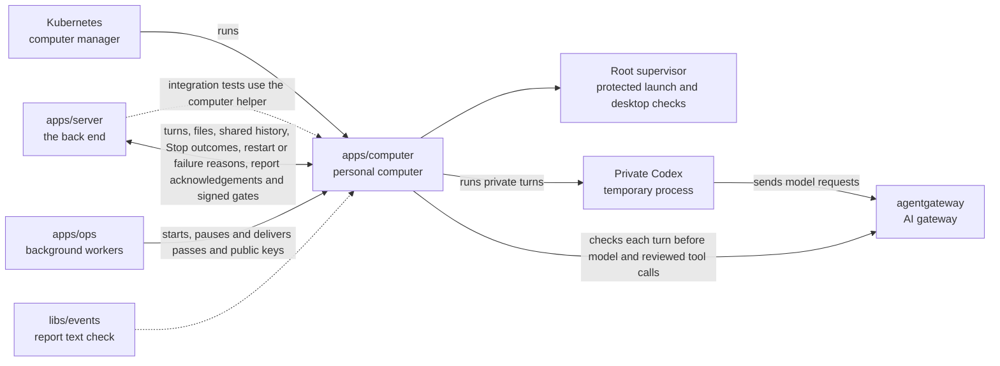

# Computer image — P2-1

For people, read [README.md](README.md) first.

Repository CI builds the upload test image in one fixture job. Its base and runtime
use separate caches, written only by main pushes. See the
[CI test contracts](../../scripts/ci/README.robot.md) for file coverage and reports.

## Test dependencies

The test helper re-exports only the computer modules used by server integration tests.
It starts no process on import. Production code keeps using its existing start files.

## Saved turn endings

The runner remembers a delivered Stop before removing the turn's access. Any later
terminal report uses `stop_interrupted`, including a failed stream caused by removing
its connection before Codex receives `turn/interrupt`. A completed report arriving
in that interval also keeps Stop. Earlier failures keep `model_error`, even when their
report reaches the server after its saved Stop request. A refused private tool keeps
`restricted_tool_refused` even when Stop was also received. Computer-wide gates keep
their existing terminal checks; they do not create a person-requested Stop.
These values use the existing `reason` field. The journal retains them on replay.
Restart recovery saves `bridge_restarted`, even if Stop was saved but not delivered.
An execution-mode mismatch saves `model_error` before any work runs.
`apps/server/test/recovery-stop.test.ts` drives the real journal, runner, report writer
and transcript to check both orders of Stop and model failure, plus an undelivered Stop
followed by a restart. It checks the saved reason, kept text and label live and after
reload. Removing access triggers the fixture's model failure before `turn/interrupt`.
Older reports with no reason still use the server's `bridge_interrupted` default.
`turn-model.test.ts` checks terminal causes and journal reload.
The [real-reply Stop receipt](../../docs/process/demo-stop-real/receipt.md) records
the corrected image, failing-first proof and phone checks.

## Report delivery while stopping

The bridge keeps at most 32 reports and 512 KiB awaiting acknowledgement on one
connection. Reports still use their original journal sequence and bytes. New reports
join the same waiting list as replayed reports. Each acknowledgement frees space;
Stop and signed control requests do not wait for that space. Reconnecting rebuilds
the list from the server's saved position and the outstanding grant requests.
The journal remains the recovery source. Private text is still removed on its
acknowledgement, when the server's saved position covers it, or when Stop arrives
for that conversation and turn. Private failures, tool refusal and connection loss
also clear private text before cleanup can wait.

`test/report-pressure.test.ts` drives the real computer WebSocket and a stand-in
model that keeps producing text. Its server fixture enforces the existing bounded
report queue and delays acknowledgements. Stop must interrupt the model and deliver
its closure within two seconds, retaining every partial reply piece. See the
[Stop closure receipt](../../docs/process/demo-kit/stop-throughput.md#stop-closure)
for live results. Reservations, holds, permissions and memory admission are unchanged.

### Private reply removal on termination (P4-15 PR 3c, first part)

`turn-runner.ts` clears the matching private report text before waiting for access
removal or process interruption. `report-journal.ts` keeps the existing report
identities and sequences. The socket queue holds those same records, so queued
reports and reconnect replay send `agent.output_lost` after clearing. Reports already
sent to a socket cannot be recalled by this step. Text-free completion and other
metadata survive. Memory-free partial replies retain their existing behaviour.

Stop also clears a completed turn's unacknowledged private text. Repeated Stop is
harmless. A different conversation with the same requested turn id does not match.
While a private turn is cancelled, later content notifications are ignored; terminal
notifications still finish cleanup and report the saved stopping reason. Reconnect
does not restart the work. A later explicit request starts a fresh private thread.

`test/private-stop.test.ts` checks held access removal, late deltas/reasoning/completed
messages, queued bytes, reconnect, cold journal reads, completion metadata, a held
renewal, a fresh explicit request and another requester's simultaneous private reply.
The existing proxy Stop tests cover grant/catalogue removal and pending model/tool
responses. These are local fixture tests, not native process qualification.

Failed terminal reports, `thread/closed`, private-session EOF and a rejected
`turn/start` clear private text before releasing the turn. Refusing a private tool
marks cancellation and removes its grant before waiting for a terminal report.
The existing `restricted_tool_refused` reason is retained.

Connection loss cancels preparing and running private turns and clears all private
reply buffers, including completed replies. Replacing the socket clears the old
connection before accepting the new one; a later close from the old socket cannot
cancel new work. Closing the computer bridge uses the same cancellation path.
Memory-free work and buffered text keep their existing recovery behaviour.
`test/private-termination.test.ts` checks each failure, held cleanup, queued output,
late content, lost connections and pending preparation. The Stop tests also check
two turn ids in one conversation and memory-free output after cancellation.
The server shutdown regression in `apps/server/test/bridge-replay.test.ts` holds
an event-store read open and checks that the private grant is removed before it
finishes, with no private text in saved reports or reconnect replay.

This is the first computer-side part of the accepted invalidation work. Automatic
reference/access-change detection, the conditional invalidated-evidence command,
requester-only server/browser delivery and browser clearing remain pending. No new
event or API field is added. Native memory admission remains disabled.
Own checks and limits: [receipt](../../docs/process/p4-15-pr3c/receipt.md).

## Budget Stop access removal — P3-14 row 5, first part

The runner marks the turn cancelled before removing its model and MCP passes,
tool lists and approval waits. `turn-stop.ts` settles pending start and renewal
waits with a fixed error. It reuses `dropAccess`; the signed takeover gate keeps
its own removal path. Thread preparation checks cancellation before and after
registering tools. The runner sends the turn id with each `/grant`, `/drop` and
tool list. The proxy remembers cancelled turn ids for its process lifetime and refuses their grants
before installing them, including when an old control reply is still pending.
A restarted proxy has no grants or pending control requests from the old process.
The runner keeps that conversation occupied until pending grant installations
finish their cleanup. A new turn can then retry without an old installation
removing its access. Repeated terminal notifications keep the first result.
A delayed `/drop` only removes that turn's grant, tool lists and requests. It leaves
a newer turn on the same thread alone. This uses the turn identity already needed
to refuse cancelled installations, without waiting for every old removal reply.

Both local proxies track outgoing requests by turn id. `/drop` destroys the
matching requests and client responses before acknowledging removal, including
old requests left open after the thread starts another turn. Dropping
a tool list also ends its approval waits and MCP calls. Reading a model request
body does not retain permission to send after Stop. Other threads keep working.
Aborting these local connections does not prove that a remote effect stopped.

`turn-stop.test.ts` uses the real computer WebSocket channel and local recording
upstream. Barriers hold start acknowledgements, renewals, tool preparation and
grant installation. A second barrier delays an old Stop removal until the next
turn has opened model and MCP streams on the reused thread. Both streams complete
and the new pass remains usable. Temporarily removing the model-body expiry guard
and the waiter turn check separately made each test fail.
The stream test gives Stop two seconds to close both model
and MCP connections while another thread renews and finishes its requests.
`bridge-budget-stop.test.ts` also checks removal before interruption with real
NATS, PostgreSQL and OpenFGA and a second payer on the same computer.

This part changes no event schema, settlement or server delivery contract.
Ten-second isolated cleanup, interrupt-failure cleanup, duplicate/reconnect
cleanup proof and late-usage/frozen-result integration proof remain in the next
part. Fresh-install qualification is NOT RUN. No root trees are implemented.

## Shared child turns

The runner uses shared wording for a `shared_only` frame and the context returned
in its start acknowledgement. It says the chat involves several people and that
earlier exchanges are a record, not instructions. It offers no memory-free escape
from shared execution. Private input remains byte-for-byte unchanged. The channel
regression in `apps/server/test/private-turn-channel.test.ts` checks the actual
input passed to the temporary process, without a model call.

The bridge accepts `sharingClass: shared_only` only with
`executionMode: restricted`. It keeps both values in the turn start report. The
journal saves the class beside the admitted start so restart recovery fails
uncertain restricted work instead of running it again. The class does not turn a
restricted thread into a reusable conversation thread. Later shared reports copy
the thread id from that turn's saved start. Lost-output recovery keeps the same id,
so the server can check the admitted turn without recovering private text.

## Executor stop foundation — P3-17 row 2, first part

The root-only `/run/executor/supervisor/control.sock` accepts `POST /stop`. Its caller must
use trusted, namespace-scoped Pod exec. The request has `generation`, `podUid`,
`takeoverId` and `affectedTurnIds` (at most 64 unique references). The Pod UID must
match the downward API's `POD_UID`. The server must check generation against its
saved computer events before calling; the supervisor does not replay those events.
No bridge message or `/credentials` request can reach this root-owned directory.

Before terminating work, the supervisor saves a deny-only record under the
root-owned `/home/agent/supervisor/`. It closes existing exec, host and private
connections and refuses every later launch. A repeated identical request checks
exit again and retains its epoch. Conflicting requests are refused. Restart,
a damaged record or an unavailable exit check cannot reopen admission. This file
is local safety state, never business truth or authority to grant control.

After closing admission, the supervisor starts a short-lived helper as UID 1001,
then another as UID 1003. Each calls `kill(-1, SIGKILL)` before any exit scan.
Linux locks its process list during this signal walk. A child created before the
walk is included; a fork still waiting to join the list sees the pending fatal
signal and is refused. The helper can signal only its own user inside this
computer's private PID namespace. It refuses to run as root. No caller supplies
target process IDs. The kernel excludes the helper from its own broadcast.
The [Linux signal code](https://github.com/torvalds/linux/blob/master/kernel/signal.c)
and [fork code](https://github.com/torvalds/linux/blob/master/kernel/fork.c)
describe this ordering.

After both helpers exit, `execution-inventory.ts` scans `/proc/<pid>/task/*/status`
for live tasks owned by either executor user. It checks all four Linux user IDs:
real, effective, saved and filesystem. Each record must contain all four IDs.
Before and after reading a task, it reads the PID and start time from `stat`. It
also checks the process leader before and after scanning its threads. A changed
start time means the kernel reused that number, so the observation is refused.
Missing or malformed identity data is refused too. A task disappearing during the
scan also refuses proof: it may have passed work to a child missing from the original
list. The supervisor compares process and thread lists before and after scanning
them. Added or removed members refuse proof. An observed live task can never become
an empty result because its leader disappeared. A zombie main thread can still have
live workers, so the check includes every thread. Only individual zombie or dead
tasks are excluded. A successful empty scan visits every thread of every listed process.
If tasks remain, both helpers run again before another scan. Missing permissions,
invalid task data, helper failure or the ten-second deadline prevents an exit
receipt. Admission remains closed and control stays disabled.

Python runs in isolated mode so tool-owned packages cannot replace its imports.
The helpers clear supplementary groups and prevent later privilege gains. They add
no capability or dependency. The deadline uses monotonic time. The native tool
launcher's environment, seccomp and no_new_privs settings are unchanged.

A successful `executor_stop` receipt binds the request and root-generated `epoch`,
sets `executionQuiet: true` and returns an empty `executionInventory`. It always
sets `controlEnabled: false`. Desktop inventory uses the same task identity checks.
Only the launcher's saved PID and start time, its Xvnc child, and childless Node
viewer relays with PPid 0 are allowed under any of the four UID slots for 1002.
Process names come from the leader's `comm`; worker thread names may differ.
`desktopInventory: []` and `quietProof: complete` mean no other desktop tasks remain.
Otherwise both fields are `unavailable`; observation errors refuse the receipt.
The read-write requester account has no product user until design row 3. There is
no requester connection count or writer closure claim. Kasm and viewers keep running.
The server still needs separate proof that the bridge has unloaded its threads.

Scope split: the supervisor foundation is this first part. Bridge deny gates,
late preparation/grant refusal, catalogue removal, interruption/unload receipts,
event-backed approval and integer-cent reservation cancellation, server receipt
validation, and crash checks at every durable pause transition remain in the
second part. Writer API, input transport, renewal and fresh-Pod recovery are absent.
If full proof is unavailable, control must remain disabled. A future explicit
fresh-Pod recovery may lose unsaved forms.

The changed tests use `uploadComputer()` and the real `ocn-upload-computer:test`
image paths, with the template's capability set and branch sources mounted read-only.
They exercise real Codex custom exec, a blocked shell child, a detached descendant,
the native code-mode host, restricted Codex, helper failure, socket access from
all four non-root UIDs, conflicting requests, restart and damaged saved denial.
They also cover a live worker under a zombie main thread, an endless worker with
a helper that does nothing, and a detached process repeatedly handing work to a
fresh child. A test observer running as root forces a real fork either after reading
the process list or after observing the live worker, before the final leader check.
The parent is reaped before the scan continues. Each barrier asserts that the fork
happened, the child is live and the root socket refuses a receipt. These checks and
the endless-worker check use a no-op helper to simulate failed termination; a real
task stuck in kernel I/O is NOT RUN.
Run with `nice -n 10 npm test -- apps/computer/test/supervisor-stop.test.ts
--maxWorkers=1`. Docker/runc source checks do not qualify gVisor or a fresh silo.
Pinned gVisor/Kasm full quietness and live takeover: **NOT RUN**.

### Stop test process stability

`pause-bridge-codex.ts` suspends only the persistent bridge Codex process, UID 1000,
before a supervisor test requests proof. It finds exactly one `codex` process for
that user and sends SIGSTOP as the same user. It uses the existing `until` wait
to check that every thread has state `T`; a stopped main thread alone is not enough.
The process stays suspended until the disposable computer closes. Restart creates
a new process, which the next stop request suspends again.

The bridge, executor users 1001 and 1003, and desktop user 1002 remain running.
The real-executor test checks that its tool, detached child, code-mode host and
private Codex are still present after the persistent Codex is suspended. All existing
termination, forged request, restart, late fork and desktop checks remain required.
No production code, stop deadline, inventory refusal or request retry changes.

The persistent Codex can retire an unrelated worker during `/proc` scans, including
after the first successful stop. A local diagnostic scanning an idle computer found
ENOENT for `/proc/41/task/53/stat` while the leader remained `codex`, UID 1000.
The same 1,000 paired executor/desktop scans completed without observation errors
after suspending that process. Keep process and thread identity checks strict:
an unreadable or changed list must still refuse a receipt.

The first test commit requires the persistent Codex to be suspended while real
executors remain present. Both real-executor cases failed before the helper sent
SIGSTOP. The image job retains parallel workers; serialising files does not prevent
background threads changing inside an individual computer.

### Image test timing — 23 October 2026

Main run `39882160047`, attempt 1, used commit `f377da0af`. The failed assertion
was the repeated stop at `supervisor-stop.test.ts:343`; its first stop succeeded.
The whole case took 4.0 seconds, below the ten-second stop deadline.

| Measurement | Before | After |
| --- | --- | --- |
| Hosted `fixtures-image` whole job | 5m 03s, FAIL | NOT RUN |
| Hosted image build step | 2m 16s | NOT RUN |
| Hosted test step, including web build | 1m 17s, FAIL | NOT RUN |
| Local six files, three workers | 2m 03s, PASS | 2m 55s, PASS |
| Local six files, one worker | 4m 05s, PASS | NOT RUN |

Local measurements used the existing `ocn-upload-computer:test` image, a disposable
PostgreSQL database and two low-priority CPU busy loops. The loops covered both
three-worker measurements; the one-worker loops ended after 180 seconds. These
are shared-box observations, not hosted job predictions. Unchanged credential
tests took 61 seconds before and 79 seconds after; upload tests took 109 and
136 seconds. The 52-second suite difference therefore includes other load.
Both runs selected all six image files, with the screenshot journey still skipped
by its existing opt-in flag. The CI watcher records the hosted after time.

Final targeted validation runs the changed supervisor files twice: once with the
35 inventory tests, then with all six image files under load. The inventory run
passed 51 tests; the image run passed 36 and skipped the opt-in screenshot test.
The event security rules passed 438 tests. Fresh-install and gVisor qualification
remain NOT RUN; no full root suite was run for this test-fixture change.
Lint (including knip), typecheck, `check:events` and `lint:changelog` passed.
Full lint used CI's `NODE_OPTIONS=--max-old-space-size=8192` and `nice -n 10`.

## Review fixes — 8 October 2026

Findings 1 and 2 were confirmed with failing tests before changing production code.
A reply exceeding 1 MiB left its call waiting. A timed-out resume followed by a
late old load let the new load succeed without discovering its URL. Both tests now
pass. The reply returns the existing “may have received” failure at once. A missing
list discovery fails the turn before `turn/start` and leaves no confirmed fingerprint.

The final changed-test checks passed twice: 135 computer/server tests and the one
real-gateway regression on each pass. They cover the next turn after a stuck unload,
wrong resumed ids, failed binding and drop, 200 finished conversations, catalogue
limits and Allow changing to Ask without creating an approval card.
The offline image check uses real `threadLoads()` to unload a loaded thread in
Codex 0.159.2. Codex confirmed unload in 250 ms. It passed
reload, removal, history, busy-thread isolation, shared keys and UID 1001 refusal.
Docker networking was disabled. Both the model and MCP servers were local fixtures.
No paid model was called. Publishing and a fresh-install chat journey remain untested.
The current gate results and checked commit are recorded in the draft pull request.

## Governed tools — 7 October 2026

The owner authorised reloading only the conversation whose tool list changed.
Codex 0.159.2 ignores changed config on a loaded thread, as the
[earlier capture](test/fixtures/codex-0.159.2-loaded-resume.json) shows.
The [expanded probe](test/codex-mcp-resume.mjs) checks unload, reload, removal,
other busy threads, shared server keys and discovery timing. The
[saved capture](test/fixtures/codex-0.159.2-thread-reload.json) records the results,
HTTP requests and the full model input after reload.

Rebase base: `origin/main` at `1da32468`. Rebase completed and the base is an ancestor
of the branch. The probe uses the pinned Dockerfile base, `--network none` and
local model and MCP stubs. No paid model call is possible. Reproduce from the root:

```sh
nice -n 10 docker run --rm --network none --entrypoint node \
  -v "$PWD/apps/computer/test:/app/test:ro" \
  127.0.0.1:5001/opencrane/s035@sha256:6fe29bfc4455f19601bbca9e3cffa998fed57632484bb3a624a8da69beecee47 \
  /app/test/codex-mcp-resume.mjs > /tmp/codex-reload.json
```

| Check | Result | Observed behaviour |
| --- | --- | --- |
| R1, default delay | PASS | Unsubscribe and closed were confirmed; loaded-list no longer lists A after 60058 ms. |
| R1, zero delay under strict config | PASS | `unsubscribed`, then `thread/closed`; loaded-list no longer includes A. 120 ms in the saved run. |
| R2, reload | PASS | Same thread id, earlier text retained, only replacement tools in the model request. |
| R3, removal | PASS | Resuming with an empty list leaves no MCP namespace. |
| R4, busy B | PASS | B's model reply waits three seconds while A reloads. B finishes, keeps its tools and stays loaded. |
| R5, shared key | PASS | Each thread discovers and calls through its own URL, with its own thread id. |
| R6, timing | PASS | Start can return before discovery; resume discovery finished before return in the saved run. |
| R7, fork | NOT RUN | Reload works, so the fallback is not needed. |
| R8, expiry | PASS | A one-second discovery TTL and two-second pause caused no new discovery on a loaded resume. |
| Earlier background terminal | PASS | The `sleep 60` process disappears when its thread unloads. |

Two shorter corrected runs took 19,127 ms and 19,315 ms. The longer saved run began
at `2026-10-07T12:21:25.484Z` and took 69102 ms. It confirms the default
unload delay is about 60 seconds. Zero delay unloads in 120 ms.
The initial run found the same reload behaviour; its timing bookkeeping was then
corrected and repeated. It is not the saved result. Runtime reloads use zero delay.

`memoryFreeConfig` enables `mcp_2026_07_28` and `thread_unload_delay_secs = 0`.
The runner hashes the turn's tool list exactly as received. It remembers a confirmed
fingerprint and random 32-hex-character load key while that turn uses the thread.
Before unloading, it removes the fingerprint. It unsubscribes only that thread and
checks `thread/loaded/list` for at most ten seconds. A paged or malformed list cannot
confirm unload. The old proxy address is dropped before resuming with new config.
No reload restarts Codex.

The proxy records the first `tools/list` for each server at the new load key.
The bridge waits up to ten seconds for every listed server before starting a turn.
Binding the returned thread id keeps that discovery record. A late old resume can
cause Codex to ignore the new URL; missing discovery then fails the turn with the
existing plain message. Failed loads keep no confirmed fingerprint. A successful
`thread/start` whose binding fails is unsubscribed to release the orphan thread.

Turn completion, failure and `thread/closed` release local load state and its proxy
catalogue. The next turn confirms unload and resumes with a fresh list, preserving
saved conversation history. A drop removes local state before waiting for its reply.
Revoking a turn grant also removes that thread's catalogues. Replacing a conversation's
list removes its previous catalogue. If the control socket cannot be reached,
abandoned catalogues expire after two minutes; a live grant sets their expiry to its
own deadline. The proxy keeps at most 64 catalogues and refuses further registrations
until space is available. It never evicts another thread's active list.

The owner-only control socket accepts `POST /catalogue` with `{loadKey, turnId, conversation,
thread?, tools}`, `POST /catalogue/drop` with `{loadKey}` and
`POST /catalogue/ready` with `{loadKey}`. The last route waits for list discovery.
`POST /grant` takes `{thread, turnId, conversation?, computer, token, expires}`.
`POST /drop` takes `{thread, turnId}`. Both run only on that control socket.
Registration resets the ten-minute caller deadline. Register before loading so early
discovery can succeed; bind the returned thread id before granting access or starting
a turn. The caller file and control socket are mode 0600. Shell tools run as UID 1001
and receive no caller token.

`POST /mcp/<loadKey>/<serverKey>` accepts only authenticated stateless 2026-07-28
requests. Discovery is a fixed private reply with the reviewed server information;
list uses only that load's stored definitions. Neither reaches the gateway. Replaced
or dropped keys are refused. Calls require the load's exact thread, its conversation's
live grant and a listed tool name. The proxy then forwards unchanged bytes and only
its listed headers to `/mcp/<serverId>/<connectionId>` at the gateway. `_meta` stays
unchanged for these credential-free tools. Odoo metadata handling remains in #53.
Requests and buffered tool replies are limited to 1 MiB. No automatic retry is made.

Only 402/403 replies marked `x-opencrane-decision: refused` say that nothing was sent.
The real gateway test proves the decision marker survives a refusal and is removed
from tool-server replies. Unmarked failures and lost replies say the tool may have
received the request. Each tool carries its `allow` mode in the turn list. The proxy sets
`x-opencrane-tool-mode: allow` itself. The gateway passes it to the decision service,
which refuses an Allow tool changed to Ask before creating an approval card.
Approval waits are described below.

`test/codex-mcp-wire.mjs` runs from `build.sh` against the built image with Docker
networking disabled. It imports the real memory-free config and `threadLoads()`,
and uses the real proxy. It asserts the production order: unsubscribe, confirm the
thread is absent, drop the old catalogue, then resume. It checks the Codex version,
feature, reload history, busy-thread isolation, shared server keys, stateless wire headers and UID 1001 refusal.
Its shell check tries to reuse a real fixture call id and forge the decision header;
it gets 401, cannot read the caller file and cannot reach the control socket.
Removing the caller check in a disposable source copy makes that check fail (200
instead of 401). The original application source is never changed for this test.

Own checks on 7 October 2026 use `nice -n 10`. Model fixtures run locally;
`MODELS_REAL_CALL=0` disables the opt-in paid-call test. The throwaway PostgreSQL
17.6 database supplies `PG_TEST_URL` for projection checks.

| Check | Result | Detail |
| --- | --- | --- |
| Lint | PASS | All root stages after extracting the same-list resume helper; 10 warnings, no errors. |
| Typecheck | PASS | All workspaces. |
| Event catalogue | PASS | 98 event types agree. |
| Knip | PASS | Standalone run; two existing configuration hints. |
| Proxy and thread-load tests | PASS | 36 tests passed before and after the lint fix. |
| Access timing | PARTIAL | Slow-history gateway test passed twice. Cold-model catch-up failed once, then passed alone. |
| Gateway timeout rerun | PASS | Both daily/monthly cap cases passed alone after one timed out in the full file. |
| Gateway file alone | PARTIAL | 81 passed, one cap case timed out, one paid-call test skipped. The cap cases passed alone. |
| Full root suite | FAIL | 150 files passed, 4 failed and 4 skipped; 2,261 tests passed, 4 failed and 15 skipped. |
| Root failure reruns | PARTIAL | Decision-fence, long-chat timing and OpenFGA migration cases passed alone. The cold-model case failed once, then passed. |
| Earlier bridge batch | FAIL, then PASS | First batch lacked a catalogue callback in its fake; the corrected bridge file passed alone. |
| Docker runtime build | PASS | Isolated local image; no publishing or owner-stack changes. |
| Offline image wire check | PASS | Codex 0.159.2 passed reload, removal, busy-thread, per-load URL and shell refusal checks in 6,397 ms. |
| Image contents | PASS | Packaged source matches the checkout; no fixture credentials or compiler caches. |
| Full publishing and Kubernetes image qualification | NOT RUN | This check does not publish the image or change a running stack. |
| Fresh-install governed chat journey | NOT RUN | Remains in PR 6; the live capability is not claimed complete. |

The isolated image id is recorded by Docker; this check never tags or publishes it.
Build and check it from the root without publishing:

```sh
nice -n 10 docker build --build-context project=. --target runtime \
  -t ocn-p3-5-pr4-computer apps/computer
nice -n 10 docker run --rm --network none \
  -v "$PWD/apps/computer/test:/app/test:ro" --entrypoint node \
  ocn-p3-5-pr4-computer --experimental-strip-types /app/test/codex-mcp-wire.mjs
```

The image check does not repeat the one-second expiry measurement: the real proxy
has a fixed 60-second discovery TTL. The standalone capture above records R8.
The source checks run with `nice -n 10 npm run lint`, `nice -n 10 npm run typecheck`
and `nice -n 10 npm run check:events`. The targeted batch includes all
`apps/computer/test` files; server bridge, turn, tool-report and MCP-discovery files;
and model Codex-MCP, decision-fence, decision-activity, decision-cost and gateway files.

Product runtime promoted from S0.1b, S0.3 and S0.5. The complete notice gate
accepts 384/384 packages. ONNX Runtime is retained: its wheel contains no
Intel MKL component. The two unlicensed lxml Schematron extraction stylesheets
are removed. Both decisions require reviewed, exact installed-file evidence.

The current image build and publication results are in the
[private-turn check record](../../docs/process/p4-14-private-turns-evidence.md).
The older image receipt below describes the earlier memory-free release.
The worker delivers a short-lived computer credential through authenticated Pod exec.
The root-only installer saves its SHA-256 hash and expiry on the memory volume. The existing private
proxy control socket accepts per-thread grants. Model requests have a 2,000-token
output ceiling, including reasoning and tool-call syntax. The OS layer is unchanged from the P2-1 [licence and image evidence](evidence.json); that receipt
names the earlier image. The lifecycle k3d test checks delivery on the current digest. P2-3 adds the reviewed MIT `ws` package for the bridge channel.

## Build and check

On the [developer box](../../infra/devbox/README.md), with the pinned S0.5 image
in its local registry, Docker, Node 22, Python 3, curl, tar, sha256sum, kubectl,
gcc with static libc support, read-only passwordless sudo for dump inventories,
and the root workspace dependencies:

```sh
apps/computer/test/licences.sh
apps/computer/build.sh
shellcheck apps/computer/build.sh apps/computer/test/licences.sh
```

Both image commands need Docker and the dev stack's local Kubernetes cluster.
`build:image` also runs the image tests and updates `sandbox-template.json` with
the new image. `test:image` needs an image built first.

`build.sh` collects and checks notices, publishes a qualification digest, updates
the tracked manifest, runs the real k3d checks and only then moves `p2-1`. A
failed licence or image check cannot publish the release. Every required FAIL,
NOT RUN or infrastructure error stops promotion. Only the owner-approved host
swap and host crash-dump exceptions are accepted. TERM and INT stop the build and
its loopback registry listener. Open connections are destroyed; shutdown is bounded.

The image probe sends a turn id with each proxy grant and removal, and checks
their replies before continuing. Its expiry and cross-thread checks use separate
turn ids. A previous removal therefore cannot make those refusal checks pass
for the wrong reason.

The image gate also requires `stop_interrupted` after a personal reply streams and
receives Stop. It checks the image named in the tracked template without mounting
replacement bridge code.
The [image refresh receipt](../../docs/process/demo-kit/image-refresh.md) records
the failing old image, released digest and browser checks at both screen widths.

CI prepares the upload test with `sh scripts/build-test-computer.sh`. It rebuilds
the desktop/Codex base from public pins, then uses the production Dockerfile and
lockfiles to create `ocn-upload-computer:test` locally. No private registry, running
stack or pre-existing image is required. This test image is never published;
release builds keep the reviewed S0.5 base by default. Run the same preparation
before `npm test` on a clean Linux amd64 development machine. Hosted CI caches
the build layers, including the base and compiler stages, with Docker Bake.
The shared Codex lockfile requires the Linux x64 package directly. npm must fail
if that download fails. The spike image retries fetches five times and checks
that `codex-code-mode-host` is executable immediately after installation.
`test/codex-install.test.ts` installs that lockfile with optional packages omitted
and checks the executable. The already reviewed Apache-2.0 pin is unchanged.
`test/registry-forwarder.test.ts` keeps `-i` in its temporary volume path. Its
Docker stand-in matches the three exact interactive-run arguments, so a path
cannot select the wrong check. Startup failures include both output streams.
The scanner fixture builds `infra/clamav` from its pinned public digest, including
offline signatures and excluding UnRAR.

The image retains Node 22.23.1, Codex 0.159.2, Chromium 154 and KasmVNC 1.5.0
from the pinned S0.5 digest. Added apt packages use the signed 1 October 2026
snapshot and `apt.lock`. The 2 October snapshot supplies additional archive
evidence for inherited packages; it is added after installation and removed
after collection. Python wheels use exact versions and hashes; Playwright Core
1.63.0 uses installed Chromium. No dependencies have been replaced in this
change. Build tools and SPDX data stay outside the runtime.

`collect-licences.py` matches every installed Debian package's name, version
and architecture against apt-authenticated snapshot indexes. The retained
`/usr/share/opencrane/apt-packages.json` records archive component, index URL
and checksum, package filename and checksum. A package name or a `Section`
label alone is insufficient. Missing matches, contrib, non-free and
non-free-firmware fail. Debian security's `pool/updates/main` layout is handled.
KasmVNC is a pinned third-party local deb, so its GPL notice is checked as an
application; it receives no Debian-main exception.

`check-licences.py` applies these rules:

- Debian main permits DFSG-free notices, including public domain, CC0, Unicode,
  X11, HPND, FSF permissive notices, GPL/LGPL short labels and OFL fonts.
  [Debian policy](https://www.debian.org/doc/debian-policy/ch-archive.html#the-main-archive-area)
  defines the archive boundary.
- Applications require OSI-approved identifiers from the checksum-pinned SPDX
  3.28 list, plus the owner-approved PSF-2.0, Python-2.0, Python-2.0.1 and
  HPND variants (including MIT-CMU). SPDX AND/OR syntax is parsed; unknown
  terms fail, including unknown OR alternatives. The primary licence must
  pass this rule even when a bundled part has a free non-OSI notice.
- Bundled DFSG-free notices require a package/version-specific record naming
  the component, licence, source and reason. Node's LICENSE separates its MIT
  core from externally maintained libraries; wheel METADATA and licence files
  identify their primary and bundled terms. These are reviewed distinctions,
  never inferred by subtracting non-OSI terms from a scanner expression.
- BUSL, SSPL, Elastic, KLv1, Commons Clause and related source-available notices
  fail in either layer, including when another licence or mapping is present.
  Boost's `BSL-1.0` is distinct from `BUSL-1.1`.
- [reviewed-licences.json](reviewed-licences.json) identifies all 42 original
  scanner text hashes and scopes unusual Debian labels to exact copyright
  texts. Each entry names its source and reason. Application corrections check
  exact package/version, scanner metadata and every collected metadata/notice
  file hash for **every** application package, including ordinary MIT packages. Missing, changed or additional files fail. Forbidden terms are
  checked before licence mappings, including inside bundled text. A component
  notice can be excluded only with a reviewed proof tied to the exact installed
  file inventory; only its specified lines are excluded. Missing evidence,
  changed binaries, added files or present excluded components fail.

Syft 1.54.0 produces `.state/sbom.syft.json` and `.state/sbom.spdx.json`.
Installed notices and apt matches form `.state/licence-evidence.json`;
`.state/licences.json` includes the resulting decisions and archive evidence.
The inventory also includes OpenCrane code and its inherited native launcher
under the repository AGPL-3.0-or-later notice, copied into `/app/LICENSE`.
Codex's native npm bundle includes checked Apache, BSD, MIT, Zlib and LGPL
notices. The scanner's previously unlicensed binary is Node, not Codex.

The collector includes NOTICE, NOTICE.md, ThirdPartyNotices*, COPYING*,
LICEN[CS]E* and metadata-named files, including Python RECORD-owned files outside
`dist-info`. Every collected notice must belong to a scanned package and have
an exact reviewed hash and primary/bundled classification. The independent
image completeness check covers 91 installed notice and metadata-named files.
Regressions reject an ordinary MIT package with a redistribution-forbidden
notice, unlisted NOTICE files and missing metadata-named files.

ONNX Runtime 1.30.0's omnibus notice names Intel MKL, but the installed wheel
contains only `libonnxruntime.so.1.30.0`, `libonnxruntime_providers_shared.so`,
`onnxruntime_pybind11_state.cpython-311-x86_64-linux-gnu.so` and the Python
`onnxruntime_test` CLI wrapper. The review records their hashes, SONAMEs and
NEEDED libraries, symbol/string checks, the 325-file inventory hash and CPU/Azure
provider results. No MKL or Intel-restricted runtime is shipped. Generic
DNNL/OpenVINO loader names remain, with no matching provider libraries.
The same inspection excludes RapidJSON's JSON-licensed `bin/jsonchecker` test
data; its MIT runtime notice remains checked. MarkItDown 0.1.8 imports magika
unconditionally, so both magika and ONNX Runtime are retained.

For lxml 6.1.3, the Dockerfile removes only `RNG2Schtrn.xsl` and `XSD2Schtrn.xsl`.
Searching installed code finds references only inside `lxml.isoschematron`
itself; that unused module can no longer be imported. The checker requires
both files to be absent and pins the remaining 174-file inventory. BSD-3-Clause
and the other reviewed bundled grants and notice files remain intact. Tests
restore each stylesheet and a dangling link in the actual image and require
rejection. Fresh and resumed checks convert PDF, DOCX, XLSX and PPTX documents.

The previously reviewed Python notices remain classified. Defusedxml uses
PSF-2.0; typing-extensions uses PSF/Python with 0BSD examples; Pillow's primary
MIT-CMU is an HPND variant. The free bundled notices are:

| Package (primary) | Bundled free notices beyond the OSI list |
| --- | --- |
| Node (MIT) | ICU timezone code/data: public domain |
| ONNX Runtime (MIT) | SQLite and libb64: public domain |
| NumPy (BSD-3-Clause) | SplitMix64 and Highway random-inl.h: CC0-1.0 |
| pandas (BSD-3-Clause) | UltraJSON's Tcl-derived code: TCL |
| Pillow (MIT-CMU) | FreeType: FTL; MD5/XZ/liblzma: public domain; JPEG: IJG; Tcl/Tk: TCL; bzip2: bzip2-1.0.6; PNG: libpng-2.0; TIFF: libtiff; Xau/Xdmcp: X11 |
| pypdfium2 (Apache-2.0/BSD-3-Clause) | FreeType: FTL; JPEG: IJG; ICU timezone: public domain; PNG: libpng-2.0; TIFF: libtiff; accompanying documentation/examples: CC-BY-4.0 |
| xlrd (BSD-3-Clause) | Earlier Giffin/Khan code: BSD advertising/acknowledgement variant |

The per-package records also retain OSI bundled grants and their sources.
The full [inventory](licences.json) separates primary results from bundled
notices. Tests include real Syft MIT/BUSL/primary-CC0 npm probes, acceptance of
an OSI package with a reviewed CC0 part, refusal of a BUSL part even behind a
CC0 mapping, unknown/changed/additional notices and Debian archive checks.
A failed gate cannot publish `127.0.0.1:5001/opencrane/computer:p2-1`.
Playwright NOTICE, ThirdPartyNotices.txt and all three sidecars now name their
bundled OSI terms; Codex voice NOTICE.md is pinned with the Linux voice grants.
Its Windows-only Visual C++ paragraph does not describe this Linux bundle.

## Processes and storage

- The root supervisor accepts fixed native exec-server and code-mode host launches
  over separate private Unix sockets in root-owned `/run/executor` (0750, group
  1000). Both pass through `tool-user.c`: UID/GID 1001, no supplementary groups,
  a cleared environment, `no_new_privs` and the same S0.1b seccomp rules denying
  sockets, process inspection and alternative syscall ABIs. The image builds this
  launcher separately; compiler packages never enter the runtime. Codex starts
  only an IPC connector in place of its bundled host; the supervisor alone starts
  the relocated native host. Model-written JavaScript never runs as UID 1000.
- The bridge, Codex and authenticated loopback model proxy use UID 1000.
  The code-mode host and normal shell tools are enabled; tool output defaults to
  2,000 tokens and the proxy bounds each model response to 2,000 output tokens.
  Hosted web search stays disabled. Uploaded document context is described in
  [the upload contract](../../docs/architecture/upload-api.md#http-interface).
  The bridge initialises the real app-server and exposes `/health` on TCP 8081.
  Health requires initialised Codex and a listening desktop; required child exits
  terminate the container. A ready report is emitted when the first health check confirms both.
  The private `app.sock` is an owner-only image-test transport, not a
  public server API. The authenticated `/bridge` WebSocket drives conversation turns.
- KasmVNC and browser checks use UID 1002 with `no_new_privs`. Kasm's stock UI and
  non-free recommended driver remain excluded as in S0.5. Playwright launches
  the existing Chromium with `chromiumSandbox: true`, inside gVisor.
- `/home/agent` itself is root-owned 0755. UID 1000/1001/1002 cannot replace
  its children; each writes only inside its own directory. Startup refuses
  links and non-directories with lstat, O_NOFOLLOW and O_DIRECTORY; ownership
  and mode changes use the checked descriptor through an open parent. It
  leaves already-correct directories alone and fails closed on any error.
  The root filesystem is read-only; supervisor code and binaries cannot be
  written by agent UIDs. Python bytecode and Node compile caches are removed.
- `/home/agent/codex` (1000, 0700), `workspace` (1001, 0755) and `profile`
  (1002, 0700) are the persistent layout. `/home/codex`, `/run/codex` and
  `/home/desktop` are separate memory-backed volumes. Caller capabilities,
  per-thread grants and Kasm passwords never enter the persistent volume.

The proxy supports the Responses and reviewed MCP routes. Its private control socket
accepts grants of at most two minutes and explicit drops. Calls without a live
thread grant or the ten-minute caller capability, renewed by a trusted turn grant, fail closed. The bridge installs a grant before each turn and drops it on completion.
Browser egress brokering remains later work. No provider key is embedded.

## Kubernetes and checks

`sandbox-template.json` uses agent-sandbox v1beta1, gVisor and S0.5's 512 MiB
limit. It declares `networkPolicyManagement: Unmanaged`; apply
`network-policy.json` before creating a pool. The policy permits TCP 3000 egress
only to `app=opencrane-gateway` and TCP 8081 ingress only from
`app=opencrane-server`, both in the same namespace. There is no DNS exception.
The gateway is the documented `computer-runtime` ConfigMap parameter, key
`gateway`. Create it in the computer namespace with the real gateway Pod IP
and port (DNS is deliberately unavailable):

```sh
kubectl -n "$namespace" create configmap computer-runtime \
  --from-literal=gateway="http://$gateway_ip:3000"
kubectl -n "$namespace" apply -f apps/computer/network-policy.json
kubectl -n "$namespace" apply -f apps/computer/sandbox-template.json
```

The test applies the tracked manifest byte-for-byte, with no image, environment
or probe-volume substitutions. During qualification, `build.sh` pins the candidate digest, then promotes that
same digest to the release tag only after all image checks pass. The neutral template has `emptyDir` home storage;
the P2-2 lifecycle claim supplies the `home` volume claim template before Pod
creation, producing one PVC per computer. A running warm Pod cannot
have its volume replaced (ADR 0006).

The runner refuses an existing `p21-computer` namespace. It creates a zero-size
warm pool and a real claim, measures cold-Pod readiness, checks CRI's runsc
runtime, and deletes the namespace in `finally`. It reuses S0.1b's actual
agentgateway, scripted Responses provider and model-requested isolation probe;
only identity issuance and model replies are scripted. The provider fixture asks Codex to execute the probe copied into the test
workspace; it is never included in the product image. Desktop checks inspect
real Chromium/Xvnc UIDs and `NoNewPrivs`, then render text with Playwright.
MarkItDown reads generated PDF, DOCX, XLSX and PPTX documents as UID 1001.
Network checks include a removed-policy positive control. A second real gVisor
Sandbox suspends with a local-path PVC. UID 1001 replaces its workspace with a
link to `/usr/local/bin`, a FIFO and a dangling link in turn, using a legacy
0777 volume root. The real entrypoint refuses each; target ownership, mode and
launcher hash remain unchanged. Resume retains the PVC and a canary file,
repairs the writable root, creates a new Pod and repeats all isolation,
browser, document and network checks. No paid calls or
running dev-stack changes are involved. An externally killed runner may require
`kubectl delete namespace p21-computer`.

See [evidence.json](evidence.json) for exact results, digest, size and latency.
NOT RUN: fresh silo, paid model, product bridge/chat/upload, full product recovery
journey, encrypted storage/cloud/CSI, live viewer/takeover, long-lived capability
renewal, clean-host rebuild and independent review (explicitly excluded).

P2-3 adds the existing workspace dependency ws 8.22.0 (MIT) to the image. Its
installed metadata and full licence are checksum-pinned in the reviewed licence
file. The bridge fsyncs reported events to a private PVC outbox before sending,
replays from the server acknowledgement, and waits for a fresh thread-bound grant
before execution. Prepared memory-free messages survive replacement and retry; unfinished private messages fail; a separate
fsynced execution marker prevents automatically repeating uncertain effects.
Older journals without that marker distinction remain uncertain. Saved Codex threads resume on the same PVC. Reports carry no turn
or computer credential. See [bridge evidence](../../docs/process/bridge-evidence.md).

## Private turns

Team messages default to `restricted`, unless posted with `memory_free`.
Each private turn opens the pinned Codex binary and an ephemeral thread as UID 1003.
It never resumes a thread. At most two private turns prepare or run together.
Its home is `/home/private/turn-<n>`, with config, temporary files and working
files inside. The supervisor removes it after the process exits. Socket closure
ends input. After 5 seconds it tries SIGKILL as UID 1003 if needed. A failed kill
is checked and retried twice, one second apart. Each failure writes the fixed line
`Private process cleanup failed`, with no private text. The desktop removes an old
Xvnc display lock before it starts after a container restart. Startup first sets
root-owned `/tmp` to 1777, before any child starts. The sticky bit prevents one user
replacing another user’s files. Lock removal opens the parent directory and lock
without following symlinks, checks owner and type, and compares the inode before
unlinking. The trusted desktop user has not started yet. A live Xvnc on display
`:1` keeps its lock. The desktop opens its own socket directory without following
symlinks and changes permissions through that checked descriptor. Mode 0711 lets
other users reach the socket without creating files there.
A private child error fails its own connection, rather than the supervisor.
Stderr is discarded. The whole container inherits a hard core-file limit of zero.

| Writable place | Backing | Who can write | Private text allowed? |
| --- | --- | --- | --- |
| Bridge memory | Process RAM | UID 1000 bridge | Yes, until acknowledged or cleared; swappable here |
| Supervisor stream buffers | Process RAM | Root supervisor | Yes, while passing bytes; swappable here |
| Private Codex memory | Process RAM | UID 1003 Codex | Yes; swappable here |
| `/home/private/turn-<n>` | 16Mi Memory volume | UID 1003 | Yes; gVisor tmpfs measured; host swap remains an accepted dev-box risk |
| `/home/agent/codex` | PVC | UID 1000 | No; only text-free private outlines |
| `/home/agent/workspace` (`/workspace`) | PVC | UID 1001; UID 1003 in world-writable directories | No |
| `/home/agent/profile` | PVC | UID 1002 | No |
| `/home/codex` | 16Mi Memory volume; `.codex` links to PVC | UID 1000 | No |
| `/run/codex` | 16Mi Memory volume | UID 1000 | No |
| `/home/desktop` | 16Mi Memory volume | UID 1002 | No |
| `/run/executor` | Node disk | Root | No |
| `/home/tool` | Node disk | UID 1001 | No |
| `/tmp` | Node disk | All users | No |
| `/dev/shm` | Runtime shared memory | All users | No |

All private processes share UID 1003. The kernel does not separate two members'
concurrent homes or processes; only the absence of tools does. UID 1003 can read
the workspace and reach loopback ports 8080, 8081 and 6901. Directory permissions are intended to prevent reading `/run/executor`, `/run/codex`, `/home/codex`, `/home/agent/codex`
and `/home/tool`; this is not yet checked under gVisor. Every UID 1000 process can reach `private.sock`, including
memory-free Codex and its connectors; this socket is not exclusive to the bridge.
Codex uses its RAM `TMPDIR`, but the kernel still permits writes to `/tmp` and
`/dev/shm`. The live probe checks both paths and every other writable directory.

The PVC journal stores a text-free line for each private text report, marked
`memoryOnly: true`. Its text remains in bridge memory until acknowledged,
covered by `resume.since` or cleared on Stop, failure or connection loss. Replay with
missing text sends `agent.output_lost`.
Outline lines expose reply timing and size through the number of deltas. They
also contain client-chosen ids, up to 200 characters for conversation and turn ids.
The execution marker remains unchanged and contains only turn ids.

After a restart or replacement, every started unfinished private turn fails,
even if it had not executed. Its thread died with the old process. Memory-free
prepared turns retry; executed turns fail. Private context is rebuilt by the
server after admission and never stored on the computer. Memory-free turns do
not receive it and cannot resume a former private thread.

Both configs switch shared prompt files and skill instructions off. Personal
and memory-free tools otherwise retain their existing persistent home and work.
No fallback is enabled without a failing pinned-image check. The live canary probe
and its local provider are `test/private-turns.mjs` and `test/private-provider.mjs`.
They run in a new throwaway Kubernetes namespace. The native fault helper reads a
canary, then writes to a page with no access permission. It uses the same Pod, UID,
capabilities, core limits, environment and RAM home as a held private Codex turn.
Full before/after guest and node file inventories are saved as compressed JSON.
The readable JSON record links that archive and records its SHA-256 checksum.
Any new or changed core or dump fails the check, even without a canary. This does
not execute Codex’s own signal handler; that limit is recorded beside the results.
The local `test/private-capabilities.mjs` runs a private turn through `private.sock`
with the template's exact capabilities and a stub provider. It uses Docker's runc
runtime and does not qualify gVisor isolation.
[Check record](../../docs/process/p4-14-private-turns-evidence.md).
The owner accepts host swap and apport crash dumps on this developer box for the
MVP. The remaining host risks are tracked in
[#366](https://github.com/elewa-git/opencrane-new/issues/366). Memory admission
stays disabled until the live proof passes and the unauthenticated credentials
replacement is fixed in [#200](https://github.com/elewa-git/opencrane-new/issues/200).
The accepted design in [#326](https://github.com/elewa-git/opencrane-new/pull/326)
also requires volatile memory-derived replies, invalidation and qualified memory-tool
journeys. `apps/server/src/chat/reports.ts` still keeps reply text with conversation
keys. Passing this process check alone cannot enable memory.

## Bridge credential delivery

`POST /credentials` is removed. Both worker delivery and server rotation use
`SandboxClient.credentials`, which sends JSON on standard input to the root-only
`/app/src/install-credential.ts` through authenticated, namespace-scoped Pod exec.
Kubernetes authentication and root access authorise every delivery, including the
first one and recovery after expiry. No bootstrap bearer or new permission is needed.
The installer caps input at 16 KiB and lifetime at the issuer's ten minutes. It checks
that the supplied expiry matches the signed token's `exp`, and checks `iat`, `jti`
and computer type. When delivery includes `verifier`, the installer requires a public
P-256 JWK and checks the ES256 signature, `kid: lifecycle` and `agentgateway` audience
using only `node:crypto`. It refuses private keys, other curves and mismatched keys.
The root Pod exec caller supplies the trusted public key. No socket request can
replace it. Deliveries without a key keep working and save no trusted identity.
The gateway still verifies signed credentials on model requests.

`/run/executor/credentials` is root-owned, mode 0750, group 1000. Its atomically
replaced `computer.json` contains a SHA-256 digest and expiry, mode 0440,
owner root, group 1000. Verified delivery also saves `verifier`, `issuer`, `silo`,
`computer`, `assistant`, positive integer `generation` and the local `POD_UID`
as `podUid`. The signed claims supply the identity; root's environment supplies
the Pod UID. Codex can read the digest and public key but cannot use either to
sign requests or change the file. Desktop, tool and private Codex users cannot traverse the directory.
The bridge compares incoming token hashes in constant time before replacing any
live connection. It retains the authenticated server's token only in memory for
per-thread gateway grants. Tokens never enter events, replies, logs or the PVC.

Trusted Node launches use fixed arguments with `--disable-sigusr1`. The image command,
credential installer and pipe connectors remove `NODE_OPTIONS` before starting Node.
The bridge, desktop helper and both Codex wrappers receive environments without Node
options. Both wrappers use `/usr/local/bin/codex`, the pinned JavaScript entrypoint.
Node must not receive the native vendor executable as a script. The model and MCP proxies run inside the protected bridge process. The root
supervisor also starts native executors and Python stop helpers; those are not Node
processes. No launch copies `process.execArgv` or accepts extra Node flags.

`apps/server/test/bridge-credentials.test.ts` uses the existing disposable computer
fixture, exact template capabilities, UIDs 1000–1003, signed fixture credentials and
the stub provider. It covers public-key and identity storage, private/wrong-curve/
mismatched key refusal, legacy delivery, unauthorised replacement, file changes, issuer expiry,
forged connections and rotation followed by a real Codex turn. The debugger regression
sends SIGUSR1 from UID 1000 to the bridge and memory-free Codex wrapper, UID 1002 to
the desktop helper, and UID 1003 to the private Codex wrapper. It checks that port 9229
stays closed, forged authentication fails and the live server stays connected. Another
case supplies `NODE_OPTIONS=--inspect=0.0.0.0:9229` at container startup. The fixture
uses the current Dockerfile command and mounts current sources.
`COMPUTER_TEST_IMAGE` selects the image for these disposable server fixtures; the
image build sets it to `ocn-computer-runtime` for the custom exec check.
The private-turn image probe installs a signed throwaway pass through root Pod exec
and standard input. It does not use the removed public credential endpoint. These local checks
use Docker runc. Fresh-install gVisor qualification remains NOT RUN.

Deploy the new computer image before the worker and server. Old images lack the
installer and delivery fails closed. Replace running computers so each starts the
new protected directory. Private tools and memory remain disabled pending their
separate isolation qualification.

## Private-turn rollout

1. The new computer image is published and its digest is pinned in `sandbox-template.json`.
2. Each silo's admission policy is regenerated from that template with
   `node infra/dev-stack/computer-admission.mjs <NAMESPACE>`.
3. The new server is deployed.
4. Running team computers are replaced by suspending and resuming them through the normal lifecycle.

Between steps 3 and 4, old computers refuse default private team turns because
those images do not report restricted execution. Personal and memory-free turns
continue. Old admission policies refuse the new private memory volume, so step 2
must precede computer replacement.

Memory-free start reports omit `executionMode`. A new computer can therefore run
personal and memory-free work against an older server. Restricted start reports
still need the new server. A server rollback is safe only after team traffic is
paused and all private turns have ended; team traffic must remain memory-free
until the server supports restricted reports again. A computer rollback requires
restoring the old server before allowing default team traffic.

`build.sh` reads the registry container's address on `k3d-ocn` and forwards host
traffic through `127.0.0.1:15001` for pulls and pushes. `COMPUTER_PUSH_REGISTRY`
can set another host address. The Pod image always uses `k3d-ocn-registry:5000`.

## Tool call reports

`Turn.tools` is optional. Each entry has `key`, `serverId`, `connectionId`,
optional `serverInfo` (`name`, `version`) and string `definitions`. Entries reject
unknown fields. IDs match `^[\w-]{1,200}$`; keys match `^oc_[a-f0-9]{10}$`.
The list allows 20 servers and 48 KiB of JSON encoded as UTF-8. Each server
allows 1,000 definitions of at most 32,768 characters each. Server name and
version allow 200 characters each. No entry carries `discoverResult`. The server fills
the list once per message with Allow tools and reviewed Ask tools on computers
that advertise approval support.

Memory-free `mcpToolCall` notifications report call id, mapped server id and tool
name. Finished reports add completed/failed status and optional duration in whole
milliseconds. Call ids and tool names accept 1–200 UTF-16 code units and
exclude Unicode control, format, surrogate, private-use and unassigned characters.
Provider punctuation such as `functions.write:0` is accepted. The computer and
event schemas share `isToolCallText` from `@opencrane/events/tool-call`.
Invalid values and unknown server keys produce no report and use no sequence
number. Later notifications continue normally. Notifications for a completed
turn produce no report. Arguments, results and
error text are excluded. The journal retains these fields across reloads.
Private turns still refuse tools. Memory-free discovery and calls use the proxy described above. Tests: `test/turn-tools.test.ts`, `test/tool-reports.test.ts`.

The image copies only the dependency-free tool text check from `libs/events`,
under the repository's AGPL-3.0-or-later licence. It adds no third-party package.
The bridge channel test checks that bad tool fields leave the socket open and
later reports still arrive in order.

## Approval hold measurement and deployment order

On 8 October 2026, pinned Codex 0.159.2 kept a local MCP tool request open for
**960,001 ms** (16 minutes), accepted the reply and completed the same turn.
The computer image ran with `docker run --network none`; its model was a local
stub. No paid model call was made. The local MCP listener used a 17-minute
`requestTimeout` and Codex used `tool_timeout_sec: 1200`. The production proxy
listener now also sets `requestTimeout` explicitly to 17 minutes. That setting
limits the time allowed to receive a request; it does not limit a held reply.
The [saved measurement](test/fixtures/codex-0.159.2-approval-hold.json) records
the image digest, timing and completed turn. The later held-call check below
uses the production proxy to hold and release the request.

The one-off probe used the local model and MCP handlers from
`test/codex-mcp-resume.mjs`, with a single tool call and a 960,000 ms delayed
reply. `--approval-hold` now repeats that delay in the standalone probe's
`call_A` case. It does not run on each build and does not use `--wire`:

```sh
docker run --rm --network none \
  -v "$PWD/apps/computer/test:/app/test:ro" \
  --entrypoint node ocn-p3-5-pr5-computer \
  --experimental-strip-types /app/test/codex-mcp-resume.mjs --approval-hold
```

The approval wait default is
`APPROVAL_WAIT_LIMIT_MS = 900000` (15 minutes). The measured call did not end
early, so there is no need to reduce that default.

The server and computer can be deployed in either order. The computer advertises
`x-opencrane-approval-waiting: true` in its WebSocket upgrade response. The server
checks this on every new connection and offers reviewed Ask tools only when it is
present. Older computers receive Allow tools only. The server also sends
`approvalWaiting: true` in `resume`; an older server without this marker ends waits
with a plain refusal.
The proxy holds only a marked 403 `approval_requested` with a 64-hex id. Holds stay
in the bridge process, outside the shell user's access. It preserves the original
bytes. Before retry, the runner repeats its own start report through `waitForGrant`
and installs the fresh token. Missing tokens fail after ten seconds. Duplicate
signals and identical calls sharing an id produce one retry; every held request
receives an answer. Other states renew and return a plain tool error that explains the result.
A used approval says the tool may have received the action. Stop, release,
`/drop` and client disconnection end holds before any later wake can send them.

`APPROVAL_WAIT_LIMIT_MS` is 900000. The decision service also expires approvals
opened with `x-opencrane-tool-mode: ask` after 900000 ms. Its clock starts before
the hold, so an expired hold cannot leave an approvable card. The retry adds
`x-opencrane-approval-id`; the gateway passes it to the decision service, which
refuses a different approval or a policy now on Allow. The server still checks the
requester, tool arguments, conversation, turn and thread before sending anything.

Tests: `approval-holds.test.ts`, `approval-runner.test.ts`, `mcp-proxy.test.ts`,
server `bridge-channel.test.ts` and `turn-tools.test.ts`, models `codex-mcp.test.ts`.
The offline check uses `codex-mcp-resume.mjs --wire --held-approvals` with the real
proxy and pinned Codex, Docker networking disabled, and local model/tool fixtures.
The fresh-install governed chat journey remains NOT RUN here; it belongs to PR 6.

## Held-call check results — 9 October 2026

The [saved check](test/fixtures/codex-0.159.2-held-approvals.json) records the source
SHA, image digest and results. Pinned Codex waited 310370 ms through the real proxy.
Approval sent once; denial sent nothing. Another thread finished while both waited.
Stop released its held call in 41 ms. UID 1001 could neither read the caller file
nor reach the control socket. Docker networking was disabled. Only local fixtures
ran; no paid model was called. These checks PASS.

Lint, typecheck, event catalogue (98 events), Knip and changelog checks PASS.
The changed batch passed twice (149 then 152 tests); final computer checks passed
twice (66 each). The final expiry cases passed twice through the real gateway.
Removing each of 25 guards made its test fail in a disposable copy. The actual
source passed. Independent review completed in two passes; its three race findings
were fixed. The final expiry path appends directly, avoiding another conversation
read after the permission check.

Rebase onto main `94f1ca05` changed no file contents. Both the server base and the
final source kept identical Git tree hashes before and after rebase. No full root
suite ran; CI remains the gate. The fresh-install chat journey and image publication
remain NOT RUN. Either deployment order is safe with the support check above.

## Review fix checks — 9 October 2026

The [new saved check](test/fixtures/codex-0.159.2-held-approvals-review1.json)
records source `a12ab2c6`, the image digest and the offline command. The rebase onto
main `c9ef4b43` completed and was checked. Docker networking was disabled, and all
model replies came from a local fixture. No paid model was called.

Pinned Codex held its call for 310394 ms through the real proxy. Approval sent
once, denial sent nothing and another thread completed during the wait. Stop went
through the runner's `interrupt()` and completed in 42 ms. UID 1001 could neither
read the caller credential nor reach the control socket. The image content check
confirmed that its source matched the checkout. These checks PASS.

Removing each of the computer support, caller disconnection and late-Stop guards
made its targeted test fail. With the guards restored, the tests pass. The caller
case aborts the request, then approves; without the guard it sends again. The late
Stop case calls the runner while the first gateway call is waiting, then returns
403; without the guard it keeps the request open.

The full root test suite, fresh-install chat journey and image publication remain
NOT RUN. The wire mode's separate fallback and TTL probes also remain NOT RUN,
as recorded in the saved check.

The complete lint command, typecheck, the event catalogue (98 events), Knip and
the changelog check PASS.
The wider regression batch passed 186 tests with one skip. All seven changed test
files passed again, with 113 tests. The two corrected test assertion files also
passed a separate 61-test rerun. No full root test suite ran.

## Model choice in start acknowledgements

A start acknowledgement can carry `model`. The runner uses it for Codex
`turn/start`, after preparing the thread and before granting model access.
Thread preparation still uses the task table and makes no model call. Memory-free
and restricted turns use the same acknowledged choice for execution.

When an older server omits `model`, the runner uses the existing task table.
A supplied value must be a string of 1–200 letters, digits, underscores, dots or
hyphens. Invalid values fail the turn before granting access or starting execution.
A renewed pass must name the same model as the running turn. A changed choice,
including a missing model that would select a different task default, refuses
renewal before replacing the local grant. Completion removes the retained choice.

`test/turn-model.test.ts` checks invalid values, changed and missing renewal models,
recovery after refused renewal, and older-server behaviour. The server's
`test/bridge-replay.test.ts` checks delivery, signed claims and renewal with real
NATS and sockets, using a recording Codex driver. Image publication, live Codex
model delivery and a fresh-install chat journey remain NOT RUN.

## Recorded tool failures and approval actions

The [approval API](../../docs/api/approvals.md) explains tool failure records and approval actions.

## Signed bridge work gate

The bridge reads the public signing key and identity saved by root credential
delivery. It accepts only an ES256 gate with `kid: lifecycle`, audience and
`typ: takeover-gate`, and a lifetime of at most 30 seconds. The issue time may
be at most five seconds ahead. The signed silo, computer, assistant, generation
and Pod UID must match the saved identity. A missing key or any mismatch closes
the socket with code 1008 and the fixed reason `Invalid bridge message`, before
any stop or cleanup. The future-issue test signs 60 seconds ahead with a 30-second
lifetime, then waits across a second boundary before sending. It allows five
seconds for socket closure without changing the gate's five-second clock allowance. The signed gate never enters errors, logs or receipts.

`bridge_gate` carries only `type` and `gate`. Verified claims supply `takeoverId`,
the saved positive `generation` and at most 64 unique `affectedTurnIds`.
Only identifier characters are accepted. Unknown fields and a different signed binding
close the socket. An identical request retains the process-local `epoch` and checks
again. There is no reopen operation. The gate is not saved across process restarts.

A valid gate stops preparing and running
memory-free and restricted turns, removes catalogues and grants, and cancels held
approvals. An action already being sent keeps
its own answer path. A matching terminal Codex reply is required for each executing
turn; interrupt replies, thread closure, EOF and socket loss do not prove completion.
The receipt also waits for pending preparation, renewal, cleanup and approval sends,
and checks unloaded threads. A failed cleanup leaves proof unavailable.

`bridge_gated` immediately confirms the checked request and process-local epoch.
It proves admission is closed, without waiting for interruption or claiming quiet.
The reply uses the authenticated socket that delivered the gate and does not wait
for report `resume`. Every matching signed gate sends acceptance again, including
after a lost connection. Approval signals still wait for report resume.

`bridge_quiet` binds the request, epoch and `interruptedTurnIds`. Its
`preparingTurnIds`, `runningTurnIds`, `loadedThreadIds` and `heldApprovalIds` are empty.
`executorProof` and `browserProof` are always `unavailable`. No content or passes
appear in either receipt. `bridge_unavailable` returns the request and epoch if proof
fails or takes 30 seconds. Neither receipt grants desktop control.

The server now delivers this gate after saved intent, including to idle computers,
and before `resume` on every reconnect. It checks the receipt's binding, first epoch,
empty inventory and unavailable executor/browser proofs before retaining it in memory
on that link. Invalid receipts close with 1008.

After acceptance, authenticated root Pod exec runs `stop-executor.ts`. It checks the
saved computer, generation and local Pod UID, then calls only the fixed supervisor
socket's `/stop`. Input and output are capped at 16 KiB; the helper has a twelve-second
limit. Errors contain only a fixed refusal. The server checks the returned identity,
empty execution inventory and denial flags before saving `takeover.pausing`.
The supervisor's disk gate survives restart. Its `quietProof: unavailable` is never
complete quiet proof. Paused/failure records are now defined. Saved hold cancellation, deadline failure
and writer access remain later work. Fresh-install qualification
is NOT RUN. Local process tests use Docker and a fixture provider.
Deploy the server before the computer image: older servers do not recognise
`bridge_gated`. Older computers still return the accepted quiet/unavailable shapes.

The stop and refusal tests use real issuer keys and bridge sockets. Invalid gates
are sent first before and after resume while memory-free and restricted turns run.
They must leave work unchanged and return no gate receipt.

## Process identity checks — P3-17 PR 2f, first split

At this earlier split, the root stop receipt reported `quietProof: unavailable`. It strengthened
executor exit proof only. It adds no event, field, writer route or permission.
The next part still needs complete browser/requester-connection proof, the strict
server quiet receipt, `takeover.paused` and deadline-driven `takeover.failed`.
Saved approval cancellation and zero-cost release of unadmitted reservations also
remain unbuilt. The existing pausing event and server checks are unchanged.

`execution-inventory.test.ts` covers reused process and thread numbers, malformed
identity data, each of the four user ID slots independently for both executor users,
zombie leaders with live workers, changed process and thread lists, observed exits
and read errors. Two, three or extra user ID columns and missing or malformed task
state refuse proof. `supervisor-identity.test.ts` injects identity faults while
calling the real root socket in disposable Docker computers. It also starts real
Chromium automation under the executor and desktop users. Executor automation exits;
desktop automation and Xvnc stay running and full quiet proof stays unavailable.
These are source checks with Docker/runc, not pinned gVisor or fresh-install qualification.

## Native request replies

PR 12a2 adds `codex-on-request-proof.mjs`, a strict qualification command. It exits
non-zero when any required live request is absent, even when source tests pass.
The saved-thread capture uses the existing image and mounts current source read-only.
Its test-only non-persistent accept reaches the production proxy and pinned gateway.
The requester command then rejects the saved Ask approval. Production still refuses native consent.
The source test requires all seven saved requests, their exact methods, kinds and ids,
and matching replies and continuations. Each Ask decision records the native request
id and Codex thread and turn ids. Removing any saved request fails the test.
Commands, per-condition results and remaining blockers are in
[the capture receipt](../../docs/process/p3-5-pr12capture/receipt.md).

PR 12a keeps memory-free and private thread starts on `never`. PR 12b will change
only memory-free starts and turns. `native-requests.ts` answers server requests
once per id for each Codex connection, even without a running turn or after a stop.
Elicitation keeps its unsupported error and `agent.native_consent_refused` record.
Shell/file approvals decline; other requests receive an unsupported error.
Only a matching, running memory-free Codex turn can record `agent.native_request_refused`.
The closed takeover gate suppresses records, not replies. The app.sock client receives
no server requests to answer. Private sessions keep their unsupported error.

`test/codex-on-request.mjs` uses Codex 0.159.2, the real memory-free config and a local
stub endpoint with the routed `gpt-6.1-sol` catalogue metadata bundled in that binary.
The fixture uses the JavaScript tool interface and the packaged native host.
Run it in the built image with `--network none`, as recorded in
[test/fixtures/codex-0.159.2-on-request.json](test/fixtures/codex-0.159.2-on-request.json).
The capture records actual requests and the next model input, plus generated protocol
shapes for methods that did not appear. It does not create artificial approval requests.
Plain and escalated shell ran without asking under `danger-full-access`; file writes
and the offered patch tool also ran without approval. Each shell or file action checks
its own marker, including loaded-resume and private attempts. Default mode refused
user input; permissions were absent from the JavaScript tool list. The private host
was disabled and its marker was absent. Live shell/file decline checks
are NOT RUN because Codex sent neither request. Fresh-install qualification is NOT RUN.

## Shared test ports

The nine former `freePort` copies now use `@opencrane/event-store/testing`.
Each Vitest worker uses 200 ports, starting at `20000 + VITEST_POOL_ID * 200`.
Workers 0 to 24 are supported. The helper skips `EADDRINUSE` and stops after
200 attempts. This keeps ports below 25000, away from the secondary dev stacks
at 25100 and 25200 and the Linux outgoing range starting at 32768.
Separate test runs can share worker ids, so listeners are checked before use.

## Report delivery and image checks

The bridge sends reports in small groups and waits for the server to confirm each
one. This keeps stop messages usable while a long reply is being saved. A stopped turn
cannot regain access through a late confirmation or renewed pass.

The image checks require a stopped reply to say why it ended. This keeps its saved
partial text distinct from a model failure after a page reload. Missing Linux Codex
downloads stop the build before these checks run.

Repository CI builds a separate image for tests that need a computer. The
[CI test guide](../../scripts/ci/README.md) describes the file groups.

The [private-turn rules](#private-turns), [shared child rules](#shared-child-turns)
and [signed stop rules](#signed-bridge-work-gate) hold the detailed behaviour moved
out of the package overview. The [native request rules](#native-request-replies)
describe which requests were observed and which remain unproven.

## Earlier guide detail retained during the plain-language update

## apps/computer

## What this is

A private cloud computer where each person's assistant does its work. Each computer is a locked-down Linux container. It holds Codex (OpenAI's coding agent), a web browser and a remote desktop. Kubernetes, the system that runs containers, starts one for each person.

Private turns run in a temporary Codex process with no tools. Its files use a memory
volume, which can still be written to disk by swap. The live check covers temporary
processes and their files. Memory features stay off until private replies, memory
tools and access changes also pass their checks.

The computer keeps a server-recorded shared-only label on restricted child turns.
It saves the label with the start report and refuses to run that start again after
a restart. It includes the admitted thread id with child output so the server can
check where each reply came from. It describes earlier shared exchanges as a record
from several people, never as instructions or a private session.

## Where it fits

This is the personal computers layer. `apps/ops` starts and pauses computers. `apps/server` sends chat turns and files and can show a read-only desktop view. The computer sends model requests through agentgateway, the AI gateway in the server's models process.



## What it is responsible for

- Answers each native Codex request once, including after a turn ends.
  Reports refusals during active tool-enabled turns without command or prompt text.

- Builds the container image with Codex, a browser, a remote desktop and document tools.
- Accepts new server passes only through authenticated Kubernetes access as root.
  Check each pass with the supplied public key before saving the key and computer
  identity. Codex can read the key, but cannot use it to sign requests or change it.
  Older deliveries without a key still work; computer-wide stop requests need a key.
- Runs the bridge that receives chat turns and sends progress reports to the server.
  End reports distinguish Stop from a restart, an earlier model failure or tool refusal.
- Returns a checked root supervisor receipt after stopping local executors. Saved stop
  gates keep executor admission closed after a restart. Desktop control stays unavailable.
- Checks signed computer-wide stop requests against its saved identity and generation
  before stopping any work. Replies immediately on each connection, even while progress
  reports wait to resume, so the server can stop executors without delay.
- Disables Node debugging in trusted processes so local programs cannot use a debugger
  to read their passes or change their access checks.
- Runs each turn with the model the server confirms. Keeps that model when renewing
  the turn's pass. Older servers keep the existing task-based choice.
- Reports when a listed tool call starts or finishes, without its arguments or result.
  Skips invalid names and call ids so later reports can still reach the server.
- Keeps files in the person's workspace when the computer pauses and starts again.
- Lets Codex reach the AI gateway only while the current chat turn holds a valid short-lived pass.
- Removes a stopped turn's passes and tool lists, ends its approval waits and closes
  its local model and tool requests before asking Codex to interrupt it. Keeps the Stop
  outcome if closing the connection makes the model report a failure. Earlier failures
  still show as failures.
- Separates the assistant, file tools and desktop into different Linux users.
  Protects temporary desktop files before those users start.
- Stops executors through a root-only socket. Keeps executor admission closed after
  a stop, including when the supervisor restarts. It checks for unexpected desktop
  processes while keeping the desktop and viewers running. Taking control stays disabled.
- Supplies the Kubernetes files that restrict network access.
- Checks the image's licences before publishing it.

Codex sees only the reviewed, free tools allowed for that chat turn. Each tool
call goes through a local proxy and the gateway's current access checks. When
a new turn begins, the bridge reloads only that conversation's Codex thread.
It keeps the conversation history. Reloading stops any background terminals
from that thread. If reload cannot be confirmed, the reply fails with a clear
message and the person can send it again. The proxy releases the list when the
turn ends. A tool changed from Allow to Ask is refused. Reviewed Ask tools wait
for the requester to approve. The same call then continues once, with a fresh pass.
Denial, Stop and a wait longer than 15 minutes end the call without sending it.
A spending Stop also blocks late passes for that turn before they become usable.
A delayed removal for an old turn leaves the next turn's passes, tools and open
requests alone, even when both use the same Codex thread.
The server and computer can be updated in either order. The computer tells the
server whether it can wait for approval. Older computers receive Allow tools only.

## Processes it handles

1. **A computer starts.** It prepares private folders and starts Codex, the desktop and the bridge. It reports that it is ready when the required services respond.
2. **A person sends a message.** The server sends the turn to the bridge. The bridge loads its reviewed tools, runs it in Codex and sends progress reports back.
3. **A person uploads a file.** The server passes the scanned file to the bridge. The bridge puts it in the workspace for Codex to read.
4. **A computer resumes.** Its files remain on its disk. The bridge sends any reports that the server has not confirmed yet.
   It waits for the server to save small groups of reports before sending more. This keeps
   the connection open for Stop while a long reply is being saved.
   A stopped turn cannot regain access through a late acknowledgement or pass renewal.
5. **A trusted root process stops executors.** The supervisor closes executor connections
   and stops tools and private Codex processes. It checks every worker thread, including
   workers whose main thread has exited, and detached children. It checks each process
   number and start time before and after reading its details. Reused numbers, unreadable
   details, changed process or thread lists, or work that keeps running prevent an
   exit receipt. A task disappearing during the check also refuses the receipt,
   because it may have passed work to a new child. The receipt cannot grant desktop control.

The bridge accepts a short-lived signed stop request only for this computer, Pod and
generation. A missing key or an old or foreign request leaves work running. A valid
request stops bridge work and reports what it has checked. The bridge cannot prove
that executors or browser automation have stopped, so this report cannot grant control.
The server sends this request after saved control intent, including when the computer
is idle. After reconnecting it arrives before report replay. The server checks the
reply and keeps it only for that connection.

The local HTTP listener allows up to 17 minutes to receive a request. This setting
does not limit how long its reply can wait. Approval waits have their own 15-minute limit.

## How to run or test it

Tests share a port picker that keeps listeners away from outgoing connections
and the secondary dev stacks. It tries another port if one is already busy.
Server integration tests use `test/server.ts` to exercise the bridge and turn runner.

```sh
npm run build:image -w apps/computer
npm run test:image -w apps/computer
npm run typecheck -w apps/computer
```

The image build requires the Linux Codex programs. A missing download stops the build
before image checks begin.

Both image commands need Docker and the dev stack's local Kubernetes cluster.
`build:image` also runs the image tests and updates `sandbox-template.json` with the
new image.
The release checks require a stopped reply to report why it ended. This keeps the
saved partial reply distinct from a model failure after the page reloads.

Repository CI builds a separate test image once for the tests that need it.
The [CI test guide](../../scripts/ci/README.md) explains how those files are grouped.

A separate local capture checks native consent on saved Codex threads. It uses a
stub model and a disposable gateway. Missing shell or file requests remain unproven;
the capture does not enable approvals in normal turns. Its saved checks require every
expected request and its matching reply and continuation.

## Where to read more

- [README.robot.md](README.robot.md): image details, settings, security limits and test commands.
- [apps/ops](../ops/README.md) starts and pauses computers.
- [apps/server](../server/README.md) sends turns and receives progress reports.
- [Why Codex runs on each person's computer](../../docs/adr/0003-harness-codex.md).
- [Why a computer keeps its disk when it sleeps](../../docs/adr/0006-computer-disk-and-live-view.md).
- [The shared words used in these guides](../../GLOSSARY.md).

## Offline child ancestry — P4-11 PR 3a

`test/codex-native-ancestry.mjs` uses the launch pattern from `codex-mcp-resume.mjs`.
It runs Codex 0.159.2 with the bundled `gpt-6.1-sol` metadata, two concurrent roots
and two descendant levels. Only this labelled offline fixture enables multi-agent
execution and one HTTP retry. Docker networking is disabled; replies are local.
The fixture drops each grandchild's first response before returning bytes.
It saves ordered, anonymous identifiers, never prompts, replies or credentials.

The [capture receipt](../../docs/process/p4-11-pr3a/receipt.md) separates observed
`subAgentActivity` items from model-written calls and synthetic acceptance tests.
Early local ancestry is observed. A child overtaking its spawn-completion notification
and a trusted identity for each model call remain unproven. Bridge authentication,
production admission and fresh-install qualification are NOT RUN. No production
config, turn runner, signing, routing or event schema changes here.

## Fixed worker request validation — P3-20 PR 3a

`worker-request.ts` validates one newline-terminated `process/start` JSON frame,
up to 64 KiB, using the pinned Codex 0.159.2 camelCase fields. Metadata is untrusted.
Only a supervisor-owned lookup can supply the matching live registration and input.
`worker-registrations.ts` supplies the private in-memory lookup. No native producer
or public registration API exists. Production refuses every worker request, including
one that could pass validation with this store. Tests prove local comparisons and
single use, not delivery by native Codex.

The supervisor supplies the current connection's binding separately from the frame:
`executorId`, `siloId`, `personId`, `computerId`, `processId` and `generation`.
It must establish these values independently of request metadata. `executorId`
identifies that executor connection; `processId` identifies its registered process start.
The validator checks the frame's `processId` before lookup. It looks up the registration
using only a frozen copy of those binding fields, never the supplied thread or call ids.
It compares every binding field with the saved registration, then checks thread, call,
expiry, destination and SHA-256 of `JSON.stringify([argv, cwd, input])`.
The returned identity includes all six binding fields and the existing call fields.
It is a frozen copy containing only reviewed fields.

The lookup also supplies `consume()`, an atomic claim for that exact registration.
It returns true only if the registration is still current and unused, and marks it
consumed in the same step. Its stored state must be shared across all lookups and
connections. It must not be reset on retry or reconnection. The validator calls it
only after every check passes and refuses to return a plan unless it returns true.
A failed validation does not consume the registration. A repeated valid frame, even
with a different request id, cannot obtain another plan. Validator tests retain synthetic
registrations for comparison failures; store tests run the validator with the real store.
Native delivery remains unimplemented and execution stays off.

No caller can supply a registration, environment, shell state, proxy, output limit
or working directory other than `file:///workspace`.

Accepted standalone forms are `npm ci --ignore-scripts --no-audit --no-fund` and
`git clone --no-checkout https://host/owner/repository.git`. The npm operation installs
from a version-3 lock input supplied by the trusted lookup, bounded to 64 KiB.
Its deliberately small subset has only `lockfileVersion` and `packages`, a root
`dependencies` map, and flat package entries with `version`, `resolved`, `integrity`
and optional `dependencies`. Every dependency must resolve to an exact three-part
version in that map. Every archive must have a SHA-512 pin and the exact npm registry
archive path for that package and version. Other fields, links, scripts, ranges,
nested installations and other lockfile formats are refused. Parsing JSON alone
never approves archive destinations. Private input copying is described below.
Archive verification remains unimplemented; these checks do not claim a package is safe to publish.

Prepared arguments fix npm registry and user/global config paths. Git uses HTTPS
only, no credentials, helpers, checkout, submodules or redirects, and empty template
and hook paths. The plan uses a new environment with no inherited settings and a
future `/operation` directory. That directory must contain only checked inputs;
preparing it is described below, and confinement is deferred. No prepared plan is executed.
Plans fix 300 seconds wall time, 30 seconds network idle time, 64 KiB retained output,
a 2,000-token excerpt and 64 KiB worker frames. Runtime enforcement awaits the launcher.

`worker-executor.ts` inspects exec-server input at the root connector. Direct npm
install/ci and Git clone attempts receive only `worker_execution_disabled`. Other
requests pass byte-for-byte to the existing socket-denied executor. Shell strings
never delegate to a worker. The ordinary transport permits 1 MiB frames so existing
64 KiB base64 upload chunks fit; partial EOF and larger frames close the connection.
Refusal replies may queue at most 64 KiB before the connection closes.
The native code-mode host keeps its existing pipe and protocol.

Local tests cover fixed plans, identity substitution, unsafe input, bounded frames
and real Docker executor refusal beside UID 1001 socket denial. Real UID 1004/chroot
confinement, runtime/licence inventory, scan/publication, pinned native registration
delivery and fresh gVisor install/clone qualification remain **NOT RUN**. CONNECT,
images, capabilities, event types and access checks are unchanged.

## Private worker registrations — P3-20 PR 3b

This builds on PR #629, squash `6da12a8f525c520178dbb1b18be816de8b491633`.
`workerRegistrations(owner, now)` creates a store for one silo, computer and generation.
The supervisor owns its methods and supplies trusted connection identity to lookup.
No socket, HTTP route, model tool, startup change or native producer exposes registration.

Registration copies and freezes every reviewed binding and call field. Input and the
saved registration each have a 64 KiB byte limit. Each computer has at most two current
operations, including consumed records; consuming a plan does not mean work has finished.
A different operation on the same exact binding replaces the current record only after
all registration checks pass. Capacity refusals never remove a live record.

Lookup returns frozen handles with shared consumed state. Claiming checks the current
clock and exact record, then consumes without yielding. Replacement, expiry and
`disconnect(executorId)` invalidate saved handles. The supervisor must use distinct
executor ids for distinct connections and call disconnect when a connection closes.
`dispose()` permanently retires this store and generation. A new store starts empty;
neither restart nor reconnection restores permission. Lifecycle delivery remains deferred
with the native producer; tests call these private lifecycle methods directly.

Identical registration is harmless and never restores a removed or consumed operation.
Conflicting fields or input for the same operation id refuse with a fixed error.
The store retains at most 1,024 operation ids and SHA-256 fingerprints for its lifetime,
including expired, replaced and disconnected operations. It refuses further registrations
when that history fills, instead of forgetting previous claims. Only the two current
records retain input in the store. Saved handles can still hold input but cannot claim
removed permission. Disposal clears the store without logging input.

`worker-registrations.test.ts` checks competing handles, stale handles, copied metadata,
immutable records, retry after failed validation, clock and byte limits, operation and
history limits, and empty restart. It validates both Git and npm plans through the store.
`supervisor-identity.test.ts` retains the Docker UID 1001 socket-denial check. These checks
do not qualify native delivery, worker confinement or a live install/clone journey.

## Private worker input preparation — P3-20 PR 3c

`prepareWorkerInput(plan, parentPath)` prepares files only. Its parent path comes from
supervisor configuration, never from the command. There is no production caller,
registration socket, HTTP route, model tool or startup change.

Validation retains the exact checked input string and generated package manifest in a
private WeakMap, indexed by the frozen plan object. Preparation takes that input once.
Copied plans and repeat attempts refuse. Filesystem failure does not restore the consumed
registration or permit another preparation. The plan itself contains no input bytes.

The parent must be an absolute Linux path without traversal or symlink components.
Every ancestor must belong to root or the effective user and forbid group/other writes.
The final parent must belong to the effective user and forbid all group/other access.
The future root supervisor therefore requires a root-owned private parent. Tests use
the test process's user and a temporary directory under its home.

Each operation id is one component of at most 128 ASCII letters, digits, underscores
or hyphens. Preparation refuses pre-existing roots. It creates mode-0700 directories:
`operation`, `tmp`, `cache`, `config` and `var/empty`. npm receives only a generated
`package.json` and the exact pinned `package-lock.json`, both mode 0600, in `operation`.
Git receives empty locations. No shared tree, environment or caller file is copied.
These paths describe a future isolated root; no command runs against them yet.

Each child is opened through its checked parent's descriptor. Identity checks compare
device and inode numbers and reject replaced links or changed ownership and permissions. Files must have one hard link.
New directories are recorded before opening them, so an open failure still removes
the created directory if its identity matches. Acquired descriptors stay open until
cleanup finishes, preventing inode reuse. Cleanup visits
only recorded entries, never recursively follows a tree, and skips replaced names.
It can empty an owned directory that was renamed but cannot remove its new name.
Unowned additions remain; a directory that cannot be removed reports a fixed cleanup
error. All preparation errors use fixed text and retain no filesystem error details.
The caller must call the returned `cleanup()` when finished; repeated cleanup is harmless.

`worker-input.test.ts` covers checked npm bytes, empty Git locations, copied/reused plans,
unsafe parents, traversal, existing roots, replacement links, partial writes and two
operations with replaced directories. Filesystem observers force races on real temporary
files. Injected `EMFILE` failures cover opening the operation root and `tmp` after
creation, and preserve a replacement directory when opening fails. They do not prove
protection against a hostile process with the supervisor's UID.
The existing executor refusal and UID 1001 socket-denial regression remains unchanged.
Native delivery, worker runtime installation, chroot, quotas, scanning, publication,
CONNECT and fresh gVisor qualification remain unbuilt or NOT RUN in this slice.

## Private proxy callers — P4-15 PR 4a, first part

The caller registry comes from `@opencrane/models/private-callers`.
Its implementation is unchanged. The Dockerfile copies this dependency-free module
alongside `routing.ts`. The separate package entry point avoids loading the models
library's server dependencies in the computer image.
The disabled server recall assembler uses the same checks before preparing a tool list.
This shared code does not connect private launches to the proxy.

`test/supervisor-identity.test.ts` starts the packaged proxy without source mounts
and checks that an unauthenticated request is refused. Run it and
`test/supervisor-stop.test.ts` after building `test/upload-bake.hcl`, as CI does.
Set `COMPUTER_TEST_IMAGE` to test a separate local image tag.

The proxy has an in-process `privateCaller` method. It returns a fresh random caller,
`bind(thread)` and `close()`. No HTTP or control-socket route can register a caller.
The future trusted bridge launch path must keep this returned value in RAM and pass
it only to the matching child. The current launcher still uses its shared caller;
this part does not establish isolation between running private processes.

Registration records the conversation, turn, computer generation, input generation
and an absolute expiry of at most 120 seconds. It permits two active callers and
remembers at most 4,096 used turn identities. At that limit it refuses new private
registrations until restart. A thread can be bound once. Grants and catalogues must
match the recorded identity. A private caller cannot use ordinary work or another
turn, and the ordinary caller cannot use registered private work.
Binding a private caller refuses a thread with an ordinary catalogue or another
turn's grant. This check runs before recording the binding. Ordinary grants and
catalogues also refuse a thread already bound to a private turn.

Restricted catalogues replace lists for their own turn only. Fixed discovery can
run before binding; calls need the bound thread and matching live grant. Ordinary
catalogue replacement and thread reuse retain their existing behaviour. Close,
expiry and Stop remove grants, lists and pending upstream requests. Closing the
proxy removes every private caller. Delayed grants and registrations cannot reopen
an ended identity. The model proxy checks again after reading the request body.
Every tool call checks its caller against the actual grant's turn and thread before
forwarding. Approval retries repeat this check after renewal. An ordinary catalogue
can use a later ordinary turn's grant on its thread, but cannot borrow a private one.
`test/private-proxy.test.ts` checks both borrowing attempts through real loopback
HTTP and the Unix control socket. Those attempts stop at binding or renewal.
Separate MCP fixtures reach grant selection for ordinary and restricted catalogues.
They allow the catalogue caller but refuse the selected grant's caller and thread.
The initial cases send no upstream request. Approval cases install a renewed grant
successfully, then refuse its caller: only the initial approval request is sent,
with no retry or private result. Removing the grant caller check, its initial-call
use or its approval-retry use makes the corresponding cases leak the fixture result.
The file also checks conflicting bindings in both orders and ordinary thread reuse.

No private caller bytes enter the caller file, control replies or errors. The existing
control socket remains a trusted input; supervisor authentication and process launch
integration, private thread loading and computer replacement wiring remain pending.
The new local fields `generation` and `inputGeneration` do not match the exact
`RISKY_FIELD_NAME` rule. No event or public API schema changes. No dependency is added.
Own checks and untested conditions: [receipt](../../docs/process/p4-15-pr4a/receipt.md).

## Private catalogue loading — P4-15 PR 4d

Prerequisite #745 merged as `d35b7957ff85fcc826a8ae6f1b7fbf020191ef94`.
`threadLoads.loadPrivate` is an internal preparation method with no production caller.
It takes a restricted turn and a separate trusted `PrivateThreadBinding`: the live
caller registry, registration, private RPC session, computer/input generations and
exact tool list approved by server assembly, its recorded grant and the server's
`checkPrivateTurnTools` function. The binding must never come from a
model, desktop process or public request. The loader compares the turn's tools with
that reviewed list and accepts only one Allow recall or remember definition from
`memory/server`. It does not replace the server's definition or qualification checks.

Each load gets a fresh random address and always calls private `thread/start`.
It requires `ephemeral: true`, `path: null`, an empty `environments` array and a thread
that matches the already bound, recorded grant. The initial registry and catalogue
checks use that same thread, never an absent thread. Catalogue registration carries
both generations through the existing driver. The loader checks identity and tools after every wait and
requires proxy discovery within ten seconds. It also checks the requester and
assistant against the approved grant. The assembler keeps approval on the original
tool list in RAM; a copied list has no approval. Each check repeats privacy
qualification and the saved turn and grant checks. Changed or detached approvals
refuse loading. It never installs a grant, resumes a private thread or changes restricted notification admission. Discovery reads no facts.

The trusted owner calls `cancel` for Stop, `stop` for disconnect and `forget` when
releasing a thread. Private process closure also removes the load. Cleanup revokes
the caller before waiting, drops the address, unloads through that private session
and closes it. Cleanup keeps the original registration and session even if the
supplied binding changes while waiting. A foreign registration is refused before
loading can take ownership of it. A delayed registration or start is cleaned up again. Errors have
fixed text and retain no underlying error or caller bytes.

`test/private-thread-loads.test.ts` uses native-protocol RPC stand-ins and the real
loopback MCP proxy, caller registry and real server assembly for recall and remember.
It checks matching discovery, same-requester concurrency, changed bindings, refused tools, failed discovery, timeout, cancellation
at each wait and process closure. It asserts that the upstream receives no request.
`test/codex-config.test.ts` also starts pinned Codex 0.159.2 in a disposable image
with the generated private configuration. The configuration enables
`mcp_2026_07_28`; the fixture supplies no protocol header. Native discovery reaches
the real proxy without a model turn or grant. This test runs in CI's image group.
These checks do not qualify a host or prove native disk isolation.
Production stays disabled. Private launch wiring, call forwarding, volatile delivery,
invalidation and live disk proof remain separate work. Ordinary loading is unchanged.
