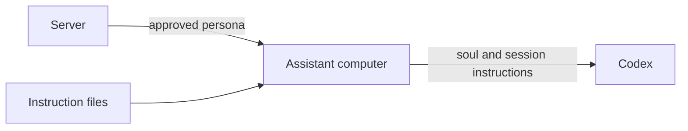

# Assistant instructions

## What this is

The editable words that tell an assistant who it is, how its computer works and
what this session expects. The approved onboarding persona supplies its identity.

## Where it fits

This folder belongs to [assistant computers](../../README.md). The server loads
the approved persona. The computer adds these words to its Codex session settings.

## What it is responsible for

- Keep the default identity, tool guidance and source notice in one soul file.
- Explain how the approved persona replaces the default identity.
- Describe personal assistants, shared assistants and unattended routines.
- Describe the tools and limits of ordinary and restricted sessions.

## Processes it handles

1. **A session starts.** The computer chooses the role and environment from the
   admitted turn. It adds the actual external tool names.
2. **A personal identity is available.** The computer adds the approved persona to
   the soul and saves the generated file outside the assistant's writable workspace.
3. **The wording changes.** The next built package contains the edited files.
   No TypeScript change is needed to edit the words.

## How to run or test it

The [computer's checks](../../README.robot.md#assistant-instructions) cover the
default and approved identities, each role and real tool execution with a stand-in model.

## Where to read more

- [Exact file roles](README.robot.md).
- [Computer settings and checks](../../README.robot.md#assistant-instructions).
