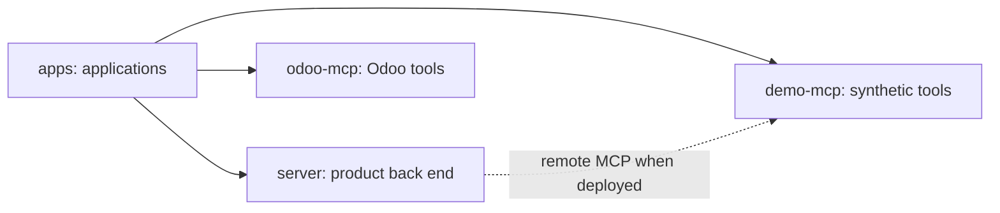

# apps/demo-mcp

## What this is

A small [MCP tool server](../../GLOSSARY.md#mcp-server-tool-server) for demonstrations.
It offers a made-up quote and lets a caller change its delivery slot without credentials.

## Where it fits

This separate application sits beside the product back end and the Odoo tool server.
The product can discover it through the ordinary remote-tool connection once public
hosting is ready. Public hosting and a live chat demonstration remain untested.



## What it is responsible for

- Describe two tools, their zero cost and the fields an admin reviews.
- Read the quote or change its slot only inside this process.
- Refuse calls that do not match the advertised tool definitions.

## Processes it handles

1. **Discovery.** A caller receives the complete tool list without signing in.
2. **Read.** The read tool returns the synthetic quote and number of accepted changes.
3. **Change.** The write tool checks the catalogue revision, then changes the slot once.
   Restarting the process resets the fixture. No supplier or product record changes.

## How to run or test it

Without TLS settings, startup binds only to the local machine on port 18445.

```sh
npm start -w apps/demo-mcp
nice -n 10 npx vitest run apps/demo-mcp/test --maxWorkers=2
```

## Where to read more

- [README.robot.md](README.robot.md): exact protocol, settings and limits.
- [Runbook](../../docs/process/demo-tool-server/runbook.md): lifecycle and hosting prerequisites.
