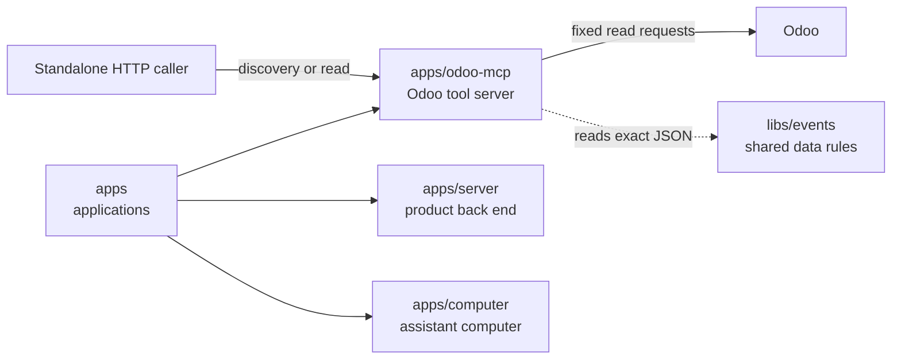

# apps/odoo-mcp

## What this is

A standalone tool server that reads one draft Odoo sales order at a time.
Odoo is business software for sales, stock and accounts. MCP, the
[Model Context Protocol](../../GLOSSARY.md#mcp-server-tool-server), lets an assistant use tools.
It describes its tools and reads orders with the credential supplied for that request.
Replacing notes remains unavailable.

## Where it fits

This is a separate application under `apps`, alongside `apps/server` (the product back end)
and `apps/computer` (the assistant's computer). Neither application calls it yet.
It runs on the local machine and connects to the Odoo instance chosen by the operator.



## What it is responsible for

- Describe the two tools without contacting Odoo or needing a credential.
- Return complete protocol, argument and result definitions.
- Check that request headers and metadata agree.
- Check note sizes in UTF-8 bytes without shortening the text.
- Read only draft orders with at most twenty lines, without shortening their contents.
- Return exact facts and escaped text for display, with a version and note digest.
- Use each request's credential and let Odoo check that account's access.
- Refuse all writes.

## Processes it handles

1. **A caller discovers tools.** The server returns protocol and tool definitions.
2. **A caller sends an unsupported request.** The server refuses sessions, batches,
   unknown methods and mismatched protocol information.
3. **A caller reads an order.** The server requests fixed fields from Odoo and returns
   the complete result. Missing, inaccessible, non-draft and oversized records are refused.
4. **A caller asks to replace a note.** The server refuses without contacting Odoo.

## How to run or test it

The server uses the shared events package to read JSON without losing number precision.

The standalone process listens only on the local machine. `PORT` chooses its port.
`ODOO_ORIGIN` and `ODOO_DATABASE` choose the upstream instance. Without them, only
discovery is available. Credentials arrive in each request, never in startup settings.
These tests need no Odoo credentials or running fixture.

```sh
npm start -w apps/odoo-mcp
nice -n 10 npx vitest run apps/odoo-mcp/test
```

## Where to read more

- [README.robot.md](README.robot.md): exact contracts, limits and remaining work.
- [Odoo fixture](../../infra/odoo/README.md): local fake records for read tests.
- [Accepted design](../../docs/specs/phase-3/p3-12-odoo-draft-note.md): the planned product connection.
