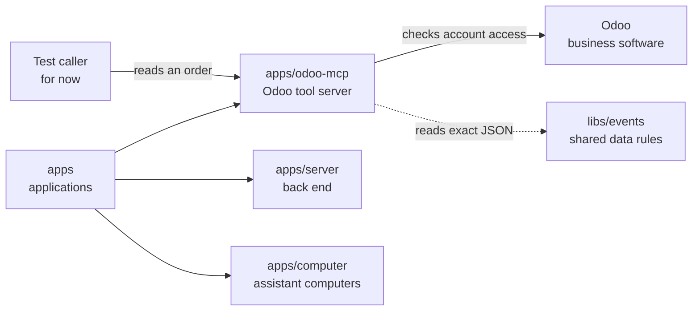

# Odoo tool server

## What this is

This is a small tool server that reads draft sales orders from Odoo, the business
software for sales, stock and accounts. The planned product connection would let an
assistant suggest a new order note for a person to approve; today this server only
reads orders, and no other OpenCrane application calls it yet.

## Where it fits

This is in the tool servers layer under `apps`, alongside the back end and assistant
computers. A [tool server](../../GLOSSARY.md#mcp-server-tool-server) gives an AI agent
named actions through MCP, a shared standard for tool calls. Test callers use this
server directly with an Odoo account's access key.



## What it is responsible for

- Describes its read and note-changing tools without contacting Odoo.
- Reads one complete draft order using the account supplied for that request.
- Returns the order as Odoo holds it, a safe copy for showing on screen, and a
  fingerprint so later changes can be spotted.
- Refuses requests it does not expect, records beyond its size limits and all writes.

## Processes it handles

1. **A caller asks what tools exist.** The server returns the tool descriptions and
   the rules for their inputs and results. No Odoo access key is needed for this list.
2. **A caller reads an order.** The server asks Odoo for fixed order fields using the
   caller's key. Missing, inaccessible, non-draft and oversized orders are refused.
3. **A caller asks to replace a note.** The listed note-changing tool always refuses
   without contacting Odoo. Safe writes and the product chat connection remain planned.

## How to run or test it

The server uses the shared events package to read JSON without losing number precision.

The server listens only on the local machine. Reading orders needs an Odoo address
and database; each request supplies its own access key. The ordinary tests use fake
Odoo replies and need no running Odoo service.

```sh
npm start -w apps/odoo-mcp
nice -n 10 npx vitest run apps/odoo-mcp/test
```

## Where to read more

- [README.robot.md](README.robot.md): exact settings, request rules, limits and checks.
- [Local Odoo setup](../../infra/odoo/README.md): made-up records for read tests.
- [Technical design for developers](../../docs/specs/phase-3/p3-12-odoo-draft-note.md): the planned product connection.
