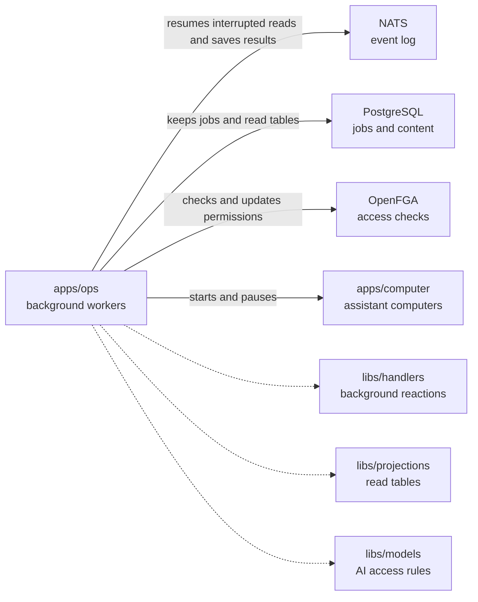

# Background workers

## What this is

The background workers and operator tools that keep OpenCrane up to date.
They copy saved changes into read tables, update permissions and manage assistant
computers. Recovery tools rebuild data from the saved event log.
The workers record their results as new events.

## Where it fits

This package belongs to the background workers layer.
[apps/server](../server/README.md) saves changes as [events](../../GLOSSARY.md#event).
The workers read them and run the matching
[reactions](../../GLOSSARY.md#reaction-handler), or background jobs.
Assistant computers run in [Kubernetes](../../GLOSSARY.md#kubernetes).



## What it is responsible for

- Keep read tables current for people, readable chats, providers, files, tools and spending.
- Apply saved permission and outside-network rules.
- Set up assistants and claim one computer for each assistant.
- Start and pause computers while keeping their files.
- Record confirmed model costs and stop affected work at a spending limit.
- Prepare reviewed gateway settings in saved order.
- Check hosted images and record admission or refusal when the evidence is complete.
- Prepare private answer keys and confirm completed welcome answers.
- Remove forgotten memory keys and old personal connection copies when configured.
- Record nightly memory preparation without sending a task to a computer.
- Provide replay, failed-job inspection and handler upgrade commands.

Not built yet:

- Enable automatic routine scheduling and execution.
- Start hosted tools through the application.
- Report departure cleanup progress through the public API.

## Processes it handles

1. **A change is saved.** A worker updates the matching read table.
   The dispatcher runs required background jobs and records their results as events.
2. **A member joins.** The dispatcher applies permissions and model access.
   It creates an assistant and computer only if requested, and checks that the member
   has not since left. Configured private key storage also prepares their answer key.
3. **A member leaves.** The dispatcher removes groups and personal grants, disables
   their assistant and waits for busy work to finish. It records completion only
   after checking saved outcomes and applied permissions.
4. **A computer sits idle.** The worker pauses it after the idle period. A new
   member's computer stays awake while they set up, for up to an hour after joining.
   Their first ordinary chat ends that extra time.
   A later message wakes the same computer with its saved files; image changes take
   effect when a paused computer starts again.
5. **Private data needs cleanup.** Saved corrections, forgetting and connection
   changes trigger cleanup jobs. Failed cleanup remains recoverable after restart;
   hidden memory stays hidden while physical key removal is pending.
6. **An operator rebuilds data.** Replay restores tables or permissions from events.
   It does not repeat outside actions; some rebuilds require readers and workers to stop.
7. **A release changes background jobs.** With writers and workers stopped, the
   upgrade tool adds jobs for changed subscriptions while retaining completed work.
   Startup waits for the required upgrade before starting workers.

## How to run or test it

Run these commands from the repository root with the service settings in
[README.robot.md](README.robot.md#live-workers).
The `members` worker writes read tables in PostgreSQL.
The `dispatcher` worker updates permissions and saves events while running background
jobs. It resumes work after a brief interruption in event delivery, acknowledgement
or computer watcher reads and logs each recovery.
On the local stack, the status command shows the latest recovery for each affected operation.
Only the replay command with `--dry-run` is read-only: it inspects saved event history.

```sh
npm run worker -w apps/ops -- members
npm run worker -w apps/ops -- dispatcher
npm run replay -- members --dry-run
```

The [operator notes](README.robot.md) list focused tests, other workers and recovery commands.

## Where to read more

- [README.robot.md](README.robot.md): settings, limits, recovery and test details.
- [apps/server](../server/README.md): requests that save changes.
- [libs/handlers](../../libs/handlers/README.md): reactions and waiting jobs.
- [libs/projections](../../libs/projections/README.md): rebuildable read tables.
- [Why NATS holds the event log](../../docs/adr/0001-event-store-nats-jetstream.md).
