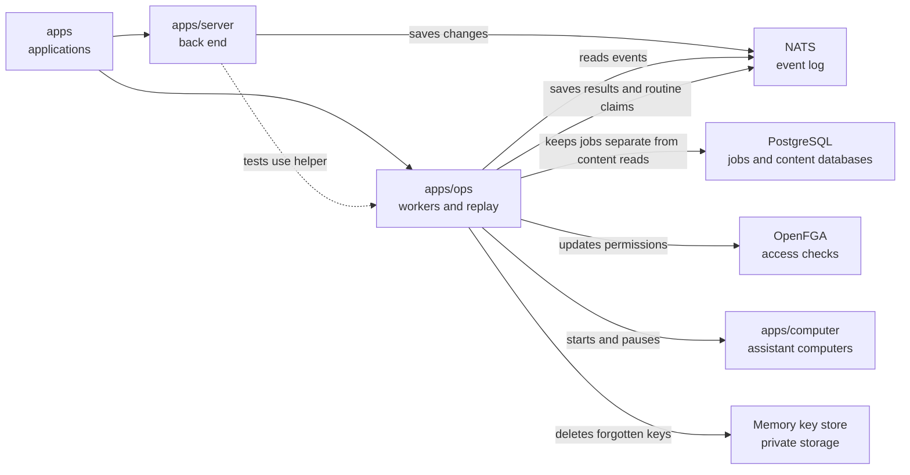

# Background workers

## What this is

This package runs the background workers that keep OpenCrane's screens, permissions
and assistant computers up to date. It also provides recovery tools that rebuild
data from the saved record of changes.

## Where it fits

This is the background workers layer, alongside the back end and assistant computers
under `apps`. [apps/server](../server/README.md) saves changes as
[events](../../GLOSSARY.md#event); these workers read them from
[NATS](../../GLOSSARY.md#nats) and run the matching
[reactions](../../GLOSSARY.md#reaction-handler), or background jobs.



The computers run in [Kubernetes](../../GLOSSARY.md#kubernetes).
[OpenFGA](../../GLOSSARY.md#openfga-permissions-service) checks who may use what.

## What it is responsible for

- Keeps [read tables](../../GLOSSARY.md#read-table-projection) current for people,
  groups, chats, tools, providers, files, computers, spending and history.
- Keeps permissions and the list of outside websites each person and assistant may reach up to date.
- Sets up assistants and claims one computer per assistant, including shared group assistants.
- Starts and pauses computers and delivers short-lived [passes](../../GLOSSARY.md#access-token).
- Charges confirmed model costs and stops affected work when a spending limit is reached.
- Stops expired gateway preparation and releases its database lock.
- Prepares reviewed tool settings for the gateway and, when configured, removes
  forgotten memory keys and old private connection copies.
- Provides [replay](../../GLOSSARY.md#replay), failed-job tools and upgrades for recovery.
- Provides an internal command that claims one scheduled routine occurrence without starting it.

## Processes it handles

1. **A change is saved.** A worker copies the event into the matching table.
   Reactions run any required background work and save its results as new events.
2. **A member joins.** The dispatcher updates permissions and model access. If the
   invitation requested an assistant, it creates one and claims its computer; when
   private key storage is configured, it also prepares the member's private answer key.
3. **A member leaves.** The worker removes their groups and personal grants and
   switches off their personal assistant. It checks saved results and applied
   permissions before recording completion.
4. **A computer sits idle.** The worker pauses it after the configured idle period.
   A new message wakes the same assistant's computer with its saved files.
5. **An operator rebuilds data.** Replay reads the event log again to rebuild tables
   or permissions. It does not repeat outside actions; some rebuilds require readers
   and workers to stop first.
6. **A release changes background jobs.** With writers and workers stopped, an
   upgrade adds jobs for newly supported events while keeping completed work recorded.

The routines worker copies routine and occurrence events into read tables. It keeps
instructions encrypted and starts no work. Offline routine replay restores these
records in one database transaction. Readers, scheduler, dispatcher and workers that
perform outside actions must stay stopped until it finishes.

An internal command can claim one saved routine slot and return the same record on
retry. It keeps the original owner, payer and run identities. It starts no session,
model or tool call. Scheduling and execution are not connected yet.

A reviewed template defines how hosted tools may run. Separate Kubernetes rules check
the image and settings and limit who may create or scale a tool. Starting hosted tools
through the application remains unavailable.

When private connection custody is configured, the dispatcher cleans old personal
connection copies after saved revocations or replacements. Failed cleanup is retried.
It also checks abandoned copies at startup and every 15 minutes. Slow storage does not
hold up event handling. Missing custody disables both jobs and scans with a warning;
invalid configuration stops startup. The scan keeps copies belonging to other silos.
Shutdown waits for the current page, even if another worker task fails.

A saved memory correction keeps the new revision and removes old revision keys and
facts derived from them. Cleanup retries and restart recovery use the saved change.
People can correct their own facts through HTTP. Correction through tools is still planned.

The dispatcher prepares one complete gateway configuration for each current reviewed
publication request. Jobs for the same silo run in saved order. Old or withdrawn
requests do nothing. Preparation and file replacement share a PostgreSQL lock, so
a newer saved generation cannot be overtaken by an older file. The dispatcher uses
the content database for this lock, with the server's read-only account. It keeps
its queue in the separate jobs database. When private connection cleanup is configured,
staging and cleanup share a profile lock in content too. Missing or unavailable content settings
stop startup before handlers run. Rebuilding tables
never prepares or delivers configuration.

A spending stop creates durable jobs on the existing dispatcher. Each job checks
saved admissions and records Stop for affected turns, even with no computer connected.
A delayed conversation index makes the job retry. Rebuilding tables sends no stops.

When configured, a saved owner or admin stop shuts down the exact private tool process
in Kubernetes. The worker records absence before status becomes Sleeping. It cannot
wake a tool or release credentials. Rebuilding read tables does no Kubernetes work.

The dispatcher also uses PostgreSQL's job queue to check enabled memory scopes each night.
It reads candidate scopes and their progress from the content database using a read-only
account. If those tables are behind or unavailable, it keeps the trigger for recovery.
It records why a dirty scope is blocked or missed. Failed triggers keep their original night
until startup or a later night can record the missed result. It sends no memory task to a computer.
It records `no_changes` when a forgotten fact leaves nothing eligible. Later nights skip
that reviewed change. It takes at most 32 whole facts in saved order and stops when
the next fact would exceed the 16 KiB input limit. It excludes facts that depend on
expired facts, using the intended nightly time. Repeated writes keep the original
  revision's expiry and saved position.

A member joins. When private key storage is configured, the dispatcher prepares one
key for their private answers, including members without an assistant. It checks
current membership before acting on an old join. The member worker copies encrypted
survey progress into read tables. Rebuilding those tables changes no keys.

1. **A change is recorded.** A worker reads the event and updates the matching PostgreSQL table, including model grants. Replaying the events can rebuild that table.
2. **A member joins.** The [dispatcher](../../GLOSSARY.md#dispatcher) is the background
   program that reacts to each new event. It updates permissions, gives the member model
   access and claims a computer for their assistant when the invitation requested one.
   A join that requests no assistant creates neither an assistant nor its computer.
   Before creating one, the worker checks the member's events and skips a late
   join delivery if the member has since been removed.
3. **A computer sits idle.** After 15 minutes without activity (by default), the worker
   pauses it. When a new message arrives, the server asks for the computer back and the
   worker starts it again. The watcher reads new events as they arrive and only asks
   Kubernetes to change a computer's mode when needed. It checks quiet computers less
   often and repairs outside changes to their mode. After an image update, a paused
   computer starts from the checked image and keeps its home files. A running computer
   waits until its next pause. The worker updates the paused computer in place.
   Failed changes wait before retrying, while other computers continue to resume.
4. **An operator rebuilds a table.** The replay command reads every saved event again.
   Most tables are rebuilt alongside the live tables, then checked and swapped in.
   Conversation and memory tables are rebuilt with readers and workers stopped.
   Memory replay checks saved tombstones and dependency links before reading keys.
   It skips hidden text, even when physical key cleanup is still pending.
   It never creates or deletes keys.

5. **A release adds a reaction or event type.** With writers and workers stopped,
   the handler upgrade tool adds jobs for the new subscriptions from saved events.
   It refuses other database clients, including idle ones, and replication workers.
   It ignores only named PostgreSQL maintenance processes, such as autovacuum,
   that cannot apply application changes. Unknown process types block the upgrade.
   It keeps the notes of finished jobs, so those reactions do not run again.
   The dispatcher names changed subscriptions and waits for this upgrade before
   starting its workers. Computers stay in their current state while it waits.
   The tool saves progress, so an interrupted scan can continue. The [upgrade procedure](README.robot.md#handler-subscription-upgrade)
   explains how to stop services, check the plan and restart them.

A member leaves. The dispatcher checks their saved removal and current resources.
It records group removal, personal grant revocation and assistant deactivation.
Retries keep one outcome per resource. The worker suspends idle personal computers
and waits for busy turns to close. It records completion only after checking the
saved changes and permission receipts, which confirm that OpenFGA applied each change.
For a lost computer, cleanup saves another loss record before completion.
This prevents an earlier claim from succeeding after cleanup finishes.
Departure status in the API is not available yet. Rebuilding read tables never runs this cleanup.

Memory cleanup checks the content database before reporting that forgotten text is gone.
Its waiting jobs and completion notes stay in the separate jobs database.

When cleanup fails repeatedly, the original job stays in place. Restarting the dispatcher
retries it in order; an operator can also retry it after repair.
The fact and its dependent copies stay hidden. The dispatcher restores pending cleanup jobs
from saved events before its workers resume if the job tables were lost. If a failed job's
unavailable report was lost, the dispatcher records it after the event store recovers.

## How to run or test it

Workers need the service connections and permissions described in the operator notes.
These commands run from the repository root; dry-run checks history without changing data.
Server integration tests use `test/server.ts` to exercise computer lifecycle work.
The nightly recovery test waits for both the saved result and removal of the failed
job, because saving the result happens first.

```sh
npm run worker -w apps/ops -- members
npm run replay -- members --dry-run
npm run worker -w apps/ops -- dispatcher
npm run replay -- memory --dry-run
npm run replay -- routines --confirm-routines-stopped --verify
npm run ops -- upgrade-handlers --dry-run
npm run ops -- jobs
```

## Where to read more

- [README.robot.md](README.robot.md): settings, recovery commands and detailed checks.
- [apps/server](../server/README.md): requests that save changes.
- [libs/handlers](../../libs/handlers/README.md): the dispatcher and waiting job list.
- [libs/projections](../../libs/projections/README.md): how read tables are built.
