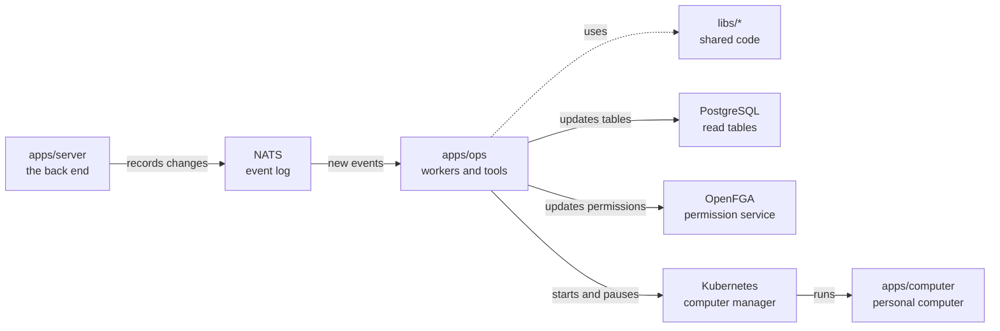

# apps/ops

## What this is

The background workers and operator tools that keep OpenCrane up to date. Workers respond to events and update PostgreSQL tables. Operator commands rebuild tables or permissions from the event log.

## Where it fits

This is the background workers layer. `apps/server` records events, and these workers read them. The workers use shared code in `libs/` and update PostgreSQL, OpenFGA permissions and computers in Kubernetes.



## What it is responsible for

- Keeps member, group, conversation, file, computer, budget and history tables up to date.
- Updates permissions and sets up a new member's assistant and computer.
- Starts computers, gives them short-lived access keys and pauses idle ones.
- Settles model spending after a model request.
- Rebuilds tables and permissions for operator recovery.
- Runs one-off upgrades for model access and the default budget group.

## Processes it handles

1. **A change is recorded.** A worker reads the event and updates the matching PostgreSQL table. Replaying the events can rebuild that table.
2. **A member joins.** The dispatcher updates permissions, gives the member model access and claims a computer for their assistant.
3. **A computer sits idle.** The worker pauses it after the idle period. When new work arrives, it starts the computer again.
4. **An operator rebuilds a table.** The replay command builds a copy and checks it before replacing the current table.

## How to run or test it

```sh
npm run worker -w apps/ops -- members
npm run worker -w apps/ops -- dispatcher
npm run replay -- members --dry-run
```

## Where to read more

- [README.robot.md](README.robot.md): worker modes, settings, recovery steps and test commands.
- [apps/server](../server/README.md) records the events these workers handle.
- [Why NATS holds the event log](../../docs/adr/0001-event-store-nats-jetstream.md).
- [Why a computer keeps its disk when it sleeps](../../docs/adr/0006-computer-disk-and-live-view.md).
- [The shared words used in these guides](../../GLOSSARY.md).
