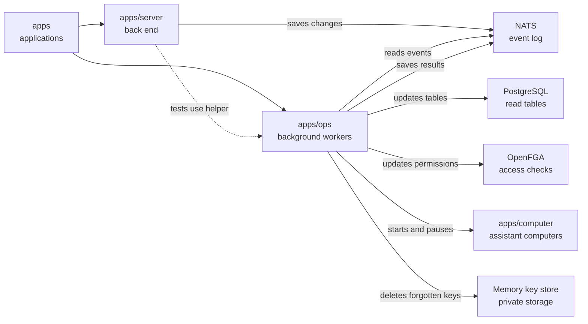

# Background workers

## What this is

This package runs the background workers that keep OpenCrane's screens, permissions
and assistant computers up to date. It also provides recovery tools that rebuild
data from the saved record of changes.

## Where it fits

This is the background workers layer, alongside the back end and assistant computers
under `apps`. [apps/server](../server/README.md) saves changes as
[events](../../GLOSSARY.md#event); these workers read them from
[NATS](../../GLOSSARY.md#nats) and run the matching
[reactions](../../GLOSSARY.md#reaction-handler), or background jobs.



The computers run in [Kubernetes](../../GLOSSARY.md#kubernetes).
[OpenFGA](../../GLOSSARY.md#openfga-permissions-service) checks who may use what.

## What it is responsible for

- Keeps [read tables](../../GLOSSARY.md#read-table-projection) current for people,
  groups, chats, tools, providers, files, computers, spending and history.
- Keeps permissions and the list of outside websites each person and assistant may reach up to date.
- Sets up assistants and claims one computer per assistant, including shared group assistants.
- Starts and pauses computers and delivers short-lived [passes](../../GLOSSARY.md#access-token).
- Charges confirmed model costs and stops affected work when a spending limit is reached.
- Prepares reviewed tool settings for the gateway and, when configured, removes
  forgotten memory keys and old private connection copies.
- Provides [replay](../../GLOSSARY.md#replay), failed-job tools and upgrades for recovery.

## Processes it handles

1. **A change is saved.** A worker copies the event into the matching table.
   Reactions run any required background work and save its results as new events.
2. **A member joins.** The dispatcher updates permissions and model access. If the
   invitation requested an assistant, it creates one and claims its computer; when
   private key storage is configured, it also prepares the member's private answer key.
3. **A member leaves.** The worker removes their groups and personal grants and
   switches off their personal assistant. It checks saved results and applied
   permissions before recording completion.
4. **A computer sits idle.** The worker pauses it after the configured idle period.
   A new message wakes the same assistant's computer with its saved files.
5. **An operator rebuilds data.** Replay reads the event log again to rebuild tables
   or permissions. It does not repeat outside actions; some rebuilds require readers
   and workers to stop first.
6. **A release changes background jobs.** With writers and workers stopped, an
   upgrade adds jobs for newly supported events while keeping completed work recorded.

## How to run or test it

Workers need the service connections and permissions described in the operator notes.
These commands run from the repository root; dry-run checks history without changing data.
Server integration tests use `test/server.ts` to exercise computer lifecycle work.

```sh
npm run worker -w apps/ops -- members
npm run replay -- members --dry-run
```

## Where to read more

- [README.robot.md](README.robot.md): settings, recovery commands and detailed checks.
- [apps/server](../server/README.md): requests that save changes.
- [libs/handlers](../../libs/handlers/README.md): the dispatcher and waiting job list.
- [libs/projections](../../libs/projections/README.md): how read tables are built.
