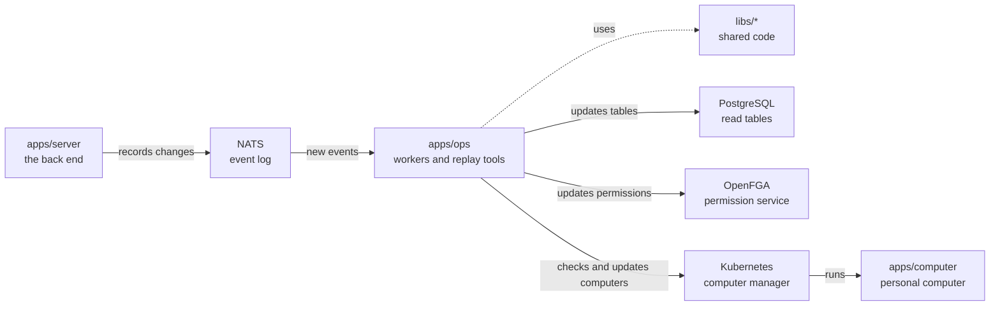

# apps/ops

## What this is

The background workers and operator tools that keep OpenCrane up to date. Workers respond to events and update PostgreSQL tables. Operator commands rebuild tables or permissions from the event log.

## Where it fits

This is the background workers layer. `apps/server` records events, and these workers read them. The workers use shared code in `libs/` and update PostgreSQL, OpenFGA permissions and computers in Kubernetes.



## What it is responsible for

- Keeps the member, group, model grant, tool catalogue, conversation, file, computer, budget and
  history tables up to date.
- Updates permissions and sets up a new member's assistant and computer.
- Starts computers, gives them short-lived access keys and pauses idle ones.
- Settles model spending after a model request.
- Rebuilds tables and permissions for operator recovery.
- Runs one-off upgrades for model access and the default budget group.

## Processes it handles

1. **A change is recorded.** A worker reads the event and updates the matching PostgreSQL table, including model grants. Replaying the events can rebuild that table.
2. **A member joins.** The [dispatcher](../../GLOSSARY.md#dispatcher) is the background
   program that reacts to each new event. It updates permissions, gives the member model
   access and claims a computer for their assistant.
3. **A computer sits idle.** After 15 minutes without activity (by default), the worker
   pauses it. When a new message arrives, the server asks for the computer back and the
   worker starts it again. The watcher reads new events as they arrive and only asks
   Kubernetes to change a computer's mode when needed. It checks quiet computers less
   often and repairs outside changes to their mode. After an image update, a paused
   computer starts from the checked image and keeps its home files. A running computer
   waits until its next pause. Failed changes wait before retrying.
4. **An operator rebuilds a table.** The replay command reads every saved event again, builds a fresh copy of the table and checks it before swapping it in.

## How to run or test it

```sh
npm run worker -w apps/ops -- members
npm run worker -w apps/ops -- dispatcher
npm run replay -- members --dry-run
```

These need the dev stack's settings. To run the whole system, use
infra/dev-stack/up.sh (see [infra/dev-stack](../../infra/dev-stack/README.md)).

## Where to read more

- [README.robot.md](README.robot.md): worker modes, settings, recovery steps and test commands.
- [apps/server](../server/README.md) records the events these workers handle.
- [Why NATS holds the event log](../../docs/adr/0001-event-store-nats-jetstream.md).
- [Why a computer keeps its disk when it sleeps](../../docs/adr/0006-computer-disk-and-live-view.md).
- [The shared words used in these guides](../../GLOSSARY.md).
