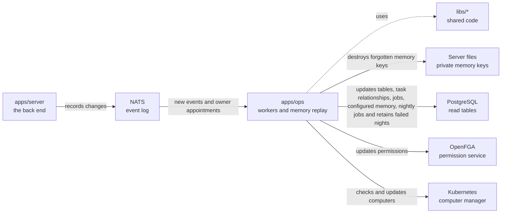

# apps/ops

## What this is

The background workers and operator tools that keep OpenCrane up to date. Workers respond to events and update PostgreSQL tables. Operator commands rebuild tables or permissions from the event log.

## Where it fits

This is the background workers layer. `apps/server` records events, and these workers read them. The workers use shared code in `libs/` and update PostgreSQL, OpenFGA permissions and computers in Kubernetes.



## What it is responsible for

- Keep destination rule tables current from saved events in the member worker.

- Confirms an owner appointment while its successor is still an active member.
- Records the first verified provider as the default once its chat model is enabled. Keeps later choices and pauses.
- Keeps the member, group, model grant, tool catalogue, conversation, file, computer, budget and
  history tables up to date. Keeps memory current when its key directory is configured.
- Copies delegated task relationships and outcomes with the `delegations` worker.
  This worker starts no tasks and changes no permissions or spending.
- Updates permissions and sets up a new member's assistant and computer when requested.
- Starts computers, gives them short-lived access keys and pauses idle ones.
- Settles model spending after a model request.
- Rebuilds tables and permissions for operator recovery.
- Checks all saved memory keys before rebuilding current memory and search text.
  Readers and workers stay stopped during this process.
- Destroy forgotten personal memory keys and dependent copies when configured.
  Record completion only after checking key deletion and removal of searchable text.
- Lists failed reaction jobs and records an operator’s chosen cancellation.
- Runs one-off upgrades for model access, the default budget group and handler subscriptions.

## Processes it handles

The dispatcher also uses PostgreSQL's job queue to check enabled memory scopes each night.
It records why a dirty scope is blocked or missed. Failed triggers keep their original night
until startup or a later night can record the missed result. It sends no memory task to a computer.

A member joins. When private key storage is configured, the dispatcher prepares one
key for their private answers, including members without an assistant. It checks
current membership before acting on an old join. The member worker copies encrypted
survey progress into read tables. Rebuilding those tables changes no keys.

1. **A change is recorded.** A worker reads the event and updates the matching PostgreSQL table, including model grants. Replaying the events can rebuild that table.
2. **A member joins.** The [dispatcher](../../GLOSSARY.md#dispatcher) is the background
   program that reacts to each new event. It updates permissions, gives the member model
   access and claims a computer for their assistant when the invitation requested one.
   A join that requests no assistant creates neither an assistant nor its computer.
   Before creating one, the worker checks the member's events and skips a late
   join delivery if the member has since been removed.
3. **A computer sits idle.** After 15 minutes without activity (by default), the worker
   pauses it. When a new message arrives, the server asks for the computer back and the
   worker starts it again. The watcher reads new events as they arrive and only asks
   Kubernetes to change a computer's mode when needed. It checks quiet computers less
   often and repairs outside changes to their mode. After an image update, a paused
   computer starts from the checked image and keeps its home files. A running computer
   waits until its next pause. The worker updates the paused computer in place.
   Failed changes wait before retrying, while other computers continue to resume.
4. **An operator rebuilds a table.** The replay command reads every saved event again.
   Most tables are rebuilt alongside the live tables, then checked and swapped in.
   Conversation and memory tables are rebuilt with readers and workers stopped.
   Memory replay checks saved tombstones and dependency links before reading keys.
   It skips hidden text, even when physical key cleanup is still pending.
   It never creates or deletes keys.

5. **A release adds a reaction or event type.** With writers and workers stopped,
   the handler upgrade tool adds jobs for the new subscriptions from saved events.
   It keeps the notes of finished jobs, so those reactions do not run again.
   The dispatcher names changed subscriptions and waits for this upgrade before
   starting its workers. Computers stay in their current state while it waits.
   The tool saves progress, so an interrupted scan can continue. The [upgrade procedure](README.robot.md#handler-subscription-upgrade)
   explains how to stop services, check the plan and restart them.

## How to run or test it

```sh
npm run worker -w apps/ops -- members
npm run worker -w apps/ops -- dispatcher
npm run replay -- memory --dry-run
npm run ops -- upgrade-handlers --dry-run
npm run ops -- jobs
```

The live memory worker runs with `npm run worker -w apps/ops -- memory`. It needs
`DATABASE_URL`, the NATS reader settings and `MEMORY_KEY_DIRECTORY`, an existing
private directory holding the saved revision keys. It only reads those keys.
An existing installation needs a memory rebuild to apply the new text checks to saved rows.
Without this setting, it logs one message and stops. Memory routes return
`503 memory_unavailable` until the server has this setting and the worker is ready.

The memory rebuild command is `npm run replay -- memory --confirm-memory-stopped`.
It needs `DATABASE_URL`, the NATS reader settings and `MEMORY_KEY_DIRECTORY`, an
existing private directory holding revision keys and permanent deletion markers.
Readers and workers stay stopped until replay succeeds. A failed replay may leave
only the successfully rebuilt part; running the command again starts from the beginning.
It does not offer the online `--verify` option.

These need the dev stack's settings. To run the whole system, use
infra/dev-stack/up.sh (see [infra/dev-stack](../../infra/dev-stack/README.md)).

## Where to read more

- [README.robot.md](README.robot.md): worker modes, settings, recovery steps and test commands.
- [apps/server](../server/README.md) records the events these workers handle.
- [Why NATS holds the event log](../../docs/adr/0001-event-store-nats-jetstream.md).
- [Why a computer keeps its disk when it sleeps](../../docs/adr/0006-computer-disk-and-live-view.md).
- [The shared words used in these guides](../../GLOSSARY.md).
