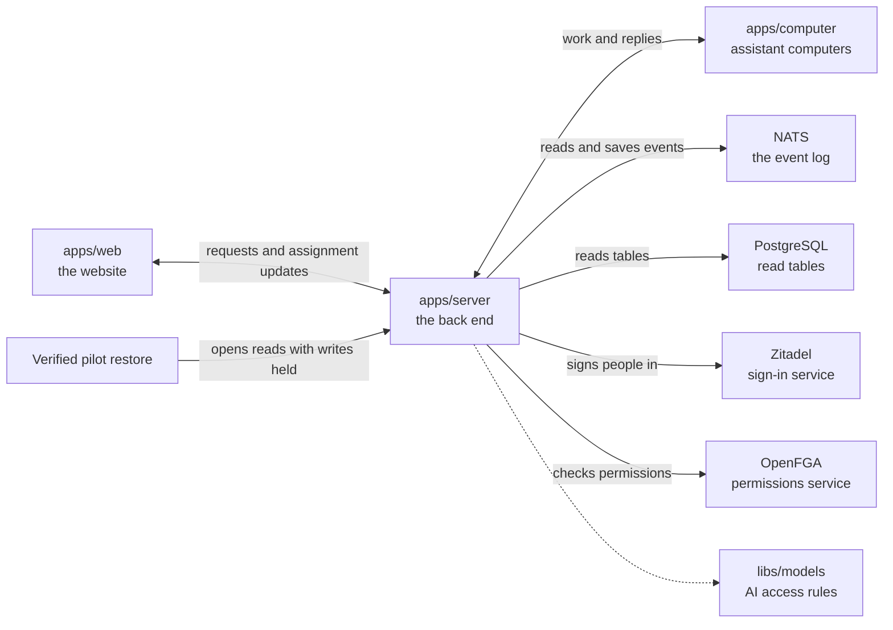

# apps/server

## What this is

The back end for OpenCrane sign-in, conversations and organisation settings.
It runs as a Node.js service that answers requests from the website.
It checks access, saves changes in the [event log](../../GLOSSARY.md#event-log-event-store)
and passes assistant work to the right computer.
A separate program here checks AI calls against spending limits and tool rules.

## Where it fits

This package belongs to the back-end layer.
[apps/web](../web/README.md) sends browser requests;
[apps/computer](../computer/README.md) runs the assistants' computers.
The server uses shared libraries to read events, check permissions and load read tables.
[apps/ops](../ops/README.md) updates those tables from saved events.



## What it is responsible for

- Sign people in and keep their browser sessions.
- Check access before returning private information or saving changes.
- Serve verified pilot restores with writes and assistant work held.
- Carry personal assistant assignments, chat messages, live replies, stops and tool approvals.
- Check and scan files before storing them or passing them to a computer.
- Serve desktop views and screenshots to people with access.
- Manage members, groups, ownership, providers, tool servers and spending settings.
- Return permitted history, saved results, memory facts and routine details.
- Check AI calls and record their costs through the separate models process.

Not built yet:

- Let people take control of an assistant's desktop.
- Start private tool instances or call tools from hosted images.
- Run automatic routines.
- Deliver live private memory tools or run nightly memory upkeep.

## Processes it handles

1. **A person joins.** The sign-in service checks their identity.
   The server records their first-owner claim or accepted invitation.
2. **A person sends a message.** The server saves readable prose in the event log and sends assistant work to the
   right computer. Replies arrive as live updates, and the person can stop the work.
   People can also chat with each other without starting assistant work.
3. **An assistant makes a call.** The AI gateway asks the models process whether
   access and spending rules allow it. The process sets money aside, records the
   cost and releases unused money.
4. **A person uses a tool.** A reviewed tool may need their approval before it runs.
   The server saves the decision and checks access again before allowing work.
5. **An admin changes settings.** The server checks their rights and saves the change.
   Background workers apply it. The website can check a lost reply without repeating
   the change.
6. **A person opens their data.** The server loads the requested history, files or
   memory facts, then checks current access before replying.
   Losing access prevents further private reads.
7. **A person uploads a file.** The server checks its type and scans its contents.
   A clean file is stored and can be sent with a message; a refused file stays unavailable.
8. **A person views a desktop.** The server checks their chat and desktop permissions.
   A confirmed loss of access ends the view.

## How to run or test it

Start the full system using the [dev stack guide](../../infra/dev-stack/README.md).
With that stack's settings, run these commands from the repository root:

```sh
npm start -w apps/server
npm run models -w apps/server
nice -n 10 npm run typecheck -w apps/server
```

[README.robot.md](README.robot.md#contract-and-verification) lists focused tests.
The server and models process need the services and settings described there.

## Where to read more

- [README.robot.md](README.robot.md): exact contracts, settings, folders and test details.
- [Chat](src/chat/README.md): conversations and assistant work.
- [Files](src/files/README.md): uploads and assistant files.
- [Members](src/members/README.md): invitations, groups and ownership.
- [apps/web](../web/README.md): the website that sends requests.
- [apps/ops](../ops/README.md): workers that apply saved changes.
- [libs/models](../../libs/models/README.md): AI access, tool rules and spending.
- [Why NATS holds the event log](../../docs/adr/0001-event-store-nats-jetstream.md).
- [Glossary](../../GLOSSARY.md): shared words used in these guides.
