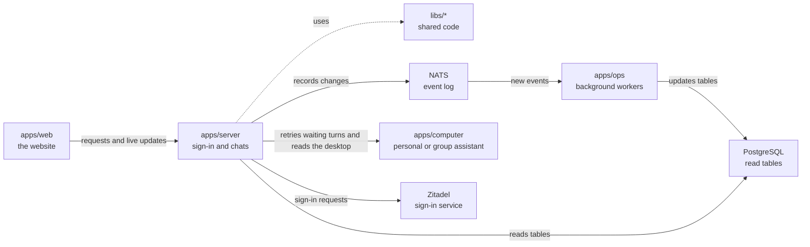

# apps/server

## What this is

The back end for OpenCrane sign-in, conversations and organisation settings. It is a Node service that accepts browser requests and sends live updates. A second process handles model access and spending.

## Where it fits

This is the back-end layer. `apps/web` sends it requests and live connections. It uses shared code in `libs/`, records changes in NATS (the event log), and reads PostgreSQL tables that `apps/ops` keeps current. It also sends work to `apps/computer`, the computer for each personal or group assistant.



## What it is responsible for

- Signs people in and keeps their browser session.
- Checks permissions before returning private information or changing data.
- Records changes as events and reads the current state from PostgreSQL.
- Handles conversations, approvals, file uploads, computer access and organisation history.
- Lets two silo members exchange private messages without starting assistant work.
- Runs a separate models process. It keeps AI budgets, approves or refuses each AI request,
  and starts [agentgateway](../../GLOSSARY.md#agentgateway-ai-gateway), the AI gateway that
  every model request passes through.
- Lets admins connect a model provider, store its key safely and check that the key works.
- Lets owners hand over ownership and admins manage groups. The website has no page for this yet.
- Lets admins create a group assistant with selected tools and a fixed paying group.
- Keeps each member's group chat private while they share the assistant's computer.
- Provides the one-time command used to claim a new installation.

Private team turns receive earlier completed replies from the same member. The
computer starts a fresh Codex process for each private team turn. Disk isolation is
not yet proven on a live computer; memory features stay off until it is.

## Processes it handles

1. **A person signs in.** The server sends the browser to Zitadel and checks the returned identity. It keeps the session in an encrypted cookie.
2. **The first owner claims a new installation.** An operator runs the one-time command,
   which prints a token. The first person signs in and enters that token on the claim page.
   The server checks it and records them as the owner.
3. **A person chats with an assistant.** The server sends the turn to that person's
   computer and passes the assistant's progress back to the browser as it arrives. The
   person can stop the turn. The chat watcher leaves finished chats alone while another
   reply is pending. It sends a waiting turn again until the computer accepts it and
   sends it again after reconnecting. It retries short service outages so pending
   messages can still reach the computer.
4. **A group uses a shared assistant.** An admin chooses its tools and paying group.
   Each member gets a private chat and thread, while everyone shares one disk and
   browser profile. A member who loses spending access can still read and stop their work.
5. **Two people chat.** The server checks who can read their direct conversation,
   then returns messages and live updates. Busy chats and slow reads keep working.
6. **An admin adds a tool server.** The server checks the remote address, lists its
   tools and leaves them blocked until an admin reviews them.
7. **An assistant asks an AI model for help.** The request goes through agentgateway, the
   AI gateway. The gateway asks the models process whether the budget allows it, and only
   then sends it on to the model provider.
8. **A person watches the assistant's desktop.** The server checks their conversation
   access and desktop grant. A confirmed member removal or conversation permission denial
   ends the view straight away, even if another access read is slow.

## How to run or test it

```sh
npm start -w apps/server
npm run models -w apps/server
npm run typecheck -w apps/server
```

These need the dev stack's settings. To run the whole system, use
infra/dev-stack/up.sh (see [infra/dev-stack](../../infra/dev-stack/README.md)).

## Where to read more

- [README.robot.md](README.robot.md): settings, request details, limits and test commands.
- [apps/web](../web/README.md) sends browser requests to this service.
- [apps/ops](../ops/README.md) reads events and updates the tables this service reads.
- [Why NATS holds the event log](../../docs/adr/0001-event-store-nats-jetstream.md).
- [The shared words used in these guides](../../GLOSSARY.md).
