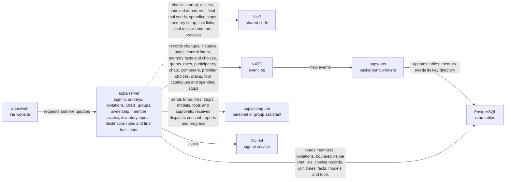

# apps/server

## What this is

The back end for OpenCrane sign-in, conversations and organisation settings. It is a Node service that accepts browser requests and sends live updates. A second process handles model access and spending.

## Where it fits

This is the back-end layer. `apps/web` sends it requests and live connections. It uses shared code in `libs/`, records changes in NATS (the event log), and reads PostgreSQL tables that `apps/ops` keeps current. It also sends work to `apps/computer`, the computer for each personal or group assistant.



Tool discovery records the exact definitions and how long the check remains valid.
Descriptions are untrusted text. They never become instructions for the server.
The models process checks each configured tool call again before sending it. Its backend
must compare the approved tool list and running instance before executing the call.

## What it is responsible for

Member access and departure reviews use indexed stream names to read saved grants,
groups and assistants. Removed access stays incomplete until permission receipts
arrive. Reviews stop above 100 groups or 500 distinct people. After an upgrade,
reviews stay incomplete until the inventory index has been rebuilt.

Reviews use indexed history changes and report incomplete results when new streams
have not been checked. Unrelated read receipts do not require reading the event log.

- Saves a member's welcome survey answers as encrypted records. Resumes confirmed
  progress, checks restarts and returns original saved receipts. Calls no model.
- Lets members read their own private tool-instance status and original change results.
  Saves an explicit owner stop request. Starting an instance remains unavailable.

- Let owners and admins save one destination rule and read its original receipt.
  A change reference keeps its original rule and arguments when a request is repeated.

- Checks hosted startup credential requirements before offering a connection.
  Compatible records stay available for review; startup processes cannot run yet.
  Existing memory calls keep their usual access checks.

- Records a member’s chosen assistant and paying group for nightly memory upkeep.
  Checks their access and explicit cost acceptance. Returns the saved choice and
  its status. Nightly execution remains disabled.
- Preview bounded facts for a saved private turn without sending text to a computer.
  Facts with expired or unusable supporting facts are left out.

- Record internal control intent for the current requester. Refuse new work while it is pending.
  Keep authorised viewing, explicit stops and approval denial available.
- Accept an owner or admin’s review of exact saved tool definitions and free tool use.
  Refuse old reviews and changes to another connection.

- Read recorded child participants without reading the whole conversation.

- Returns missing approval details and accepts requester retries after verified non-dispatch.
- Lets admins review a departure, remove access and recover the saved removal receipt.
  Other members can keep posting messages and updating chat tables during removal.
- Records owner appointments as requests. Counts a successor only after confirmation.
- Lets owners and admins save provider choices and pauses, count affected assistants
  and recover saved results. Conflicting requests cannot report an unsaved change
  as saved. Ordinary calls keep their existing setup.
- Serves personal facts, the bound assistant's notes and its group facts after checking
  the gateway pass, saved grants, current permissions and the recorded turn mode.
  Refuses agent writes until saved records cover every fact loaded into the turn.
- After managed calls are switched on, records the assistant's provider choice or the
  silo default for each new turn. A turn keeps that model when its pass is renewed.
  No command to switch this on is built yet.
- Signs people in and keeps their browser session.
- Uses the shared organisation check for session routes and WebSocket connections.
  Production refuses extra sign-in identities. Development can allow named identities
  from another organisation, but session routes still need a configured organisation.
- Uses one member check for chat, approval and file requests. It checks the signed-in
  identity, current membership and chat access. Writes must come from this website.
  These replies tell browsers and caches not to save them. Missing approvals and
  approvals the person cannot access receive the same refusal.
- Checks permissions before returning private information or changing data.
- Loads group and ownership results before checking current access. Slow history
  reads can finish, and a removal during loading prevents the reply.
- Lists and searches a person's own memory and permitted group or assistant notes.
  Returns fact detail and checks each source separately, hiding denied references.
  Checks chat access and the latest join before looking up one source message. Describes a member statement
  without naming its author. Reports destroyed or quarantined facts without text.
  Checks write permission before inspecting a fact. Records human facts and checks
  the original command when a reply is lost. Checks chat access before looking up
  a source message. Slow permission checks leave database connections free. The server
  shares a few write slots between members. A member can save one fact at a time
  and have one more write waiting, across all their scopes and sign-in sessions.
  This leaves room for another person. Busy writers receive a prompt reply.
  Keeps the fact's key while a delayed write could still be saved.
  These reads need the memory worker and its existing private key directory.
  It returns current facts only after the read table has caught up with their events.
- Accepts bound and email invitations after a recent sign-in with a verified email, while
  the inviter is still an owner or admin. Records whether a personal assistant was requested.
- Checks an invitation email and explains that the person is confirmed when they accept.
- Changes Member and Admin roles after checking current access. Owners use the ownership route.
  Role changes and team turns read membership history before the short write check.
  Reports a competing appointment as applying until its permissions have been updated.
- Records and renews email invitations for owners and admins. Reads saved command results.
- Returns member headers to members and the email directory to current owners and admins.
- Explains recorded access and reviews departure effects without private content.
  Reports incomplete reviews while access changes are being applied, and returns only
  counts and dates for private history. A complete review lets admins remove access.
- Keeps checking member access while a live connection is open.
- Records changes as events and reads the current state from PostgreSQL.
- Keeps the original provider choice when repeating or closing a recorded turn.
  Checks current membership before repeating a start and passes the saved model
  to the turn-token issuer and the computer that runs the turn.
- Handles conversations, approvals, file uploads, computer access and organisation history.
  Checks saved participation changes before returning private content.
  Checks closing events even while read tables are catching up. Keeps the last
  checked position, so later checks read only new events.
  Gives late participants only files and screenshots saved since their latest join.
- Offers a personal assistant only reviewed, free tools that both the person and assistant can use.
- Returns spending records to current owners and admins. It reads the records first,
  then checks access, so a longer read does not use up the write access time limit.
  Resolving a hold also reads its history first and rechecks access before saving.
- Starts personal turns using the latest default paying group. It keeps a small
  summary with the provider switch-on state and reads each new spending event once.
- Records tool starts and finishes as events and returns them in the conversation feed.
- Tells a computer whether it supports approval messages and when a waiting
  approval has been decided or ended. A changed tool policy also ends a waiting approval.
  Reads each approval separately, so a slow read leaves other chats free to continue.
  Spaces out failed reads and tells the computer when it cannot accept another wait.
- Records streamed replies using a chat summary. After its first use, it reads only
  new events and checks one saved event. It handles repeats without saving them again.
- Starts, closes and replays turns using the shared computer summary. It reads new
  events first and keeps the conditional write at the position it checked.
  Both summaries drop older entries when their memory budget is reached. A
  summary that is too large is dropped on its own, leaving other chats warm.
- Lets silo members create a group chat from reviewed people and exchange messages
  without starting assistant work. Offers only groups they belong to.
- Lets group chat creators add or remove people, and lets other participants leave.
  Refuses stale edits and keeps saved retries from adding someone again.
- Lets two silo members exchange private messages without starting assistant work.
  Tells the browser when a new chat is waiting for its permissions, so it can keep the draft.
- Runs a separate models process. It keeps AI budgets, approves or refuses each AI request,
  and starts [agentgateway](../../GLOSSARY.md#agentgateway-ai-gateway), the AI gateway that
  every model request passes through.
- Lets admins connect a model provider, store its key safely and check that the key works.
- Lets owners hand over ownership and admins manage groups. The website has no page for this yet.
- Lets owners and admins read model grants and list same-silo people, groups or assistants
  that a grant could name. HTTP clients can give or revoke one grant and check its result.
  Admins can remove a departed person's grant. An empty revoke saves no change.
  Provider choices and configured uses say “Not available yet” until those records exist.
- Lets admins create a group assistant with selected tools and a fixed paying group.
- Keeps each member's group chat private while they share the assistant's computer.
- Provides the one-time command used to claim a new installation.

Private team turns receive earlier completed replies from the same member. The
computer starts a fresh Codex process for each private team turn. Disk isolation is
not yet proven on a live computer; private chat memory stays off until it is.

The reviewed tool list includes each tool's Allow mode. The computer and gateway
use it to refuse calls if the tool changes to Ask during the turn.

An owner or admin can pause new model turns before a provider change. Running
turns keep their original path. Starting or cancelling the pause saves an event.
Owner and admin spending reads include saved budget stop reasons and UTC resets.
A zero limit, or a limit lowered to the money already spent or held, stops affected
model reservations as soon as the change is saved. Applying stops to every running
computer and tool call is still planned. Switching on managed provider calls remains
unavailable.

## Processes it handles

1. **A person signs in.** The server sends the browser to Zitadel and checks the returned identity. It keeps the session in an encrypted cookie. If the sign-in details are too large
   for a browser cookie, it shows a clear error.
2. **The first owner claims a new installation.** An operator runs the one-time command,
   which prints a token. The first person signs in and enters that token on the claim page.
   The server checks it and records them as the owner.
3. **An admin prepares an invitation.** The server checks the email input. The person
   is confirmed when they accept; the server does not look them up in Zitadel.
   An admin can save or renew an email invitation and recover their own saved result.
   Another admin cannot read that command receipt. Refusal records keep only a
   hash of the command id, a fixed-length value used to find a saved result. Organisation history checks
   current access and tells browsers and HTTP caches not to save its replies.
   The server finds matching emails in its member table and checks their events.
   Acceptance finds account records in the member table and checks their events.
   It reads newer events too, so delayed background work cannot hide an active account.
   It records the signed-in account and keeps concurrent invitations from admitting it twice.
   If an admin renews the invitation during acceptance, the person must accept the
   renewed invitation. The old invitation cannot grant its earlier role.
4. **A person chats with an assistant.** The server sends the turn to that person's
   computer and passes the assistant's progress back to the browser as it arrives. The
  person can stop the turn. A personal turn may include a short list of reviewed
  tools. The gateway checks permission again each time one is used. The chat watcher
  leaves finished chats alone while another reply is pending. It sends a waiting turn
  again until the computer accepts it, and
   sends it again after reconnecting. It retries short service outages so pending
   messages can still reach the computer. Personal memory-free turns include only tools
   that have been reviewed, cost nothing and are available to both the person and assistant.
   Ask tools also need a review describing the action the person will approve.
   Private team turns stay restricted and do not receive tools.
   The watcher reuses computer history while it is unchanged. It checks for changes
   again before sending a turn or file, so new control intent holds waiting work.
   Open chat pages repeat permission checks when silo or team membership changes.
   Removing someone from a team closes their private chat with that team's assistant
   within two seconds. If OpenFGA takes too long to apply another change, the page
   reconnects after five seconds and resumes receiving messages. The server checks
   each open chat's feed position every 100 ms and reads chat content only after it
   changes. Computer state follows lifecycle events and stays in recovery until a
   new ready event appears. The worker saves this state in the computer read table,
   so each chat update reads a small record. Sleeping and waking computers show starting.
5. **A group uses a shared assistant.** An admin chooses its tools and paying group.
   Each member gets a private chat and a private turn by default. Private turns have
   no local tools. A member can choose a memory-free turn to use the group's shared
   computer disk and browser. That turn has no earlier private context. A member who
   loses spending access can still read and stop their work.
6. **Two people chat.** The server checks who can read their direct conversation,
   then returns messages and live updates. Busy chats and slow reads keep working.
   A removed participant loses access even before the permissions service catches up.
   A person who joins later sees messages from their latest join onwards.
   Group creators can edit the people list. Other participants can leave.
   Lists reuse permission facts within the request and check for changes after each
   answer from the permissions service.
7. **An admin adds a tool server.** The server checks the remote address, lists its
   tools and leaves them blocked until an admin reviews them.
   A member can read their own private instance and request its stop through HTTP.
   Reading status never starts it or releases credentials. A missing result stays unknown.
8. **An assistant asks an AI model for help.** The request goes through agentgateway, the
   AI gateway. The gateway asks the models process whether the budget allows it, and only
   then sends it on to the model provider.
9. **A person watches the assistant's desktop.** The server checks their conversation
   access and desktop grant. A confirmed member removal or conversation permission denial
   ends the view straight away, even if another access read is slow. A later invitation
   on a removed member’s event stream does not restore desktop or file access.
10. **An admin opens groups or ownership.** The server loads the records, then checks
    current access before replying. Slow histories can finish. A removal during
    loading denies the reply; unrelated chat activity does not interrupt it.

11. **A member continues the welcome survey.** The server checks their current
    membership and saves one step. Reloading returns confirmed answers. Editing
    an earlier answer clears later current steps. Restarting keeps encrypted history.
12. **A person opens their conversation list.** The server returns a small page ordered
    by activity they can see. Recent and Archived follow the person's saved choice.
    Search checks only visible titles. Continuations refer only to visible chats.
    Lists that reach the fixed scan limit return an incomplete reply so hidden chats
    cannot create extra pages. Ordinary late joiners see their join time, including in
    personal sessions. Group lists also show current participants without earlier
    creation details. The website loads the first page; paging controls are planned.

The server checks whether each computer can wait for approval before offering Ask
tools. Older computers receive Allow tools only, so either update order is safe.

## How to run or test it

```sh
npm start -w apps/server
npm run models -w apps/server
npm run typecheck -w apps/server
```

These need the dev stack's settings. To run the whole system, use
infra/dev-stack/up.sh (see [infra/dev-stack](../../infra/dev-stack/README.md)).

## Where to read more

- [README.robot.md](README.robot.md): settings, request details, limits and test commands.
- [apps/web](../web/README.md) sends browser requests to this service.
- [apps/ops](../ops/README.md) reads events and updates the tables this service reads.
- [Why NATS holds the event log](../../docs/adr/0001-event-store-nats-jetstream.md).
- [The shared words used in these guides](../../GLOSSARY.md).
