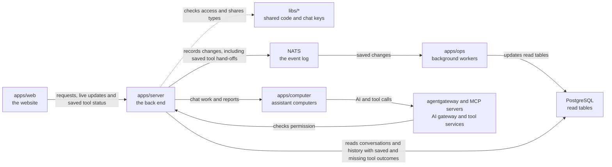

# apps/server

## What this is

The back end for OpenCrane sign-in, conversations and organisation settings.
It runs as a Node.js service. The website sends it requests to sign in, chat, upload
files and manage the organisation.
The server checks who is asking and what they may do, saves each change in the
[event log](../../GLOSSARY.md#event-log-event-store), and passes chat work to each
assistant's [computer](../../GLOSSARY.md#computer).
A second program here, the [models process](../../GLOSSARY.md#models-process), checks
AI calls against spending limits and tool rules.

Change history includes saved tool hand-offs and transport observations.
A hand-off without a saved outcome stays unknown, even when other evidence reports success. A response
does not prove a business change succeeded. Reading history never sends a tool call.

## Where it fits

This package is the back-end layer. [apps/web](../web/README.md) is the website;
[apps/computer](../computer/README.md) runs one computer for each personal or group
assistant. [apps/ops](../ops/README.md) runs background workers that apply saved
changes to permissions and database tables. The server reads those tables, but the
event log remains the permanent record of what happened.



[Zitadel](../../GLOSSARY.md#zitadel-sign-in-service) handles sign-in.
[OpenFGA](../../GLOSSARY.md#openfga-permissions-service) checks permissions.
The [AI gateway](../../GLOSSARY.md#agentgateway-ai-gateway) sends model and tool calls
only after the models process allows them.

## What it is responsible for

- Signs people in and keeps their browser session.
- Checks current membership and permissions before returning private information or saving a change.
- Handles chats, assistant work, live replies, stop requests and tool approvals.
- Checks uploads and saves clean files and authorised screenshots.
- Serves assistant desktops to people who may view them.
- Handles members, groups, ownership, model providers, tool servers and spending settings.
- Returns permitted change history, saved results and memory facts.
- Runs the separate models process that checks AI calls, records costs and starts the gateway.

## Folders

[src/main.ts](src/main.ts) starts the server; [src/models-main.ts](src/models-main.ts) starts the models process.
[src/server.ts](src/server.ts) builds the server. Tests live in `test/`, with shared helpers in [test/support/](test/support/).

| Folder | What it does |
| --- | --- |
| [assistants](src/assistants/README.md) | Sets up shared assistants and lists the ones a person may use. |
| [audit](src/audit/README.md) | Returns permitted organisation and conversation change history. |
| [auth](src/auth/README.md) | Handles browser sign-in, sign-out and session status. |
| [chat](src/chat/README.md) | Saves conversations and carries assistant work, replies, stops and approvals. |
| [computers](src/computers/README.md) | Provides desktop views, screenshots and control-preparation status. |
| [effects](src/effects/README.md) | Reviews call costs and resolves supported uncertain outcomes. |
| [egress](src/egress/README.md) | Saves rules for connections to outside destinations. |
| [files](src/files/README.md) | Checks, scans, stores and delivers conversation files. |
| [integrations](src/integrations/README.md) | Registers and reviews tool servers, manages tool access and serves spending settings. |
| [members](src/members/README.md) | Manages invitations, membership, groups, roles and ownership. |
| [memory](src/memory/README.md) | Reads, saves, corrects and forgets permitted remembered facts. |
| [models](src/models/README.md) | Manages access to AI models for people, groups and assistants. |
| [onboarding](src/onboarding/README.md) | Saves and resumes a member's private welcome survey. |
| [providers](src/providers/README.md) | Connects model providers and manages keys, checks and provider choices. |

## Processes it handles

1. **A person joins.** [Auth](src/auth/README.md) checks their sign-in.
   [Members](src/members/README.md) handles the first owner's claim or a later invitation.
2. **A person sends a message.** [Chat](src/chat/README.md) saves it and sends assistant
   work to the right computer. Replies return as live updates. People can also chat
   with each other without starting assistant work.
3. **An assistant makes a call.** The gateway asks the models process whether the
   person, assistant, tool and budget allow it. The process sets money aside before
   a call, then charges its real cost and releases unused money.
4. **An admin changes settings.** The server checks their rights and saves the change.
   Background workers apply it. A saved result lets the website check a lost reply
   without repeating the change.
5. **A person reviews their data.** The server checks current access before returning
   chat history, memory facts, files, desktop pictures or change history.

Requests to take control of a desktop, starting private tool instances and running
nightly memory upkeep remain switched off. Their folder guides explain what can be
saved and read today. [Chat](src/chat/README.md) also describes the remaining limits
on starting newly requested side conversations and closing chats through HTTP.

## How to run or test it

```sh
npm start -w apps/server
npm run models -w apps/server
nice -n 10 npm run typecheck -w apps/server
```

These commands need the dev stack's settings. The full system starts with
`infra/dev-stack/up.sh`, as described in the
[dev stack guide](../../infra/dev-stack/README.md).
[README.robot.md](README.robot.md) lists required settings and exact test commands.

## Where to read more

- [README.robot.md](README.robot.md): request contracts, settings, limits and test detail.
- [apps/web](../web/README.md): the website that sends browser requests.
- [apps/ops](../ops/README.md): workers that apply saved changes.
- [libs/models](../../libs/models/README.md): AI access, tool rules and spending decisions.
- [Why NATS holds the event log](../../docs/adr/0001-event-store-nats-jetstream.md).
- [Glossary](../../GLOSSARY.md): shared words used in these guides.
