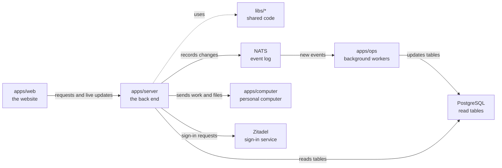

# apps/server

## What this is

The back end for OpenCrane sign-in, conversations and organisation settings. It is a Node service that accepts browser requests and sends live updates. A second process handles model access and spending.

## Where it fits

This is the back-end layer. `apps/web` sends it requests and live connections. It uses shared code in `libs/`, records changes in NATS (the event log), and reads PostgreSQL tables that `apps/ops` keeps current. It also sends work to `apps/computer`, the private computer for each person.



## What it is responsible for

- Signs people in and keeps their browser session.
- Checks permissions before returning private information or changing data.
- Records changes as events and reads the current state from PostgreSQL.
- Handles conversations, approvals, file uploads, computer access and organisation history.
- Runs a separate models process that checks budgets and sends allowed model requests through agentgateway.
- Provides the one-time command used to claim a new installation.

## Processes it handles

1. **A person signs in.** The server sends the browser to Zitadel and checks the returned identity. It keeps the session in an encrypted cookie.
2. **A person chats with an assistant.** The server sends the turn to that person's computer and streams reports back to the browser. The person can stop the turn.
3. **An admin adds a tool server.** The server checks the remote address, lists its tools and leaves them blocked until an admin reviews them.
4. **A model request arrives.** The models process checks the available budget and starts agentgateway for allowed requests.

## How to run or test it

```sh
npm start -w apps/server
npm run models -w apps/server
npm run typecheck -w apps/server
```

## Where to read more

- [README.robot.md](README.robot.md): settings, request details, limits and test commands.
- [apps/web](../web/README.md) sends browser requests to this service.
- [apps/ops](../ops/README.md) reads events and updates the tables this service reads.
- [Why NATS holds the event log](../../docs/adr/0001-event-store-nats-jetstream.md).
- [The shared words used in these guides](../../GLOSSARY.md).
