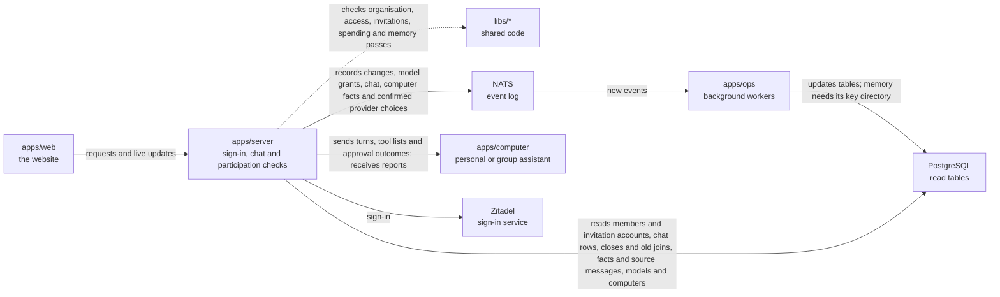

# apps/server

## What this is

The back end for OpenCrane sign-in, conversations and organisation settings. It is a Node service that accepts browser requests and sends live updates. A second process handles model access and spending.

## Where it fits

This is the back-end layer. `apps/web` sends it requests and live connections. It uses shared code in `libs/`, records changes in NATS (the event log), and reads PostgreSQL tables that `apps/ops` keeps current. It also sends work to `apps/computer`, the computer for each personal or group assistant.



## What it is responsible for

- Lets owners and admins save provider choices and pauses, count affected assistants
  and recover saved results. Conflicting requests cannot report an unsaved change
  as saved. Ordinary calls keep their existing setup.
- Serves personal facts after checking the gateway pass, saved grants,
  current permissions and the recorded turn mode.
- Signs people in and keeps their browser session.
- Uses the shared organisation check for session routes and WebSocket connections.
  Production refuses extra sign-in identities. Development can allow named identities
  from another organisation, but session routes still need a configured organisation.
- Checks permissions before returning private information or changing data.
- Lists and searches a person's own memory and permitted group or assistant notes.
  Returns fact detail and checks each source separately, hiding denied references.
  Checks chat access and the latest join before looking up one source message. Describes a member statement
  without naming its author. Reports destroyed or quarantined facts without text.
  These reads need the memory worker and its existing private key directory.
  It returns current facts only after the read table has caught up with their events.
- Accepts bound and email invitations after a recent sign-in with a verified email, while
  the inviter is still an owner or admin. Records whether a personal assistant was requested.
- Checks an invitation email and explains that the person is confirmed when they accept.
- Records and renews email invitations for owners and admins. Reads saved command results.
- Returns member headers to members and the email directory to current owners and admins.
  Keeps checking their access while a live member connection is open.
- Records changes as events and reads the current state from PostgreSQL.
- Handles conversations, approvals, file uploads, computer access and organisation history.
  Checks saved participation changes before returning private content.
  Checks closing events even while read tables are catching up.
  Gives late participants only files and screenshots saved since their latest join.
- Offers a personal assistant only reviewed, free tools that both the person and assistant can use.
- Returns spending records to current owners and admins. It reads the records first,
  then checks access, so a longer read does not use up the write access time limit.
  Resolving a hold also reads its history first and rechecks access before saving.
- Starts personal turns using the latest default paying group. It keeps a small
  summary and reads only new spending events after the first use.
- Records tool starts and finishes as events and returns them in the conversation feed.
- Tells a computer whether it supports approval messages and when a waiting
  approval has been decided or ended. A changed tool policy also ends a waiting approval.
  Reads each approval separately, so a slow read leaves other chats free to continue.
  Spaces out failed reads and tells the computer when it cannot accept another wait.
- Records streamed replies using a chat summary. After its first use, it reads only
  new events and checks one saved event. It handles repeats without saving them again.
- Starts, closes and replays turns using the shared computer summary. It reads new
  events first and keeps the conditional write at the position it checked.
  Both summaries drop older entries when their memory budget is reached. A
  summary that is too large is dropped on its own, leaving other chats warm.
- Lets two silo members exchange private messages without starting assistant work.
  Tells the browser when a new chat is waiting for its permissions, so it can keep the draft.
- Runs a separate models process. It keeps AI budgets, approves or refuses each AI request,
  and starts [agentgateway](../../GLOSSARY.md#agentgateway-ai-gateway), the AI gateway that
  every model request passes through.
- Lets admins connect a model provider, store its key safely and check that the key works.
- Lets owners hand over ownership and admins manage groups. The website has no page for this yet.
- Lets owners and admins read model grants and list same-silo people, groups or assistants
  that a grant could name. HTTP clients can give or revoke one grant and check its result.
  Admins can remove a departed person's grant. An empty revoke saves no change.
  Provider choices and configured uses say “Not available yet” until those records exist.
- Lets admins create a group assistant with selected tools and a fixed paying group.
- Keeps each member's group chat private while they share the assistant's computer.
- Provides the one-time command used to claim a new installation.

Private team turns receive earlier completed replies from the same member. The
computer starts a fresh Codex process for each private team turn. Disk isolation is
not yet proven on a live computer; private chat memory stays off until it is.

The reviewed tool list includes each tool's Allow mode. The computer and gateway
use it to refuse calls if the tool changes to Ask during the turn.

## Processes it handles

1. **A person signs in.** The server sends the browser to Zitadel and checks the returned identity. It keeps the session in an encrypted cookie. If the sign-in details are too large
   for a browser cookie, it shows a clear error.
2. **The first owner claims a new installation.** An operator runs the one-time command,
   which prints a token. The first person signs in and enters that token on the claim page.
   The server checks it and records them as the owner.
3. **An admin prepares an invitation.** The server checks the email input. The person
   is confirmed when they accept; the server does not look them up in Zitadel.
   An admin can save or renew an email invitation and recover its saved result.
   The server finds matching emails in its member table and checks their events.
   Acceptance finds account records in the member table and checks their events.
   It reads newer events too, so delayed background work cannot hide an active account.
   It records the signed-in account and keeps concurrent invitations from admitting it twice.
   If an admin renews the invitation during acceptance, the person must accept the
   renewed invitation. The old invitation cannot grant its earlier role.
4. **A person chats with an assistant.** The server sends the turn to that person's
   computer and passes the assistant's progress back to the browser as it arrives. The
  person can stop the turn. A personal turn may include a short list of reviewed
  tools. The gateway checks permission again each time one is used. The chat watcher
  leaves finished chats alone while another reply is pending. It sends a waiting turn
  again until the computer accepts it, and
   sends it again after reconnecting. It retries short service outages so pending
   messages can still reach the computer. Personal memory-free turns include only tools
   that have been reviewed, cost nothing and are available to both the person and assistant.
   Ask tools also need a review describing the action the person will approve.
   Private team turns stay restricted and do not receive tools.
   Open chat pages repeat permission checks when silo or team membership changes.
   Removing someone from a team closes their private chat with that team's assistant
   within two seconds. If OpenFGA takes too long to apply another change, the page
   reconnects after five seconds and resumes receiving messages. The server checks
   each open chat's feed position every 100 ms and reads chat content only after it
   changes. Computer state follows lifecycle events and stays in recovery until a
   new ready event appears. The worker saves this state in the computer read table,
   so each chat update reads a small record. Sleeping and waking computers show starting.
5. **A group uses a shared assistant.** An admin chooses its tools and paying group.
   Each member gets a private chat and a private turn by default. Private turns have
   no local tools. A member can choose a memory-free turn to use the group's shared
   computer disk and browser. That turn has no earlier private context. A member who
   loses spending access can still read and stop their work.
6. **Two people chat.** The server checks who can read their direct conversation,
   then returns messages and live updates. Busy chats and slow reads keep working.
   A removed participant loses access even before the permissions service catches up.
   A person who joins later sees messages from their latest join onwards.
   Lists reuse permission facts within the request and check for changes after each
   answer from the permissions service.
7. **An admin adds a tool server.** The server checks the remote address, lists its
   tools and leaves them blocked until an admin reviews them.
8. **An assistant asks an AI model for help.** The request goes through agentgateway, the
   AI gateway. The gateway asks the models process whether the budget allows it, and only
   then sends it on to the model provider.
9. **A person watches the assistant's desktop.** The server checks their conversation
   access and desktop grant. A confirmed member removal or conversation permission denial
   ends the view straight away, even if another access read is slow.
   When background work is behind, later checks reuse the chat records already checked
   for a close. New records still receive a check before access continues.

The server checks whether each computer can wait for approval before offering Ask
tools. Older computers receive Allow tools only, so either update order is safe.

## How to run or test it

```sh
npm start -w apps/server
npm run models -w apps/server
npm run typecheck -w apps/server
```

These need the dev stack's settings. To run the whole system, use
infra/dev-stack/up.sh (see [infra/dev-stack](../../infra/dev-stack/README.md)).

## Where to read more

- [README.robot.md](README.robot.md): settings, request details, limits and test commands.
- [apps/web](../web/README.md) sends browser requests to this service.
- [apps/ops](../ops/README.md) reads events and updates the tables this service reads.
- [Why NATS holds the event log](../../docs/adr/0001-event-store-nats-jetstream.md).
- [The shared words used in these guides](../../GLOSSARY.md).
