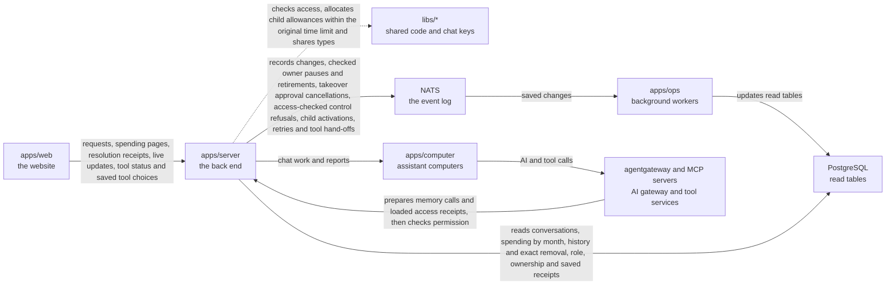

# apps/server

## What this is

The back end for OpenCrane sign-in, conversations and organisation settings.
It runs as a Node.js service. The website sends it requests to sign in, chat, upload
files and manage the organisation.
The server checks who is asking and what they may do, saves each change in the
[event log](../../GLOSSARY.md#event-log-event-store), and passes chat work to each
assistant's [computer](../../GLOSSARY.md#computer).
A second program here, the [models process](../../GLOSSARY.md#models-process), checks
AI calls against spending limits and tool rules.

Change history includes saved tool hand-offs and transport observations.
Control refusals recheck access before saving and appear in the requester’s
conversation history. Each control command can save only one outcome.
A hand-off without a saved outcome stays unknown, even when other evidence reports success. A response
does not prove a business change succeeded. Reading history never sends a tool call.

Refused control attempts in enabled test setups save a small audit record. They do not
change the current controller or interrupt work. Production control stays disabled.

Owners and admins can read safe admission, removal, role and ownership change details.
The server checks receipts for the exact saved change before showing its progress, then checks current access.
It still checks access when loading fails, so errors do not reveal protected records.
Admission history keeps each join separate, including when a person returns.
Removal progress covers permissions and the member list. It does not report departure cleanup.

Approval decisions check ownership and current write access before saving a cancellation.
Approval polling saves cancellation when a saved takeover covers an unused approval.
It notices computer changes even when the chat and approval have not changed.
The computer receives its local work gate before an approval reply. Failed saves or
unavailable gate delivery keep the wait pending. Reconnection reads the same result.
HTTP decisions check approval ownership and current write access before saving a
cancellation, so a foreign approval stays unchanged.

Recall, Correct and Forget load their history before the gateway signs the short pass.
The server keeps that data briefly for one call and checks current access before use.
Calls and turn renewal prepare access receipts for every memory scope already loaded.
Correct and Forget validate their targets but remain disabled.

## Where it fits

This package is the back-end layer. [apps/web](../web/README.md) is the website;
[apps/computer](../computer/README.md) runs one computer for each personal or group
assistant. [apps/ops](../ops/README.md) runs background workers that apply saved
changes to permissions and database tables. The server reads those tables, but the
event log remains the permanent record of what happened.



[Zitadel](../../GLOSSARY.md#zitadel-sign-in-service) handles sign-in.
[OpenFGA](../../GLOSSARY.md#openfga-permissions-service) checks permissions.
The [AI gateway](../../GLOSSARY.md#agentgateway-ai-gateway) sends model and tool calls
only after the models process allows them.

Agent correction and forget requests need a signed proof of a loaded, current personal fact.
A correction names every other loaded fact as a dependency, with no revision of its own target.
Both operations remain disabled after these checks and create no fact, key or command file.
Discovery still lists recall alone.
Memory tests finish their setup reads before signing short-lived requests. Separate tests
delay history and permission reads inside the server and record only elapsed times.
These check that slow preparation leaves the original two-second pass available
for current permissions and memory revisions.

## What it is responsible for

- Signs people in and keeps their browser session.
- Checks current membership and permissions before returning private information or saving a change.
- Handles chats, assistant work, live replies, stop requests and tool approvals.
- Checks uploads and saves clean files and authorised screenshots.
- Serves assistant desktops to people who may view them.
- Handles members, groups, ownership, model providers, tool servers and spending settings.
- Returns permitted change history, saved results and memory facts.
- Runs the separate models process that checks AI calls, records costs and starts the gateway.

An internal operation checks a child's saved activation and asks the budget actor
to record its reviewed spending allowance. It refuses if that allowance or the
first call cannot fit. The first turn remains held; allocation starts no work.
Each save attempt checks access again within the original time limit, including
retries after a connection failure.

Owners and admins can read separate saved facts for integration registration,
account requirements, grants and publication. A saved grant does not prove an
assistant can call. These reads check current admin rights after loading the facts.

## Folders

[src/main.ts](src/main.ts) starts the server; [src/models-main.ts](src/models-main.ts) starts the models process.
[src/server.ts](src/server.ts) builds the server. Tests live in `test/`, with shared helpers in [test/support/](test/support/).

| Folder | What it does |
| --- | --- |
| [assistants](src/assistants/README.md) | Sets up shared assistants and lists the ones a person may use. |
| [audit](src/audit/README.md) | Returns permitted organisation and conversation change history. |
| [auth](src/auth/README.md) | Handles browser sign-in, sign-out and session status. |
| [chat](src/chat/README.md) | Saves conversations and carries assistant work, replies, stops and approvals. |
| [computers](src/computers/README.md) | Provides desktop views, screenshots and control-preparation status. |
| [effects](src/effects/README.md) | Reviews call costs and resolves supported uncertain outcomes. |
| [egress](src/egress/README.md) | Saves rules for connections to outside destinations. |
| [files](src/files/README.md) | Checks, scans, stores and delivers conversation files. |
| [integrations](src/integrations/README.md) | Registers and reviews tool servers, manages tool access and serves spending settings. |
| [members](src/members/README.md) | Manages invitations, membership, groups, roles and ownership. |
| [memory](src/memory/README.md) | Reads, saves, corrects and forgets permitted remembered facts. |
| [models](src/models/README.md) | Manages access to AI models for people, groups and assistants. |
| [onboarding](src/onboarding/README.md) | Saves and resumes a member's private welcome survey. |
| [providers](src/providers/README.md) | Connects model providers and manages keys, checks and provider choices. |

## Processes it handles

An internal operation lets a routine's current owner save a pause when no run is active.
It checks saved ownership and permissions, and recovers the original change after a lost
reply. A separate internal operation lets the owner retire a routine with no active run.
Retirement clears its next scheduled time and keeps permitted history. The original
owner can recover a lost retirement reply while they still have metadata access.
The server checks that access before reporting a saved change or revision conflict.
Neither operation has a website route. Routine execution remains disabled.

1. **A person joins.** [Auth](src/auth/README.md) checks their sign-in.
   [Members](src/members/README.md) handles the first owner's claim or a later invitation.
2. **A person sends a message.** [Chat](src/chat/README.md) saves it and sends assistant
   work to the right computer. Replies return as live updates. People can also chat
   with each other without starting assistant work.
3. **An assistant makes a call.** The gateway asks the models process whether the
   person, assistant, tool and budget allow it. The process sets money aside before
   a call, then charges its real cost and releases unused money.
4. **An admin changes settings.** The server checks their rights and saves the change.
   Background workers apply it. A saved result lets the website check a lost reply
   without repeating the change.
5. **A person reviews their data.** The server checks current access before returning
   chat history, memory facts, files, desktop pictures or change history.

Requests to take control of a desktop, starting private tool instances and running
nightly memory upkeep remain switched off. Their folder guides explain what can be
saved and read today. [Chat](src/chat/README.md) also describes the remaining limits
on starting newly requested side conversations and closing chats through HTTP.

An admin saves one remote tool grant. After a lost reply, they check the original reference.
The check never resends the change. A draft server's grants cannot publish its tools.

A lost spending-limit reply can be checked by its original command id. Owners and
admins see the saved amount and stop status. The original caller can still see a
minimal confirmation after losing that role, while they remain a member.
The check saves nothing and makes no AI call.

Owners and admins can also recover an original resolution receipt after a lost reply.
It names the saved change, date, resolver, outcome and recorded amount. The receipt
stays separate from current spending and retained holds. It does not claim that settlement
or an outside action succeeded. Losing the owner or admin role removes access to it.
A missing result never means that repeating the resolution is safe.

A member can review a child chat from their own group message, then save its first input.
The requester can retry a saved start failure, up to three attempts. A background worker
completes missing child creation and first input after a restart or retry.
It checks the saved request and current permissions each time. These children stay queued;
they cannot start assistant work yet. Retry replies check current access before reporting
that the parent chat is closed.

Owners and admins can read whether a saved publication is Applying, Ready, Disabled
or Unknown. Ready requires matching saved gateway and server receipts. Checking a
change never sends configuration or calls the gateway. The original command id also
recovers hosted registration results without confusing them with publication.

When a saved event closes a chat, the server refuses new turn passes and rebuilt
context. It still acknowledges delayed reports, so another person's chat can keep
using the same computer connection. An admitted turn stays recorded until cleanup
can confirm it ended. Public closing and freezing displayed output are not built yet.

A participant can read why a chat turn stopped for spending. Only the person who
asked for that turn sees its limit and call amounts. The reply distinguishes held,
charged and released calls, and calls that might have been sent.
Reading the saved result starts no work.
Failed reads still check access before reporting that the result is unavailable.

The models process shares a PostgreSQL lock with the preparation worker while
replacing the gateway file. It delivers the latest saved configuration and checks its
reply while it holds the budget worker lease. Startup settings supply no tool routes.
Reviewed tool calls stay unavailable until generation checks are connected.

After saved control intent, the server sends a signed request to stop computer work.
An idle computer receives it too. Slow chat reads, file uploads and report replay do
not delay this request. If a turn finishes while the request is being signed, the
server checks it again before telling the computer to resume reports.
The server checks the computer's immediate reply and keeps it only for that connection.
It can then ask the root supervisor to stop executors while reports still wait to resume.
This does not grant desktop control or save proof that all computer work has stopped.

A child chat can link back to its source only when the reader can still read that
parent message. Otherwise it returns a restricted result without parent details.

A shared child chat's creator can invite someone after acknowledging that all shared
history will be visible. The invite gives access only to that child. The creator can
remove others, and others can leave. Saved removals stop reads and live connections
before the permissions service catches up.

An owner or admin can register a hosted image and read the result using the original
command id. The image stays Checking until a valid image check result is recorded.
Registration does not fetch an image, discover tools or start a process.

Internal child-chat commands review a person’s own group message, save their chosen
people and assistant, and create the named child. A separate command waits for its
permissions to apply, then copies only the reviewed message under the child’s own key.
Repeating a request returns the same saved records. The reviewed start route and recovery
worker use these commands. They do not start assistant work.
Another internal command records that the saved first input and current access were checked.
The child stays held until spending allocation and first-start recovery are connected.

A person continues a shared child chat. The server gives the assistant completed
exchanges from that child, including replies to other people. It leaves out parent
history, private sessions, files and unfinished text. A first turn uses only the
reviewed source message already saved in the child.

A queued message cannot start after an applicable spending stop, even if the limit
has since risen or the default payer has changed. Admission uses the payer and
position saved when the message was queued. It checks again after saving the computer
start and before issuing a turn pass.
These checks do not change access to read the chat or view the desktop.

The models process checks each configured tool server at startup and before its saved
list expires. Calls pause when a check fails or finds a change. A changed server stays
paused until a new review and publication receive a matching gateway receipt while checks
are fresh. Publication preparation alone never releases the hold. The worker sends the
latest current configuration; a Ready read is not built yet.

The person who set up nightly memory upkeep can read its blocked and missed history.
These reads contain dates and fact references, with no saved memory text or new work.
The same status shows whether the scope is clean or has facts waiting for a future
night. It shows the next 02:00 UTC boundary for waiting facts.

1. **A person signs in.** The server sends the browser to Zitadel and checks the returned identity. It keeps the session in an encrypted cookie. If the sign-in details are too large
   for a browser cookie, it shows a clear error.
2. **The first owner claims a new installation.** An operator runs the one-time command,
   which prints a token. The first person signs in and enters that token on the claim page.
   The server checks it and records them as the owner.
3. **An admin prepares an invitation.** The server checks the email input. The person
   is confirmed when they accept; the server does not look them up in Zitadel.
   An admin can save or renew an email invitation and recover their own saved result.
   Another admin cannot read that command receipt. Refusal records keep only a
   hash of the command id, a fixed-length value used to find a saved result. Organisation history checks
   current access and tells browsers and HTTP caches not to save its replies.
   The server finds matching emails in its member table and checks their events.
   Acceptance finds account records in the member table and checks their events.
   It reads newer events too, so delayed background work cannot hide an active account.
   It records the signed-in account and keeps concurrent invitations from admitting it twice.
   If an admin renews the invitation during acceptance, the person must accept the
   renewed invitation. The old invitation cannot grant its earlier role.
4. **A person chats with an assistant.** The server sends the turn to that person's
   computer and passes the assistant's progress back to the browser as it arrives. The
  person can stop the turn. A personal turn may include a short list of reviewed
  tools. The gateway checks permission again each time one is used. The chat watcher
  leaves finished chats alone while another reply is pending. It sends a waiting turn
  again until the computer accepts it, and
   sends it again after reconnecting. It retries short service outages so pending
   messages can still reach the computer. Personal memory-free turns include only tools
   that have been reviewed, cost nothing and are available to both the person and assistant.
   Ask tools also need a review describing the action the person will approve.
   Private team turns stay restricted and do not receive tools.
   The watcher reuses computer history while it is unchanged. It checks for changes
   again before sending a turn or file, so new control intent holds waiting work.
   While a computer has not acknowledged a file, the watcher still sends spending
   Stops and checks approvals. A slow chat history read delays only that chat’s Stop
   check. Shutdown waits for unfinished checks. It sends each file once per connection and waits for
   the receipt before sending that chat’s turn.
   Open chat pages repeat permission checks when silo or team membership changes.
   Removing someone from a team closes their private chat with that team's assistant
   within two seconds. If OpenFGA takes too long to apply another change, the page
   reconnects after five seconds and resumes receiving messages. The server checks
   each open chat's feed position every 100 ms and reads chat content only after it
   changes. Computer state follows lifecycle events and stays in recovery until a
   new ready event appears. The worker saves this state in the computer read table,
   so each chat update reads a small record. Sleeping and waking computers show starting.
5. **A group uses a shared assistant.** An admin chooses its tools and paying group.
   Each member gets a private chat and a private turn by default. Private turns have
   no local tools. A member can choose a memory-free turn to use the group's shared
   computer disk and browser. That turn has no earlier private context. A member who
   loses spending access can still read and stop their work.
6. **Two people chat.** The server checks who can read their direct conversation,
   then returns messages and live updates. Busy chats and slow reads keep working.
   A removed participant loses access even before the permissions service catches up.
   A person who joins later sees messages from their latest join onwards.
   Group creators can edit the people list. Other participants can leave.
   Lists reuse permission facts within the request and check for changes after each
   answer from the permissions service.
7. **An admin adds a tool server.** The server checks the remote address, lists its
   tools and leaves them blocked until an admin reviews them. A lost reply to a tool-mode
   change can be checked by its original reference, even after later changes. Remote discovery uses
   the public address checks shared by `libs/models`.
   Published calls require permission for both the person and the assistant. Removing
   either grant stops new calls and calls waiting to be sent, even while IAM, the
   permissions service, is still applying the change. Giving the grant again allows
   calls once the saved content and permission updates are current.
   A member can read their own private instance and request its stop through HTTP.
   Reading status never starts it or releases credentials. A missing result stays unknown.
8. **An assistant asks an AI model for help.** The request goes through agentgateway, the
   AI gateway. The gateway asks the models process whether the budget allows it, and only
   then sends it on to the model provider.
9. **A person watches the assistant's desktop.** The server holds one place while the
   connection opens and until the session stops. It checks their conversation
   access and desktop grant. A confirmed member removal or conversation permission denial
   ends the view straight away, even if another access read is slow. A later invitation
   on a removed member’s event stream does not restore desktop or file access.
10. **An admin opens groups or ownership.** The server loads the records, then checks
    current access before replying. Slow histories can finish. A removal during
    loading denies the reply; unrelated chat activity does not interrupt it.

11. **A member continues the welcome survey.** The server checks their current
    membership and saves one step. Reloading returns confirmed answers. Editing
    an earlier answer clears later current steps. Restarting keeps encrypted history.
12. **A person opens their conversation list.** The server returns a small page ordered
    by activity they can see. Recent and Archived follow the person's saved choice.
    Search checks only visible titles. Continuations refer only to visible chats.
    Lists that reach the fixed scan limit return an incomplete reply so hidden chats
    cannot create extra pages. Ordinary late joiners see their join time, including in
    personal sessions. Group lists also show current participants without earlier
    creation details. The website loads the first page; paging controls are planned.
13. **A person archives a chat or marks messages read.** The server saves only that
    person's choice. Other devices see the same choice after the read tables catch up.
    A lost reply can be checked with the original request id. Leaving and joining
    again starts fresh choices. These actions start no assistant work or spending.

Owners and admins can read small pages of recorded call spending. The reply keeps
money held separate from money charged, with the original dates and safe references.
They can select the UTC month when money was first held for each call. Late charges
stay in that month. Older open holds still reduce current spending capacity.
The server checks current finance access after loading. A read starts no work.

The server renews computer passes through authenticated Kubernetes access as root.
It sends the signing public key with the pass so the computer can check its signature
and save its identity.
Desktop and Codex processes cannot replace these passes through HTTP.

The server checks whether each computer can wait for approval before offering Ask
tools. Older computers receive Allow tools only, so either update order is safe.

The server checks browser connections with a heartbeat every 15 seconds by default.
Tests can shorten the interval. A missed reply still closes the connection on the
next heartbeat.
Sending too many messages in one second closes the connection with a retryable response.
The browser can reconnect and keep the chat. Losing access still clears its content.

## How to run or test it

```sh
npm start -w apps/server
npm run models -w apps/server
nice -n 10 npm run typecheck -w apps/server
```

These commands need the dev stack's settings. The full system starts with
`infra/dev-stack/up.sh`, as described in the
[dev stack guide](../../infra/dev-stack/README.md).
[README.robot.md](README.robot.md) lists required settings and exact test commands.

Child-chat retry tests wait until NATS stores a repeated event as a new message.
Their private test streams use a short duplicate window set before any messages
are saved. They then check that repeating the child command keeps its saved result.

## Where to read more

- [README.robot.md](README.robot.md): request contracts, settings, limits and test detail.
- [apps/web](../web/README.md): the website that sends browser requests.
- [apps/ops](../ops/README.md): workers that apply saved changes.
- [libs/models](../../libs/models/README.md): AI access, tool rules and spending decisions.
- [Why NATS holds the event log](../../docs/adr/0001-event-store-nats-jetstream.md).
- [Glossary](../../GLOSSARY.md): shared words used in these guides.
