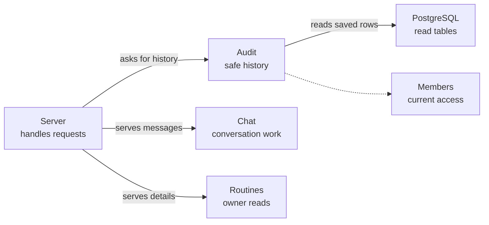

# Audit

## What this is

This folder lets people see why OpenCrane allowed, refused or charged for work. It serves organisation change history to owners and admins, and a smaller history for someone reading a conversation.

## Where it fits

The server reads saved history from PostgreSQL and checks current membership
before sending it. Chat and routine details have their own access checks.

## What it is responsible for

- Returns filtered pages of saved decisions and changes.
- Returns details of one organisation history entry to a current owner or admin.
- Checks parent and child chat rights separately before showing publication references.
- Checks those rights for every publication record returned with another history entry.
- Checks a child task's own chat rights before showing its outcome, identity or link.
- Shows saved nightly memory choices with a random reference and no fact text.
  Only the person who owns the personal memory gets its scope link; opening it
  checks access again.
- Groups saved routine due, skipped, missed, admission, Stop and send records by
  occurrence. A result is clear only after the saved finish proves settlement.
  The history shows a safe reference without instructions or connection details.
- Checks the exact read-table and permission receipts for admissions, removals, role and ownership changes.
- Limits conversation history to the reader's own requests in a conversation they may read.
- Loads the history before checking current access, so a slow read cannot return private information to someone removed during loading.
- Checks access after failed loads too, so errors do not reveal protected records.
- Tells browsers and shared caches not to store the replies.

These requests only read history. They save no changes and start no assistant work. Missing setup or an unavailable permission check returns an unavailable result rather than history.
The parent link opens only that chat. It gives no access to the child or its files.
Task history shows execution separately from spending. Spending stays unavailable
without a saved join. Restricted task entries use one neutral placeholder.
Each admission keeps its own receipts, even when the same person returns later.
Invitation progress is not included. Removal receipts do not report whether departure cleanup has finished.

## Processes it handles

An owner opens change history. The server loads a page of saved rows, checks
current access and sends safe fields. Opening a row loads bounded detail and
checks access again.

## How to run or test it

Run `nice -n 10 npx vitest run apps/server/test/audit-child-publication.test.ts`
for authorised history and private data checks.

## Where to read more

- [The read contract](README.robot.md) has filters, limits and replay rules.
- [The server](../../README.md) registers the requests.
- [Read tables](../../../../libs/projections/README.md) build the saved history.
