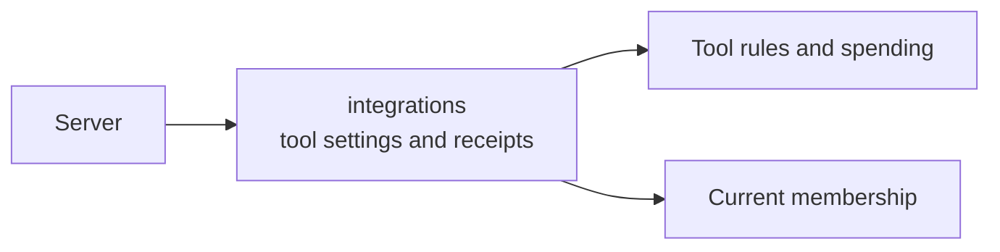

# Integrations

This folder lets admins register tools an assistant can use and review their access. It keeps finding changes in remote tools, reports whether reviewed tools are ready to use, and serves organisation spending settings.

## What it is responsible for

- Registers remote tool servers and hosted images, and records checked tool definitions.
- Requires an admin to review exact definitions, declared free use and approval details before enabling tools.
- Requests publication, meaning delivery of reviewed tool settings to the [AI gateway](../../../../GLOSSARY.md#agentgateway-ai-gateway), the program that forwards AI and tool calls, and reports its saved status.
- Gives or revokes tool access for people, groups and assistants, with explanations of saved rights.
- Reads personal tool-instance status, records stop requests and accepts reports from a registered worker.
- Serves model prices, spending limits and saved spending-change results.
- Keeps remote checks fresh and supplies the models process with the information needed to refuse changed tools.

**Finding and reviewing tools.** A [tool server](../../../../GLOSSARY.md#mcp-server-tool-server) makes outside actions available to the assistant. Remote discovery checks its public HTTPS address using shared models code. It records exact definitions and when the check expires. It also records each tool's declared zero cost and approval details, including any need for recent sign-in. Missing declarations keep tools listed but blocked. Invalid declarations exclude them from the discovered list. Admins must review both definitions and free use even for read-only tools. Reviews refuse old definitions or settings from another connection. Descriptions are untrusted text, never instructions to the server. Successful discovery without credentials saves a stable connection reference; it creates no personal or company account.

The models process checks remote servers at startup and before their lists expire, including servers registered after startup. A restart begins with calls held. Failed checks, missing checks, changed definitions or a changed promise to check tool revisions pause calls. A list of registered servers that takes more than one second to read also pauses calls. Healthy servers with short-lived lists are checked before expiry. Changed servers stay paused until fresh checks, a new review and publication have matching gateway confirmation.

**Publishing and calling.** Publication requests alone enable nothing. Owners and admins can read Applying, Ready, Disabled or Unknown. Ready needs matching saved gateway and server confirmations. Checking an original change id reads status without sending settings, probing the gateway or repeating a write. Hosted registration recovery stays separate from publication recovery. Granting access to a draft server cannot publish its tools.

The models process replaces the gateway file under a PostgreSQL lock shared with the preparation worker, while it holds the spending-worker lock. It sends the latest saved configuration and checks the running gateway's reply. Startup settings supply no tool routes. After a restart, saved configuration alone cannot enable calls: each final check also needs the running gateway's confirmed configuration. Preparing publication alone never allows a paused call.

Each configured call is checked again immediately before sending. The tool server must compare the approved tool list and running instance before execution. Published remote calls use their saved destination through the shared checked HTTPS connection. The remote server must promise to refuse calls against a changed tool list. [Memory](../memory/README.md) discovery, recall and remember use these same checks. A reviewed tool's Allow mode also travels with a chat turn, so changing it to Ask prevents an old automatic call.

**Saved tool choices.** An admin can recover their own saved mode by its original
reference. Later changes keep the original receipt intact. Reading it checks current
access and reports current availability separately, without repeating the change.

**Saved facts.** Owners and admins can read registration, account requirements,
saved grants and publication separately. No account required does not mean a
connection was tested. Personal and company account verification remains unavailable.
The reply does not claim permission for an assistant without a selected person and assistant.

**Access.** Owners and admins can read saved grant sources and browse suitable people, groups and assistants in small pages. A grant is a saved permission; its result reports database and permission progress separately. A lost reply can be checked by the original reference without repeating the change. Membership status is shown separately from saved grants. Departed people retain grant history but cannot use tools. Grant lists do not promise that a tool is ready.

Published calls require permission for both the person and the assistant. Removing either grant stops new calls and calls waiting to be sent, even while the permissions service is still applying the change. Giving the grant again allows calls once the saved content and permission updates are current.

Members can read explanations for their own accessible servers; owners and admins can read others. Explanations show why the person and assistant have access. Guessed private tools and servers get the same refusal. Missing grants return permission reasons only. Missing account support and unavailable checks have distinct reasons. These reads approve or start no calls.

**Hosted images and instances.** An admin can register a hosted image and recover the result by its original request id. It stays Checking until a valid image-check result is saved. All four image checks must pass before admission. Registration does not fetch an image, discover tools or start a process; admission grants no tool access. Startup credential requirements are checked before a connection is offered. Compatible declarations remain reviewable, but startup processes cannot run yet. Existing memory calls keep their own access checks.

Members can read their private instance and request its stop. Owners and admins can stop another member's instance and recover only their own stop confirmations. Reads never start an instance or release credentials; missing results stay unknown. Worker reports name one exact run. Only a fixed-length digest of the worker pass is kept, and it is removed at expiry. Expiry or replacement ends observation retries. Instance startup and wake remain unavailable.

**Spending settings.** The organisation models requests live here alongside tool settings. Owners and admins see saved budget-stop reasons and UTC resets. Every amount is an integer number of euro cents. The server sends changes to the models process and checks selected groups and shared assistants before saving. Personal assistants cannot receive a new cap. The installation's saved payer needs no group record. An unavailable choice asks the admin to correct it; lost admin rights still clear the page.

A zero limit, or a limit lowered to money already spent or set aside, stops affected model reservations as soon as the change is saved. A reservation is money held before a call; later reports charge the real cost or release it. Applying stops to every running computer and tool call still needs further work. [Chat](../chat/README.md) explains the saved spending stops it already delivers. Raising a limit permits new work but cannot reopen a stopped turn.

A lost spending-limit reply can be checked by its original request id. Current owners and admins see the saved amount and stop status. The original caller can still receive a minimal saved confirmation after losing that role while remaining a member. These checks save nothing and make no AI call. [Effects](../effects/README.md) loads call spending history before checking current admin access and handles supported resolutions of uncertain calls.

## Main files

| File | What it does |
| --- | --- |
| [routes.ts](routes.ts), [facts.ts](facts.ts), [registration.ts](registration.ts) | Serve registration, tool policy, publication, image checks and spending settings. |
| [remote.ts](remote.ts), [inventory.ts](inventory.ts), [install-worker.ts](install-worker.ts) | Check remote addresses and collect exact tool definitions. |
| [remote-catalogue-watch.ts](remote-catalogue-watch.ts) | Keeps the models process's remote checks current. |
| [access-reads.ts](access-reads.ts), [access-changes.ts](access-changes.ts) | List tool grants and suitable recipients, and save access changes. |
| [access-explanation.ts](access-explanation.ts), [explanation-routes.ts](explanation-routes.ts) | Explain saved tool rights without starting calls. |
| [instance-routes.ts](instance-routes.ts), [instance-worker.ts](instance-worker.ts), [startup-credentials.ts](startup-credentials.ts) | Check instance requests, worker reports and hosted startup requirements. |

## How it connects

The [server](../../README.md) registers these requests. [Models](../models/README.md) registers the tool-grant routes; [members](../members/README.md) supplies access reviews. The separate [models process](../models-main.ts) runs remote checks, gateway delivery and final decisions using the [models library](../../../../libs/models/README.md). [Background workers](../../../ops/README.md) apply saved changes to read tables and permissions.

