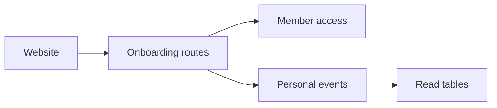

# Onboarding

## What this is

This folder saves a member's welcome survey and persona revisions. Reloading
restores both. Private answers and persona text are encrypted. A member can
approve one saved version for later use. Saving does not start an assistant or
spend money.

## Where it fits

The website sends survey and persona requests to the server. This folder checks
membership and saves each change in the member's personal event history.

## What it is responsible for

- Reads confirmed progress from the member's saved history.
- Saves each of the four steps only after the preceding step is confirmed.
- Clears later current answers when an earlier answer changes.
- Restarts the survey without deleting its encrypted history.
- Checks membership of groups selected in the survey.
- Returns the original saved confirmation when a reply is lost.
- Builds the same first persona from the same saved answers and keeps every edited version.
- Lists revision dates and opens one version for its member after an access check.
- Approves the exact current version and shows its saved time and original receipt.

Reads check current membership after loading, before opening private answers.
Opening a persona revision loads that version before checking membership. Writes
finish history loading before the short access check. Each accepted request saves
one record. Changed retries and competing edits are refused; an uncertain save
stays unknown until its original result can be read. These requests use the
member's personal encryption keys rather than conversation keys.
Approval keeps its chosen version after a later edit or survey restart. It does
not change assistant settings or grants.

## Main files

| File | What it does |
| --- | --- |
| [routes.ts](routes.ts) | Serves progress, saves, revision reads and original change results. |
| [commands.ts](commands.ts) | Checks step order, revision versions and repeated requests before saving. |
| [history.ts](history.ts) | Reads saved history and opens authorised encrypted answers. |
| [persona.ts](persona.ts) | Builds the first persona from saved survey answers. |

## How it connects

The [server](../../README.md) registers these requests for the [website](../../../web/README.md). [Members](../members/README.md) checks who is asking; [chat access helpers](../chat/README.md) supply membership checks without starting a chat. Shared [event rules](../../../../libs/events/README.md) define the saved answers. The personal key directory must already be prepared by background workers.
