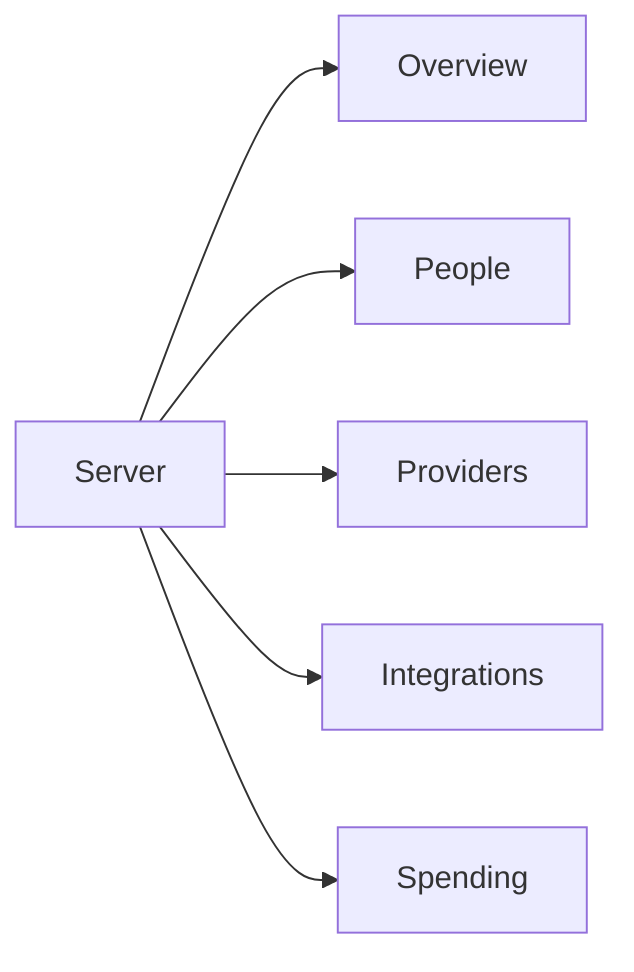

# Organisation overview

## What this is

This folder builds the short organisation overview for owners and admins. It brings
safe saved facts together so people can see what needs attention. A missing source
stays visible as unavailable.

## Where it fits

The server handles the request. The overview reads saved results from the same
read tables used by people, providers, integrations and spending.

## What it is responsible for

- Reads small pages of saved organisation facts.
- Orders rows by urgency and recorded event time.
- Checks current owner or admin access before sending rows.
- Shows gaps when a source is late or unavailable.

## Processes it handles

An owner or admin opens the overview. The server loads bounded rows, checks access
and sends safe links to the owning pages. The read starts no work.

## How to run or test it

Run `nice -n 10 npx vitest run apps/server/test/org-overview.test.ts` for row rules.
The [server guide](../../README.md) explains how to run the service.

## Where to read more

- [README.robot.md](README.robot.md) records the request contract and limits.
- [Spending](../models/README.md) owns the call records shown here.
