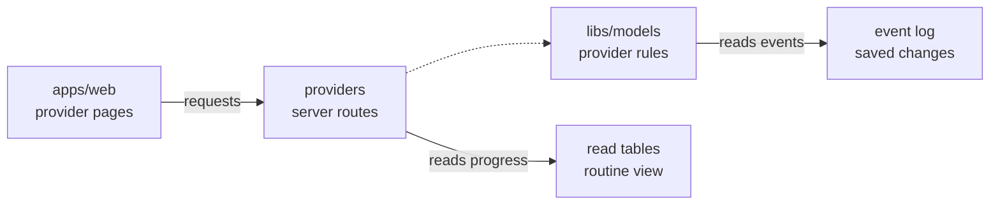

# Providers

This folder lets owners and admins connect OpenCrane to AI model providers. It handles provider settings, safely saving a key, checking the connection and choosing which provider an assistant uses.

## What it is responsible for

- Creates providers and records their offered models.
- Stores keys in the secret store and saves only references in the event log.
- Offers a price estimate for a connection test and requests the chosen checks.
- Reports connection and model-test results without returning keys.
- Saves provider choices, counts affected assistants and returns original saved results.
- Shows saved assistant bindings, safe replacement choices and unresolved routines
  before a provider can retire. A proposed choice changes nothing.
- Pauses new model turns before a provider change and records when managed provider calls are switched on.

A turn is one message and the assistant's reply. New managed turns use the assistant's chosen provider or the installation default. Renewing, repeating or closing a saved turn keeps its original model and provider. Running turns keep their original path during a pause. Provider lists also report that the model-access requests are available. Starting or cancelling the pause saves a change.

Provider requests report when saved membership or ownership is still being applied. The caller can wait briefly and repeat the same command id after that reply.

Switch-on requires a default provider and waits for earlier calls to finish charging or release their unused money. A lost reply can be checked by its original request id. Repeating switch-on refuses if later evidence has reopened a hold, even though the original switch-on stays saved. Changes during the retry's reads also refuse it. [Effects](../effects/README.md) explains how uncertain calls are resolved. Conflicting requests cannot return an unsaved provider choice as saved.

The separate models process reads the saved switch-on choice at startup and on later checks. After switch-on, it takes the provider key selected for each checked call. A leftover fallback-key setting stops startup; an older running process exits and needs restarting. Gateway configuration reloads keep the same provider mode. Both server processes use the same conversation-key protection in a packaged installation.

Dependency requests check for saved routines through one indexed database position.
They require the routine table to have caught up with the event log. Older and retired
routines still mean that complete dependency information is unsupported. A failed read
cannot report an empty result, and current permissions are checked before returning it.
The retirement preview also shows safe routine names and saved positions. It cannot
confirm retirement because routine model bindings and the retirement command are not built.

## Main files

| File | What it does |
| --- | --- |
| [routes.ts](routes.ts) | Handles provider lists, keys, verification, model choices, pauses and switch-on. |
| [README.robot.md](README.robot.md) | Gives the preview route contract and safety limits. |

## How it connects

The [server](../../README.md) registers these requests for the [website](../../../web/README.md). [Models](../models/README.md) controls who may use each model. The [models library](../../../../libs/models/README.md) owns provider rules and saved changes; [chat](../chat/README.md) uses the saved choice when starting work. Verification goes through the models process and AI gateway rather than calling a provider directly from these routes.

