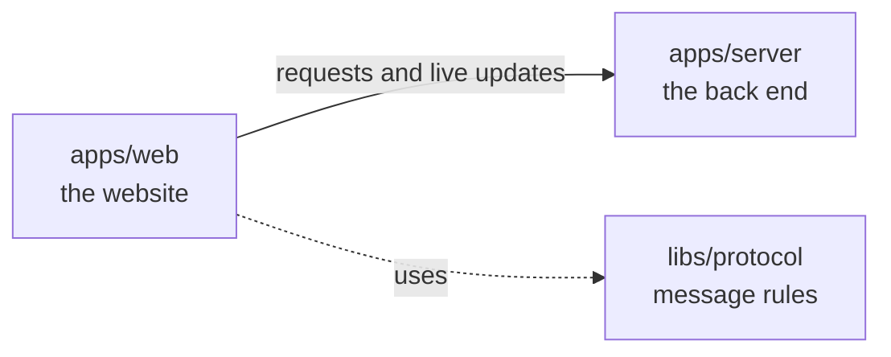

# apps/web

## What this is

The website people use to chat with their assistant and manage an OpenCrane organisation. It runs in a browser and sends requests to `apps/server`, the back end. Passwords go to the sign-in service, not to the website.

## Where it fits

This is the browser app layer. It talks to `apps/server` over web requests and a live connection. The shared message rules in `libs/protocol` check data before the website shows it.



## What it is responsible for

- Shows sign-in and the first-owner claim page.
- Lets people start conversations, send messages and stop a reply.
- Shows tool approval requests, uploaded files and the assistant's desktop.
- Gives admins pages for People & groups at `/org/people` and
  `/org/people/groups/<id>`, integrations, models, spending and change history.
- Clears private information when the server refuses access.
- Adapts the workspace and menus for phones and desktop screens.
- Supports keyboard use in menus, dialogs and the chat workspace.
- Not built yet: the organisation overview and Routines pages.
- Not built yet: several personal settings pages, which show an unavailable message.

## Processes it handles

1. **A person signs in.** The website sends them to the sign-in service. After sign-in,
   it brings them back to the start page, where they can open the workspace.
2. **The first owner claims a new installation.** They sign in and enter its one-time token. The server records them as the owner.
3. **A person sends a message.** The website opens a conversation and sends the message to the server. It shows the reply as it arrives and offers Stop.
4. **An admin reviews a tool.** The website shows the tools found on a tool server (MCP server) that an admin has added. The admin can allow, ask before use or block each tool.
5. **A person watches a computer.** The website opens a read-only live view. A screenshot can be saved to the conversation.
6. **An admin checks a change.** The website shows organisation history to people with access.
7. **An Owner or Admin opens People & groups.** The website checks group reads,
   shows members and grants, creates groups and removes a member after review.
8. **An admin reviews held spend.** The website shows settled spend separately from held spend. An Owner or Admin can read a hold's evidence and record a settlement or release. The existing budget editor remains available.

## How to run or test it

```sh
npm run dev -w apps/web
npm run build -w apps/web
npm run typecheck -w apps/web
```

## Where to read more

- [README.robot.md](README.robot.md): routes, message details, limits and test commands.
- [apps/server](../server/README.md) handles the website's requests.
- [Who may watch a computer's live desktop, and why](../../docs/adr/0006-computer-disk-and-live-view.md).
- [The shared words used in these guides](../../GLOSSARY.md).
