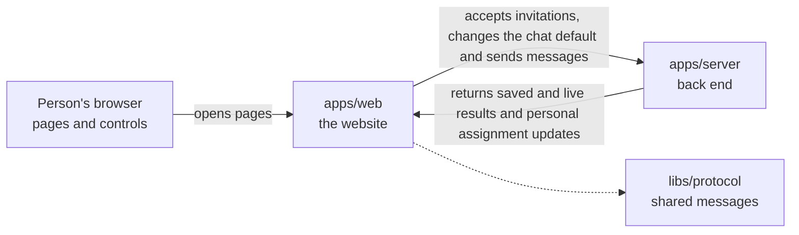

# apps/web

## What this is

The website people use to chat with their assistant and manage an OpenCrane organisation.
It runs in a browser and sends requests to the server.
The company sign-in service checks passwords.
The website shows saved results; the server decides permissions and spending limits.

## Where it fits

This package belongs to the browser app layer.
[apps/server](../server/README.md) handles its requests, sign-in and live updates.
[libs/protocol](../../libs/protocol/README.md) defines the messages they exchange.
The browser uses the website's own address for server connections.



## What it is responsible for

- Show sign-in, first-owner setup, invitation acceptance, the welcome survey and private persona review.
- Show the installation's name and provide sign-out from desktop and phone menus.
- Offer Settings to owners and admins.
- Support assistant sessions and direct or group chats with colleagues.
- Let people open a draft after their identity and session list first load successfully.
  Show their personal assistant as soon as it is assigned, along with live and saved replies.
- Keep private personal replies only in page memory and clear them when access ends.
- Open recent and archived chats, load older messages and show saved action details.
- Upload and preview files, explain refusals and show when files are ready to send.
- Show tool approvals and the assistant's read-only desktop when permitted, including
  in the packaged website.
- Show permitted memory facts and support personal saving, correction and forgetting.
- Let members choose personal tool keys and which assistants may use them.
- Let admins manage people, groups, assistants, model providers and tool servers.
- Connect and test providers, choose the chat default and switch on member chats through Settings.
- Show spending, budgets, held money and permitted organisation history.
- Keep unknown save results tied to their original reference while checking status.
- Support phones, keyboard navigation and clear messages when access changes.

Not built yet:

- Organisation Routines and personal Preferences pages.
- Some profile details and the Invitations list.

## Processes it handles

1. **A person signs in.** Their company account identifies them.
   The first owner can claim a new installation. An invited person accepts
   their link with the account it was sent to. Sign-in opens the welcome survey
   or the step they last reached. After they finish or skip setup, sign-in opens
   the workspace. Survey answers grant no access to tools or groups.
2. **A person chats.** They press Enter or Send to send their current text and watch the assistant's reply
   arrive.
   Stop requests an end to the reply; a spending stop explains the relevant limit.
   Colleague chats save human messages without starting assistant work.
3. **A person asks a shared assistant for work.** They review the audience, paying
   group and allowance from their own group-chat message. The server checks the
   reviewed request before starting a private session.
4. **A person uses files, memory or the desktop.** The website loads permitted data
   and shows its current state. Refused uploads explain the reason and offer retry;
   losing access clears protected content and the desktop picture.
5. **An admin changes settings.** They review and save a change, then follow its
   recorded result. A lost reply triggers a status read before another action is offered.
6. **A person returns to a chat.** The website loads saved messages and catches up
   live updates. A failed read keeps messages already shown and offers another try;
   a missing chat reveals no private details.

## How to run or test it

From the repository root, with the server running:

```sh
npm run dev -w apps/web
nice -n 10 npm run build -w apps/web
nice -n 10 npm run typecheck -w apps/web
```

The development proxy connects to the server on port 8080.
Use the [dev stack](../../infra/dev-stack/README.md) for the full product.
[README.robot.md](README.robot.md#contract-and-verification) lists component and browser checks.

## Where to read more

- [README.robot.md](README.robot.md): routes, settings, folders, limits and tests.
- [apps/server](../server/README.md): sessions, permissions and saved changes.
- [Chat](src/app/chat/README.md): conversations, files and assistant work.
- [People](src/app/people/README.md): members, groups and ownership.
- [Why desktop viewing checks access](../../docs/adr/0006-computer-disk-and-live-view.md).
- [Glossary](../../GLOSSARY.md): shared words.
