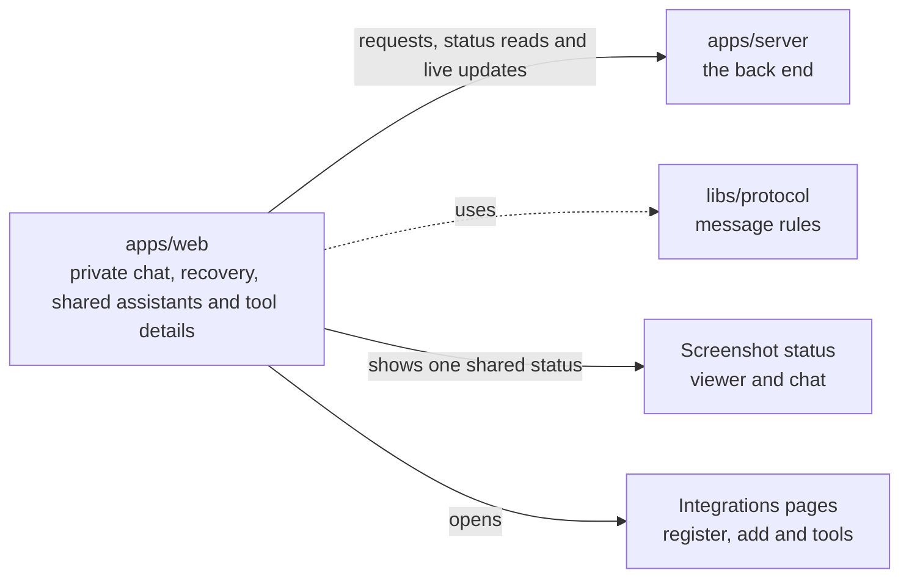

# apps/web

## What this is

The website people use to chat with their assistant and manage an OpenCrane organisation. It runs in a browser and sends requests to `apps/server`, the back end. Passwords go to the sign-in service, not to the website.

## Where it fits

This is the browser app layer. It talks to `apps/server` over web requests and a live connection. The shared message rules in `libs/protocol` check data before the website shows it.



## What it is responsible for

- Shows sign-in and the first-owner claim page.
- Lets people start conversations, send messages and stop a reply.
- Shows reviewed tool approvals, sanitised tool details, uploaded files and the assistant's desktop.
- Gives admins pages for People & groups at `/org/people` and
  `/org/people/groups/<id>`, an integration register and detail at
  `/org/integrations` and `/org/integrations/<id>`, adding a remote server, and setting
  modes for each tool, as well as models, spending and change history.
- Lets organisation admins create a shared assistant for a group with selected grants
  and a fixed paying group, including groups managed by an identity provider. Group
  membership does not grant desktop access.
- Clears private information when the server refuses access.
- Adapts the workspace and menus for phones and desktop screens.
- Supports keyboard use in menus, dialogs and the chat workspace.
- Not built yet: the organisation overview and Routines pages.
- Not built yet: several personal settings pages, which show an unavailable message.

## Processes it handles

1. **A person signs in.** The website sends them to the sign-in service. After sign-in,
   it brings them back to the start page, where they can open the workspace.
2. **The first owner claims a new installation.** They sign in and enter its one-time token. The server records them as the owner.
3. **A person sends a message.** The website opens a conversation and sends the message to the server. It shows the reply as it arrives and offers Stop.
   Team turns are private by default. A memory-free choice applies to one turn and
   explains that it uses the shared disk. Recovery pauses sending and explains why.
   A reply whose output was lost stays incomplete.
4. **An admin adds a tool server.** MCP (Model Context Protocol) lets an assistant use tools from another server. The website accepts a remote HTTPS address and shows the discovery result. When tools are ready, the admin can continue to set each tool to Allow automatically, Ask or Block. If a save reply is lost, the website checks the saved modes before offering another action. It never sends the save again.
5. **An admin checks an integration.** The website shows registered MCP servers and the facts it can read for each one. Refresh keeps the current page and keyboard focus in place while it reads again. Connection, access grants and publishing wait for their server support.
6. **A person watches a computer.** The website opens a read-only live view. A screenshot can be saved to the conversation. The transcript and Files panel show its name and capture facts. The preview shows the image and offers a download. Failed saves, scan refusals and access changes have separate messages. If the reply is lost, the website checks Files before it offers another action. The same status appears in the viewer and chat, and keeps keyboard focus while Files are checked.
7. **An admin checks a change.** The website shows organisation history to people with access.
8. **An Owner or Admin opens People & groups.** The website checks group reads,
   shows members and grants, creates groups and removes a member after review.
   An organisation admin can also create a shared assistant for a group, even when an
   identity provider manages the group's members. The assistant keeps one paying group
   for its private member sessions.
9. **An admin reviews held spend.** The website shows settled spend separately from held spend. An Owner or Admin can read a hold's evidence and record a settlement or release. The existing budget editor remains available.

## How to run or test it

```sh
npm run dev -w apps/web
npm run build -w apps/web
npm run typecheck -w apps/web
```

## Where to read more

- [README.robot.md](README.robot.md): routes, message details, limits and test commands.
- [apps/server](../server/README.md) handles the website's requests.
- [Who may watch a computer's live desktop, and why](../../docs/adr/0006-computer-disk-and-live-view.md).
- [The shared words used in these guides](../../GLOSSARY.md).
- [Screenshot screens and browser checks](../../docs/process/p3-18-screens/README.md).
