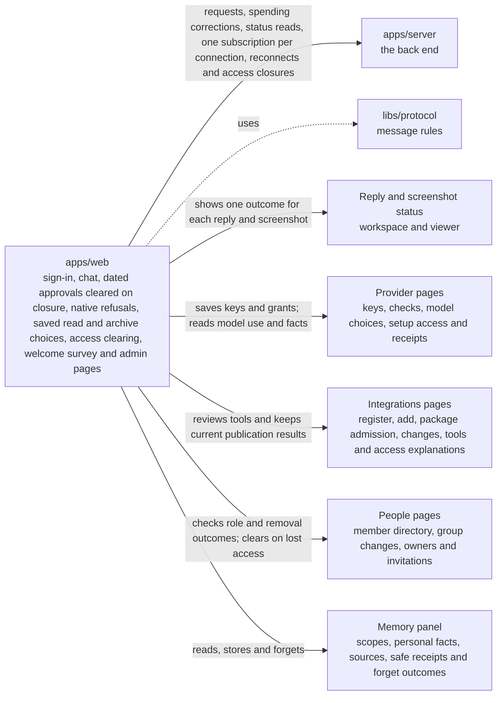

# apps/web

## What this is

The website people use to chat with their assistant and manage an OpenCrane organisation. It runs in a browser and sends requests to `apps/server`, the back end. Passwords go to the sign-in service, not to the website.

## Where it fits

This is the browser app layer. It talks to `apps/server` over web requests and a live connection. The shared message rules in `libs/protocol` check data before the website shows it.



## What it is responsible for

The Spending editor keeps the typed ceiling and payer when a chosen group or shared
assistant is unavailable. A message beside the editor asks for another choice.
Losing Owner or Admin access clears spending details and closes the editor.

Admins can grant or remove model access for one person, group or assistant at a time.
The editor checks that each save has taken effect. An uncertain reply offers a status
check with the original request id, including after a page reload. The candidate list
loads more people, groups or assistants when requested.
Provider setup uses the same editor for each selected model. Its last step lists
confirmed saves separately from changes still being checked. Saved models stay selected
until removal can check their existing uses. Pending access changes keep setup open
so the original request can still be checked.

The Models table shows models enabled on a connection, their task routes and granted
audiences. It names a shared assistant whose selected model lacks its own grant.
While grants are updating, or when some assistants cannot be checked, it leaves the
assistant check open rather than guessing an answer.

- Shows a single sign-on card with a clear email sign-in notice, a cancellable
  handoff, and a plain failure message. It also shows the first-owner claim page.
- Lets a person enter their name, optional pronouns and work description for the
  welcome survey. It shows their current groups without offering to change membership.
  It shows saved progress, checks an uncertain save, and asks before changing
  an answer recovered after a failed read. Changing saved work asks before clearing
  later answers or replacing saved groups. Lost access clears the answers, even when
  a group read finishes after the person leaves that step.
- Lets a person choose their assistant's tone, answer length, citations and desired
  tasks. These wishes give no access to groups or tools. A completed survey links to
  the Assistant page, which shows when persona review becomes available.
- Lets people start conversations, send messages and stop a reply.
  A stopped reply keeps its partial text and shows only its stopped outcome,
  both live and after a reload. Failed replies still show “Reply failed”.
  Closing a session clears its approval cards and any open approval details.
  An approval awaiting another use still shows its earlier saved uses.
- Shows why a spending limit stopped work, including its reset time when available.
  A stopped approval, including one now cancelled, keeps its review visible without decisions.
- Lets Owners and Admins create an email invitation and copy its link. If the reply is
  lost, the People page checks that request's status before showing a link.
- Lets organisation admins create shared assistants for groups and members start private
  sessions with them.
- Lets someone choose one colleague for a direct conversation between two people.
  Direct chats send human text and never start assistant work.
- Lets someone choose several colleagues for a group chat, or review the current members
  of one of their groups. Human chats never start assistant work.
- Shows group conversations with each message's saved author and resumes live updates
  from the last message shown. Each draft stays with its conversation. A saved message
  means the server recorded it; it does not say that anyone received it.
- Saves how far someone has read in a direct or group chat after the newest message appears.
  Losing access clears its messages, draft, names and files, even when an older reply arrives later.
  A closed live connection that reports lost access clears an open chat as well. The lock notice
  receives keyboard focus, and phone headers show every chat action without clipping.
- Lets a group creator add or remove participants and lets other people leave. It locks
  the creator in place, marks a colleague who left the company as removed, and checks an
  uncertain change by reading its original status. Losing access clears the conversation.
  Phones show the participant list with a Back button; the view honours reduced motion.
- Shows every selected recipient in a full-screen review. Groups larger than three need
  that review before the first message can be sent. Message recovery stays on screen while
  the first send is unresolved.
- Shows live tool updates, reviewed approvals and sanitised tool details. It also
  shows uploaded files and the assistant's desktop. An incomplete review names its
  missing fields. The requester can deny it, while other participants can only read it.
  A decision checks the latest card again before it is sent. Finished approvals
  show their saved times and the recorded reason when one exists. A used approval
  keeps its result check inside its details.
  A refused native consent request shows its saved request reference and, when known,
  the server name. An older detail reply cannot change a reopened drawer. It grants no
  tool permission.
- Keeps the conversation list available when a saved chat link is missing and says
  that the selected chat cannot be opened.
- Shows Recent and Archived conversations at `/workspace/conversations`. People can
  search titles, load more results and open an older chat from its saved link. If the
  list changes during that search, the website starts it again once.
- Lets people archive or unarchive a direct or group chat from its header. The server
  saves the choice for their own list. An archived chat stays readable and can still
  receive messages. An uncertain save keeps the person in that chat until they check
  its status. Group chat headers show the full saved title.
- Gives admins pages for People & groups at `/org/people`,
  `/org/people/groups/<id>` and `/org/people/owners`, an integration register and detail at
  `/org/integrations` and `/org/integrations/<id>`, adding a remote server, and setting
  modes for each tool, as well as models, spending and change history.
- Shows when changed tools pause an integration. The changes page compares the saved
  field types and limits, titles and other details. Admins can open each full definition.
  A failed policy read is visible;
  earlier rows keep their last successful check time. Admins can review the current
  tool list when the saved comparison is complete, then save its publication. Calls stay
  paused while publication is applying. A lost reply can be checked by its original
  reference after reopening the page. A later tool change can be reviewed after an older
  publication, including when its reference was saved in the browser. An uncertain
  publication for the current tool list still needs a status check. Publishing cannot
  restore old approvals.
- Accepts an exact package image digest and shows dated admission checks. Continue
  stays disabled while tool discovery is unavailable. The form checks encoded host
  names before sending a package. It shows when a signature or licence is refused,
  and when a scanner has no result. A failed read can be checked again. Saving gives
  nobody access. After a refusal, choosing another version moves keyboard focus to the
  new image field. An older status reply cannot clear a newer package.
- Lists current members with search and more pages. A refused member read clears both
  member and group details. A temporary read failure keeps loaded rows visible.
- Lets Owners and Admins add an active organisation member to a local group from its page.
  It waits for the add request before offering a status check or the same request again.
  It checks that the group and access records are current before showing the addition as done.
- Shows each member's recorded groups and grants in a table that becomes labelled cards
  on phones. A missing member or lost access clears the page. A failed refresh keeps
  earlier details with separate times for member and grant data.
- Lets Owners and Admins change a Member or Admin role. It checks the saved change
  before showing the new role. An uncertain result keeps the original status check
  and pauses removal. A pending removal pauses role changes.
  A person with a read-only view sees only the member's name and role.
- Lets Owners and Admins review a member's departure before removal. The review names
  ending organisation and group membership, lost tools, a recorded personal computer,
  work needing a separate decision and saved history. A confirmed removal replaces the
  old member detail with its outcome. An uncertain removal stays tied to its original
  request and can be checked without sending it again.
- Lets organisation admins create a shared assistant for a group with selected grants
  and a fixed paying group, including groups managed by an identity provider. Group
  membership does not grant desktop access.
- Clears private information when the server refuses access.
- Explains a named tool's person grant, assistant grant and account state. A failed check
  stays unknown, and a refused read clears the explanation.
- Lets a signed-in person open Memory in the workspace session panel to read permitted
  scopes, search facts, inspect source status and store a fact with a checked receipt.
- Adapts the workspace and menus for phones and desktop screens.
- Supports keyboard use in menus, dialogs and the chat workspace.
- Not built yet: the organisation overview and Routines pages.
- Not built yet: several personal settings pages, which show an unavailable message.

Admins can stage modes for newly added tools, review their declared costs and approval
details, then confirm the saved catalogue and audience. Publishing creates no grants.
Calls wait until the gateway acknowledges the publication. Reload keeps its status check.
Publishing and its result use a short status card. An uncertain result keeps Check status
near the top. Overlapping checks keep the latest result and the newer saved tool policy.

## Processes it handles

Direct chats reconnect after a busy server closes their connection. Refreshing
a saved message keeps the current subscription instead of opening it twice.

1. **A person signs in.** The website checks whether they already have a session.
   Otherwise, it sends them to the sign-in service after a short cancellable wait.
   A failed sign-in shows a safe message and offers another try. After sign-in,
   they return to the start page and can open the workspace.
2. **The first owner claims a new installation.** They sign in and enter its one-time token. The server records them as the owner.
3. **A person sends a message.** The website opens a conversation and sends the message to the server. It shows the reply as it arrives and offers Stop.
   After Stop, it says “Stopping…” while it waits for an ending report. If no report
   arrives, it says “Stop not confirmed” and keeps the reply active so Stop can be tried again.
   Team turns are private by default. A memory-free choice applies to one turn and
   explains that it uses the shared disk. Recovery pauses sending and explains why.
   A reply whose output was lost stays incomplete. Approval cards show the reviewed
   change to every participant, while only the requester can approve or deny it.
4. **Colleagues start a human chat.** One person searches joined colleagues and chooses
   one for a direct chat, or adds several people for a group. They can also review the
   current members of one of their groups. The server creates the conversation only when
   they send the first message. If group membership changes after review, they review it
   again. Each draft stays with its conversation. Group transcripts show the saved author
   on each message and continue from the last message shown. A saved message means the
   server recorded it; it does not claim that anyone received it. The server records human
   messages and starts no assistant, computer, memory or model work. Group participants can
   be reviewed in the conversation, and their list updates as people join or leave. Only its
   creator manages other people; the creator stays in the chat and everyone else can leave.
   Colleague search includes later result pages. A lost reply keeps its original change id,
   and workspace links stay on the page until that change's status can be checked. When the
   live connection needs to catch up, the website reloads the current participants from the
   server. Once the newest message appears in a visible tab, the website saves the read place
   for that direct or group chat.
   Access loss clears protected chat details and late replies.
5. **An admin adds a tool server.** MCP (Model Context Protocol) lets an assistant use tools from another server. The website accepts a remote HTTPS address and shows the discovery result. When tools are ready, the admin can continue to set each tool to Allow automatically, Ask or Block. If a save reply is lost, the website checks the saved modes before offering another action. It never sends the save again.
6. **An admin checks an integration.** The website shows registered MCP servers and the facts it can read for each one. An admin reviews changed tools, saves publication and checks its progress before calls resume. Refresh keeps the current page and keyboard focus in place while it reads again. A tool access explanation shows the two grants and account check from a dated server reply. It does not say that a call can run.
7. **A person watches a computer.** The website opens a read-only live view. A screenshot can be saved to the conversation. The transcript and Files panel show its name and capture facts. The preview shows the image and offers a download. Failed saves, scan refusals and access changes have separate messages. If the reply is lost, the website checks Files before it offers another action. The same status appears in the viewer and chat, and keeps keyboard focus while Files are checked.
8. **An admin checks a change.** The website shows organisation history to people with access.
9. **An Owner or Admin opens People & groups.** The website checks group reads,
   shows members and grants, creates groups, adds a member to a local group and removes
   a member after review.
   An organisation admin can also create a shared assistant for a group, even when an
   identity provider manages the group's members. The assistant keeps one paying group
   for its private member sessions.
10. **An admin reviews held spend.** The website shows settled spend separately from held spend. An Owner or Admin can read a hold's evidence and record a settlement or release. The existing budget editor remains available.
11. **An admin connects a model provider.** The website records the connection name and saves
    a key without showing it again. A lost reply keeps the original reference and offers a
    status check before another save. A paid model test needs consent for one request. An
    unknown outcome stays locked while the website checks its status.
12. **A member starts a private shared session.** The website shows assistants they can use, confirms the fixed paying group, then opens their private conversation. Group membership does not give desktop access.
13. **An Owner transfers ownership.** The website reviews the proposed successor and asks the server to record the transfer. It shows success only after the server confirms it. A lost reply keeps its command reference and offers a read-only status check.
14. **A person reads memory.** The workspace session panel lists permitted scopes and facts,
    searches and pages through them, and checks each source separately. Scope changes and
    access loss discard old replies. A refused write clears the draft and its command too.
    Changing requester clears the form and ignores replies from the old requester. An
    unknown write keeps its original command available for a read-only status check.
    Memory is not saved in browser storage.
15. **A person forgets one of their facts.** The Memory panel asks them to review the effect
    before sending one request. The fact disappears when the server confirms it is hidden.
    The panel shows whether cleanup is pending, complete or unavailable. An uncertain reply
    offers a status check for the same request. A second fact gets its own review while the
    first fact's pending outcome stays on the page.

## How to run or test it

```sh
npm run dev -w apps/web
npm run build -w apps/web
npm run typecheck -w apps/web
```

The desktop viewer first asks for access, then connects its socket and display.
It clears the picture when permission expires or the session closes.

## Where to read more

- [README.robot.md](README.robot.md): routes, message details, limits and test commands.
- [apps/server](../server/README.md) handles the website's requests.
- [Who may watch a computer's live desktop, and why](../../docs/adr/0006-computer-disk-and-live-view.md).
- [The shared words used in these guides](../../GLOSSARY.md).
- [Screenshot screens and browser checks](../../docs/process/p3-18-screens/README.md).
- [Ownership screen binding and receipt](../../docs/process/p4-2-screens/README.md).
