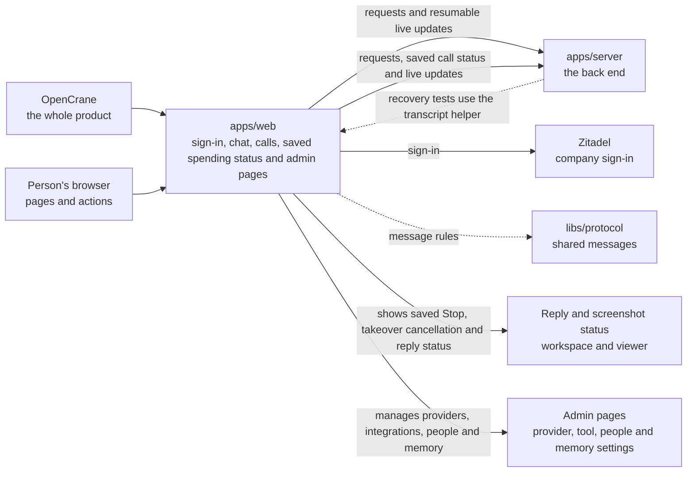

# apps/web

## What this is

The website people use to chat with their assistant and manage an OpenCrane organisation.
It runs in a browser and sends requests to the server. Passwords go to the company
sign-in service. The website shows saved results from the server rather than deciding
permissions or spending limits itself.

## Where it fits

This is OpenCrane's browser app layer. [apps/server](../server/README.md) handles its
requests and live updates. [libs/protocol](../../libs/protocol/README.md) supplies
shared rules for checking messages before the website shows them.



Sign-in goes through the server to [Zitadel](../../GLOSSARY.md#zitadel-sign-in-service).
The browser uses the website's own address for requests and live connections.
No credentials are built into its public assets.

## What it is responsible for

For everyone, the website:

- Shows sign-in, first-owner setup and the welcome survey.
- Supports assistant sessions and direct or group chats with colleagues.
- Lists recent and archived conversations and opens saved chat links.
- Shows tool actions for review and lets the requester approve or deny them.
  A saved takeover cancellation names its cause and end time.
- Uploads and previews files, saves screenshots and opens the assistant's read-only
  [computer](../../GLOSSARY.md#computer) view when permitted.
- Shows permitted memory facts and supports saving and forgetting personal facts.
- Supports phones, keyboard navigation and clear messages when access changes.

For owners and admins, it:

- Manages people, groups, invitations, shared assistants and ownership.
- Connects model providers and changes who may use their models.
- Shows spending, edits budgets and reviews money held for unfinished calls.
- Registers tool servers, reviews tools and publishes their settings.
- Shows organisation change history.

A shared assistant belongs to a group; members can start private sessions with it.
Its paying group is the group whose budget pays for that work.
If the reply to a save is lost, the website asks the server what was saved before
it offers another action. An unknown result stays visible with its original reference.

Not built yet: organisation Overview and Routines; personal Preferences, persona
review and My tools; some profile details and the Invitations list. The relevant
pages explain these limits instead of showing invented data.

## Folders

| Folder | What it contains |
| --- | --- |
| [src](src/) | Browser startup in `main.ts`, `csp.ts` and `startup.ts`, the page in `index.html` and shared styles in `styles.css`. |
| [test](test/) | `chat-browser.test.ts`, `chat-state.test.ts` and `theme.test.ts`; example pages in `live-view-main.ts` and `overlays-main.ts`; and the `chat-state.ts` transcript helper used by server recovery tests. |
| [src/app](src/app/README.md) | Selects pages and puts them inside shared menus. |
| [audit](src/app/audit/README.md) | Organisation changes and conversation action history. |
| [chat](src/app/chat/README.md) | Assistant sessions, colleague chats, files and conversation lists. |
| [claim](src/app/claim/README.md) | First-owner setup for a new installation. |
| [core](src/app/core/README.md) | Browser navigation and the live server connection. |
| [integrations](src/app/integrations/README.md) | Tool-server lists, details, changed tools and publication. |
| [live-view](src/app/live-view/README.md) | Read-only viewing of an assistant's computer. |
| [mcp-install](src/app/mcp-install/README.md) | Remote tool-server registration and package safety checks. |
| [memory](src/app/memory/README.md) | Search, saving and forgetting of permitted memory facts. |
| [models](src/app/models/README.md) | Provider setup, model choices and model permissions. |
| [organisation](src/app/organisation/README.md) | Shared navigation for organisation settings. |
| [people](src/app/people/README.md) | Members, groups, invitations, shared assistants and owners. |
| [settings](src/app/settings/README.md) | Account identity and personal settings navigation. |
| [shared-state](src/app/shared-state/README.md) | Reusable progress, result and access messages. |
| [sign-in](src/app/sign-in/README.md) | Company sign-in and its waiting and rejection pages. |
| [spending](src/app/spending/README.md) | Budgets, charges and review of held amounts. |
| [tool-policy](src/app/tool-policy/README.md) | Tool rules and initial person and assistant access. |
| [ui](src/app/ui/README.md) | Shared dialogs, menus and paper effects. |
| [ui/fold-loader](src/app/ui/fold-loader/README.md) | Folding-paper activity animation. |
| [welcome](src/app/welcome/README.md) | Saved welcome-survey answers and progress. |
| [public](public/README.md) | Files the browser loads directly. |
| [public/chat](public/chat/README.md) | The paper background texture. |

A spending stop keeps its reason beside saved call statuses. A reservation, an unknown
outcome, a recorded charge and a released reservation have different labels. Check status
reads the original turn again and politely announces its progress and result. Participants
see the status and reference without amounts.

## Processes it handles

1. **Sign-in and setup.** A person signs in through their company account. The first
   owner can claim a fresh installation; the welcome survey saves personal wishes
   without granting access to tools or groups.
2. **Conversations.** A person sends a message and sees the assistant's reply arrive.
   A chat turn is one message and its reply. Stop requests an end to that reply;
   a budget stop separately explains that a spending limit ended work.
   Colleague chats send human text and never start assistant work.
   A socket rate limit keeps the selected chat, saved messages and draft while the
   connection retries. Recovery reads missing updates without resending work.
   Losing access still clears protected content, including files and drafts.
3. **Files, memory and viewing.** A person opens the session panel to read permitted
   facts or files, or watch the computer. The viewer checks permission before connecting
   and clears its picture when permission expires or the session closes.
4. **Organisation changes.** An admin reviews a person, budget, provider or tool server,
   sends a change and follows its recorded result. The server checks permissions,
   records changes and applies them; the website shows the confirmed outcome.

## How to run or test it

From the repository root:

```sh
npm run dev -w apps/web
nice -n 10 npm run build -w apps/web
nice -n 10 npm run typecheck -w apps/web
```

`npm run dev` needs `apps/server` running on port 8080. The local proxy forwards
`/api`, `/auth` and `/ws` to it. Builds reuse compiled files locally and in CI.
The browser fixture runner builds the development app before its checks start their
own test servers. This keeps the first build outside their startup time limits.
Angular component checks live beside their source in `*.spec.ts` files. The root test
runner also runs the checks in `test/`.
The build writes static files to `apps/web/dist/web/browser`; deployment serves
these with requests and live connections routed to the server.

## Where to read more

- [Detailed notes](README.robot.md): routes, settings, limits, retry rules and test commands.
- [The back end](../server/README.md): sessions, permissions and saved changes.
- [Live desktop access](../../docs/adr/0006-computer-disk-and-live-view.md): who may watch a computer and why.
- [Shared words](../../GLOSSARY.md): terms used across the system.
