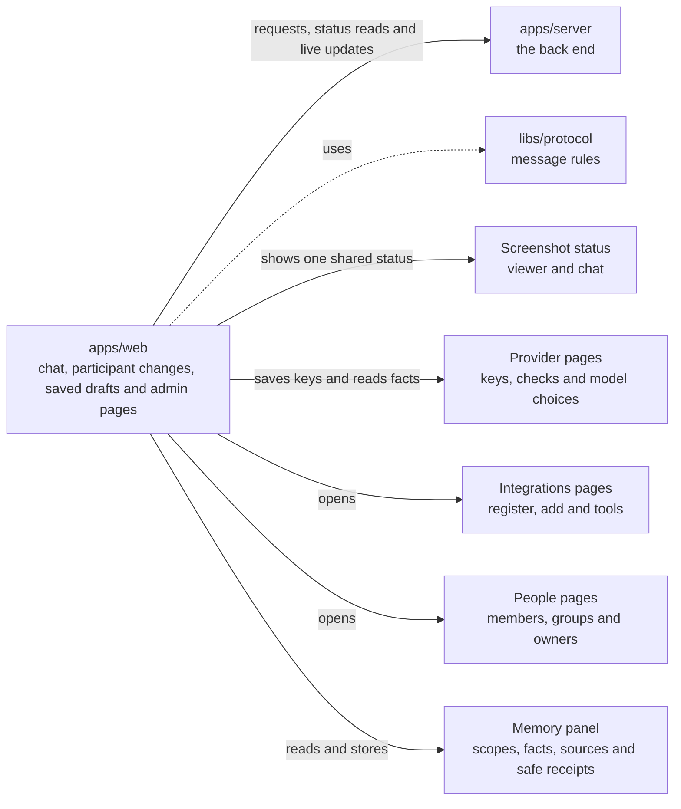

# apps/web

## What this is

The website people use to chat with their assistant and manage an OpenCrane organisation. It runs in a browser and sends requests to `apps/server`, the back end. Passwords go to the sign-in service, not to the website.

## Where it fits

This is the browser app layer. It talks to `apps/server` over web requests and a live connection. The shared message rules in `libs/protocol` check data before the website shows it.



## What it is responsible for

- Shows sign-in and the first-owner claim page.
- Lets people start conversations, send messages and stop a reply.
- Lets organisation admins create shared assistants for groups and members start private
  sessions with them.
- Lets someone choose one colleague for a direct conversation between two people.
  Direct chats send human text and never start assistant work.
- Lets someone choose several colleagues for a group chat, or review the current members
  of one of their groups. Human chats never start assistant work.
- Shows group conversations with each message's saved author and resumes live updates
  from the last message shown. Each draft stays with its conversation. A saved message
  means the server recorded it; it does not say that anyone received it.
- Lets a group creator add or remove participants and lets other people leave. It locks
  the creator in place, marks a colleague who left the company as removed, and checks an
  uncertain change by reading its original status. Losing access clears the conversation.
  Phones show the participant list with a Back button; the view honours reduced motion.
- Shows every selected recipient in a full-screen review. Groups larger than three need
  that review before the first message can be sent. Message recovery stays on screen while
  the first send is unresolved.
- Shows live tool updates, reviewed approvals and sanitised tool details. It also
  shows uploaded files and the assistant's desktop.
- Keeps the conversation list available when a saved chat link is missing and says
  that the selected chat cannot be opened.
- Gives admins pages for People & groups at `/org/people`,
  `/org/people/groups/<id>` and `/org/people/owners`, an integration register and detail at
  `/org/integrations` and `/org/integrations/<id>`, adding a remote server, and setting
  modes for each tool, as well as models, spending and change history.
- Lets organisation admins create a shared assistant for a group with selected grants
  and a fixed paying group, including groups managed by an identity provider. Group
  membership does not grant desktop access.
- Clears private information when the server refuses access.
- Lets a signed-in person open Memory in the workspace session panel to read permitted
  scopes, search facts, inspect source status and store a fact with a checked receipt.
- Adapts the workspace and menus for phones and desktop screens.
- Supports keyboard use in menus, dialogs and the chat workspace.
- Not built yet: the organisation overview and Routines pages.
- Not built yet: several personal settings pages, which show an unavailable message.

## Processes it handles

1. **A person signs in.** The website sends them to the sign-in service. After sign-in,
   it brings them back to the start page, where they can open the workspace.
2. **The first owner claims a new installation.** They sign in and enter its one-time token. The server records them as the owner.
3. **A person sends a message.** The website opens a conversation and sends the message to the server. It shows the reply as it arrives and offers Stop.
   After Stop, it says “Stopping…” while it waits for an ending report. If no report
   arrives, it says “Stop not confirmed” and keeps the reply active so Stop can be tried again.
   Team turns are private by default. A memory-free choice applies to one turn and
   explains that it uses the shared disk. Recovery pauses sending and explains why.
   A reply whose output was lost stays incomplete. Approval cards show the reviewed
   change to every participant, while only the requester can approve or deny it.
4. **Colleagues start a human chat.** One person searches joined colleagues and chooses
   one for a direct chat, or adds several people for a group. They can also review the
   current members of one of their groups. The server creates the conversation only when
   they send the first message. If group membership changes after review, they review it
   again. Each draft stays with its conversation. Group transcripts show the saved author
   on each message and continue from the last message shown. A saved message means the
   server recorded it; it does not claim that anyone received it. The server records human
   messages and starts no assistant, computer, memory or model work. Group participants can
   be reviewed in the conversation, and their list updates as people join or leave. Only its
   creator manages other people; the creator stays in the chat and everyone else can leave.
   Colleague search includes later result pages. A lost reply keeps its original change id,
   and access loss clears protected chat details and late replies.
5. **An admin adds a tool server.** MCP (Model Context Protocol) lets an assistant use tools from another server. The website accepts a remote HTTPS address and shows the discovery result. When tools are ready, the admin can continue to set each tool to Allow automatically, Ask or Block. If a save reply is lost, the website checks the saved modes before offering another action. It never sends the save again.
6. **An admin checks an integration.** The website shows registered MCP servers and the facts it can read for each one. Refresh keeps the current page and keyboard focus in place while it reads again. Connection, access grants and publishing wait for their server support.
7. **A person watches a computer.** The website opens a read-only live view. A screenshot can be saved to the conversation. The transcript and Files panel show its name and capture facts. The preview shows the image and offers a download. Failed saves, scan refusals and access changes have separate messages. If the reply is lost, the website checks Files before it offers another action. The same status appears in the viewer and chat, and keeps keyboard focus while Files are checked.
8. **An admin checks a change.** The website shows organisation history to people with access.
9. **An Owner or Admin opens People & groups.** The website checks group reads,
   shows members and grants, creates groups and removes a member after review.
   An organisation admin can also create a shared assistant for a group, even when an
   identity provider manages the group's members. The assistant keeps one paying group
   for its private member sessions.
10. **An admin reviews held spend.** The website shows settled spend separately from held spend. An Owner or Admin can read a hold's evidence and record a settlement or release. The existing budget editor remains available.
11. **An admin connects a model provider.** The website records the connection name and saves
    a key without showing it again. A lost reply keeps the original reference and offers a
    status check before another save. A paid model test needs consent for one request. An
    unknown outcome stays locked while the website checks its status.
12. **A member starts a private shared session.** The website shows assistants they can use, confirms the fixed paying group, then opens their private conversation. Group membership does not give desktop access.
13. **An Owner transfers ownership.** The website reviews the proposed successor and asks the server to record the transfer. It shows success only after the server confirms it. A lost reply keeps its command reference and offers a read-only status check.
14. **A person reads memory.** The workspace session panel lists permitted scopes and facts,
    searches and pages through them, and checks each source separately. Scope changes and
    access loss discard old replies. A refused write clears the draft and its command too.
    Changing requester clears the form and ignores replies from the old requester. An
    unknown write keeps its original command available for a read-only status check.
    Memory is not saved in browser storage.

## How to run or test it

```sh
npm run dev -w apps/web
npm run build -w apps/web
npm run typecheck -w apps/web
```

## Where to read more

- [README.robot.md](README.robot.md): routes, message details, limits and test commands.
- [apps/server](../server/README.md) handles the website's requests.
- [Who may watch a computer's live desktop, and why](../../docs/adr/0006-computer-disk-and-live-view.md).
- [The shared words used in these guides](../../GLOSSARY.md).
- [Screenshot screens and browser checks](../../docs/process/p3-18-screens/README.md).
- [Ownership screen binding and receipt](../../docs/process/p4-2-screens/README.md).
