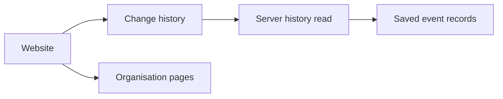

# Change history

## What this is

This page shows saved organisation changes and their observed results.
People can also read the action history for a conversation they may open.

## Where it fits

The website asks the server for safe records. The server checks access before
each reply.

## What it is responsible for

- Shows a decision beside what was later observed.
- Filters and loads older records without repeating a change.
- Opens one record's evidence at a time.
- Shows membership, publication and delegation facts that the server permits.
- Shows memory work as metadata without fact text.
- Keeps loaded records during a temporary failure and clears them when access ends.

## Main files

| File | What it does |
| --- | --- |
| `audit.ts` | Reads the list and the selected record's evidence. |
| `audit.html`, `audit.css` | Draw the filters, list and detail panel. |

## How it connects

[Page selection](../README.md) opens Change history.
[The server](../../../../server/README.md) supplies safe records.

## Where to read more

[README.robot.md](README.robot.md) records the API, access and capture details.
