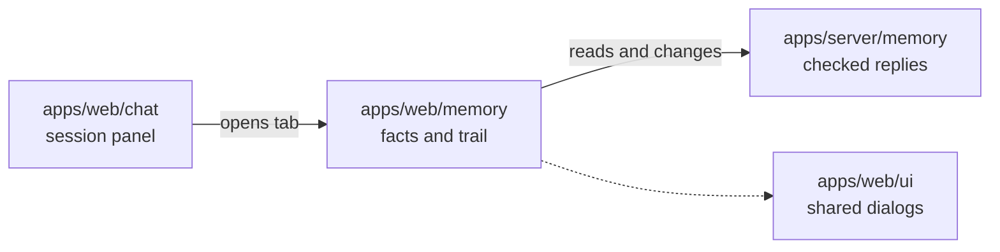

# Memory

## What this is

This folder shows the Memory tab inside a chat session. People can read facts they may
see, inspect their sources and view saved nightly maintenance for that scope. They can
also remember, correct or forget their own facts.

## Where it fits

The chat workspace opens this tab. The server checks access and returns saved facts
and maintenance history.

## What it is responsible for

- Show permitted memory scopes and facts, with search and more pages.
- Show saved nightly maintenance in date order and open the chosen original run.
- Show actual saved times and keep accepted allowance separate from spending.
- Keep safe rows during a temporary read failure and clear them when access is lost.
- Let people remember, correct and forget facts when the server allows it.

## Processes it handles

A person opens Memory and chooses a scope. The tab reads its facts and nightly trail.
Opening a trail row reads that same saved run; Check status reads it again without
starting work. A refused read hides the private rows.

## How to run or test it

`npm test -w apps/web -- --watch=false --include=src/app/memory/maintenance-trail.spec.ts`
checks the trail. `npm run visual:screen-p4-17-trail` builds the website and captures
both widths with an intercepted API.

## Where to read more

[README.robot.md](README.robot.md) describes the reply rules and current limits.
[apps/server/memory](../../../../server/src/memory/README.md) describes server access.
