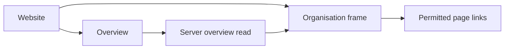

# Organisation navigation

## What this is

This folder supplies the shared frame and home page for organisation settings.
People see an ordered list of tasks, links to admin pages and a way back to chat.

## Where it fits

The website reads organisation tasks from the server. Each task opens an existing
admin page or an authorised evidence view.

## What it is responsible for

- Shows each organisation link when the current overview read permits it.
- Keeps links hidden while that read is pending and clears them when access is refused.
- Marks the current page and recognises member, group, assistant-setup and integration addresses.
- Shows a sidebar on larger screens and a keyboard-friendly menu on phones.
- Opens Overview for `/org` and `/org/overview`.
- Keeps tasks visible after a failed refresh and clears them when access is refused.
- Lists dated Ready evidence separately. A provider action opens that provider's row
  on Models & providers.

## Main files

| File | What it does |
| --- | --- |
| `organisation-shell.*` | Draw the sidebar, phone header and shared page area. |
| `pages.ts` | Names the pages and matches their addresses. |
| `overview.*` | Shows the task list and safe actions. |

## How it connects

[Page selection](../README.md) places [People & groups](../people/README.md),
[Models](../models/README.md), [Spending](../spending/README.md),
[Integrations](../integrations/README.md) and [Change history](../audit/README.md)
inside this frame. [Shared controls](../ui/README.md) supply the brand and phone menu.
Routines still shows an unavailable message.
The menu itself grants no access; the server checks each page's requests.

## Where to read more

[README.robot.md](README.robot.md) records the task response and browser capture.
