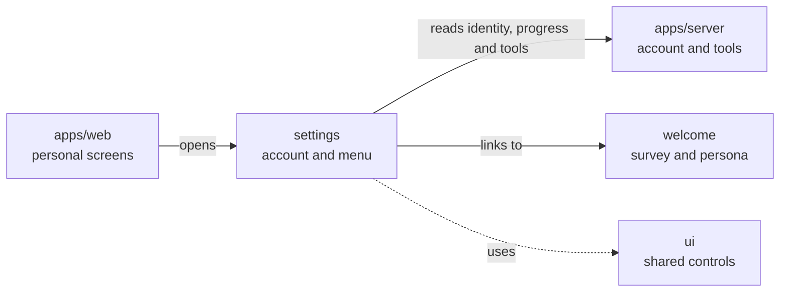

# Personal settings

## What this is

This folder shows a person's Account page, My tools and settings menu. People
can check their signed-in name and continue their welcome survey. The Assistant
page links to saved persona review.

## Where it fits

These pages are part of the website. They read identity and progress from the
server and show the tools the organisation has added. People can connect their
own account and choose which assistants may use it.

## What it is responsible for

- Show the signed-in name as read-only.
- Distinguish an expired session, a failed read and a missing name.
- Check survey progress before offering its continuation link.
- Show desktop navigation and a phone menu for personal settings.
- Link Assistant to saved persona review.
- Save a personal key only after the reviewed server verifies its account, then choose it for use.
- Show each tool and whether the person can use it, needs to connect an account
  or needs access from an owner or admin.
- Let the person choose which assistants may use their selected key and keep confirmed
  choices usable while the profile list is catching up.
- Review the effects before revoking a saved personal connection.
- Account editing and preferences are not available yet.

## Processes it handles

1. **Account.** The page reads the current session and shows the name it returned.
   It checks welcome progress before offering the survey link.
2. **Navigation.** The shell keeps Account, Preferences, Assistant and My tools
   in one menu. Assistant offers a link to the separate persona review screen.
3. **Connections.** Connect opens the chosen tool's key form. My tools checks the
   account before saving the key. The person then selects the key and chooses
   which assistants may use it. Their own assistant is allowed by default.
   My tools also opens saved connections for review and revoke. The review
   names the tool and profile. If a reply is lost, a return visit can check
   the original request.

## How to run or test it

Run `npm test -w apps/web -- --watch=false --include='**/account-screen.spec.ts'`
for the account screen test.

## Where to read more

[README.robot.md](README.robot.md) names the page files and current limits.
[Welcome](../welcome/README.md) explains the survey and persona review.
