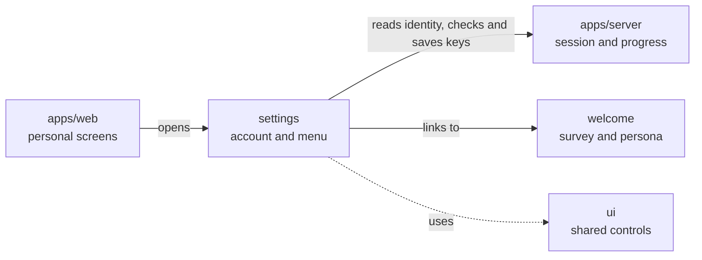

# Personal settings

## What this is

This folder shows a person's Account page, saved personal tool connections and
settings menu. People can check their signed-in name and continue their welcome
survey. The Assistant page links to saved persona review.

## Where it fits

These pages are part of the website. They read identity and progress from the
server, save and choose verified personal keys, and use the shared menu controls.

## What it is responsible for

- Show the signed-in name as read-only.
- Distinguish an expired session, a failed read and a missing name.
- Check survey progress before offering its continuation link.
- Show desktop navigation and a phone menu for personal settings.
- Link Assistant to saved persona review.
- Save a personal key only after the reviewed server verifies its account, then choose it for use.
- List saved personal profiles for a chosen integration and explain their safe status.
- Review the effects before revoking a saved personal connection.
- Account editing and preferences are not available yet.

## Processes it handles

1. **Account.** The page reads the current session and shows the name it returned.
   It checks welcome progress before offering the survey link.
2. **Navigation.** The shell keeps Account, Preferences, Assistant and My tools
   in one menu. Assistant offers a link to the separate persona review screen.
3. **Connections.** My tools checks a key with the reviewed identity tool before saving
   it. The person then chooses the verified key. My tools reads saved profiles and opens
   safe details for the last chosen profile. Its review names the profile and
   integration. If a revoke reply is lost, a return visit can check the original
   request before another attempt.

## How to run or test it

Run `npm test -w apps/web -- --watch=false --include='**/account-screen.spec.ts'`
for the account screen test.

## Where to read more

[README.robot.md](README.robot.md) names the page files and current limits.
[Welcome](../welcome/README.md) explains the survey and persona review.
