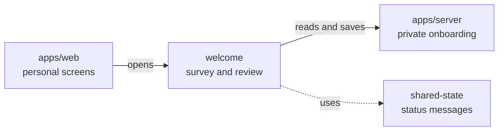

# Welcome survey and persona review

## What this is

This folder shows the welcome survey and the saved persona it creates. People can
review the current private text and approve that exact saved version.

## Where it fits

These screens are part of the website. The server supplies saved survey answers,
persona versions and approval results.

## What it is responsible for

- Show four saved survey steps and let people continue from their confirmed answers.
- Read the current saved persona and show its private text only after access checks.
- Approve the exact current version and check an uncertain approval by its command id.
- Clear private text when access ends.
- Not built yet: persona editing, replacement and survey restart from the review screen.

## Processes it handles

1. **Survey.** A person saves each answer. The screen reads progress again before
   moving on. The completed survey links to persona review.
2. **Persona review.** The screen reads progress, the current version list and that
   version's text. It offers approval only when they agree. A competing edit makes
   the screen read the latest version again.
3. **Approval.** The screen sends one command. If the result is uncertain, it checks
   that same command. Confirmed approval offers the welcome link.

## How to run or test it

Run `npm test -w apps/web -- --watch=false --include='**/persona-review.spec.ts'`
for the focused review tests. Run `npm run visual:screen-p4-19-persona` for
intercepted browser captures at desktop and phone widths.

## Where to read more

[README.robot.md](README.robot.md) records the HTTP and state details.
[The server onboarding folder](../../../../server/src/onboarding/README.md)
describes where the private answers are saved.
