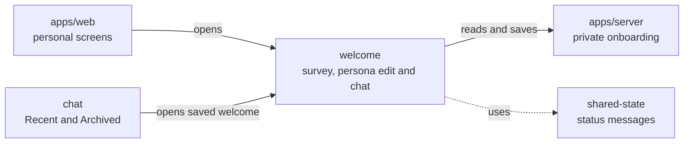

# Welcome survey and persona review

## What this is

This folder shows the welcome survey and creates a private persona from its four
saved answers. People can review and edit the text, approve an exact version,
restart the survey and answer one saved welcome question.

## Where it fits

These screens are part of the website. The server supplies saved survey answers,
persona versions and approval results.

## What it is responsible for

- Show four saved survey steps and let people continue from their confirmed answers.
- Create the first persona after the survey, then read and show its private text
  only after access checks.
- Approve the exact current version and check an uncertain approval by its command id.
- Save an edit as a new version while the earlier approval stays active.
- Explain the effect of restarting the survey before saving that choice.
- Show when approval was saved and link to the welcome chat.
- Link to unfinished survey or persona review before offering a welcome start.
- Show the saved welcome question and answer, then a read-only completion.
- Open the completed welcome from Recent or Archived and save its archive choice.
- Show a centred completion notice when a welcome began without an assistant,
  then let the person open an unsent colleague or group draft.
- Clear private text when access ends.
- Replacing an older persona version is not available on the review screen yet.

## Processes it handles

1. **Survey.** A person saves each answer. The screen reads progress again before
   moving on. The completed survey links to persona review.
2. **Persona review.** The screen reads progress, the current version list and that
   version's text. If there is no version yet, it asks the server to create one
   from the saved answers. It checks an uncertain creation without sending it again.
   A competing edit makes the screen read the latest version again.
3. **Edit and restart.** An edit saves a new version without approving it. Restart
   asks for confirmation and keeps the approved version active. An uncertain save
   is checked with its original command id.
4. **Approval.** The screen sends one command. If the result is uncertain, it checks
   that same command. Confirmed approval shows the saved time and opens welcome.
5. **Welcome.** A person finishes any step the server says is needed, then
   chooses a start that the server confirms is ready.
   Returning to a saved question shows a welcome-back notice. The screen checks
   an uncertain answer by its original command and shows the saved completion time
   before closing the composer.
6. **Saved welcome.** Recent and Archived open the same completed page.
   Archive and restore move its list row without changing the saved answer.
   A welcome completed without an assistant shows its own notice and human chat actions.

## How to run or test it

Run `npm test -w apps/web -- --watch=false --include='**/persona-review.spec.ts'`
for the focused review tests. Run `npm run build -w apps/web` to build the site.
The exact capture command is in [README.robot.md](README.robot.md).

## Where to read more

[README.robot.md](README.robot.md) records the HTTP and state details.
[The server onboarding folder](../../../../server/src/onboarding/README.md)
describes where the private answers are saved.
