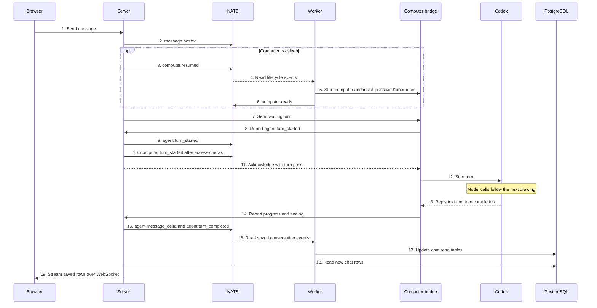
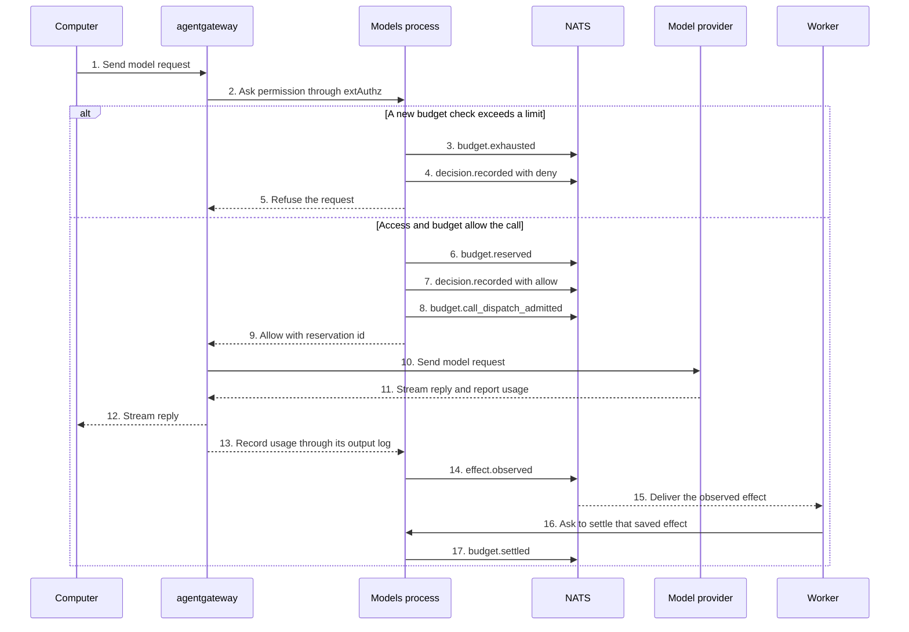
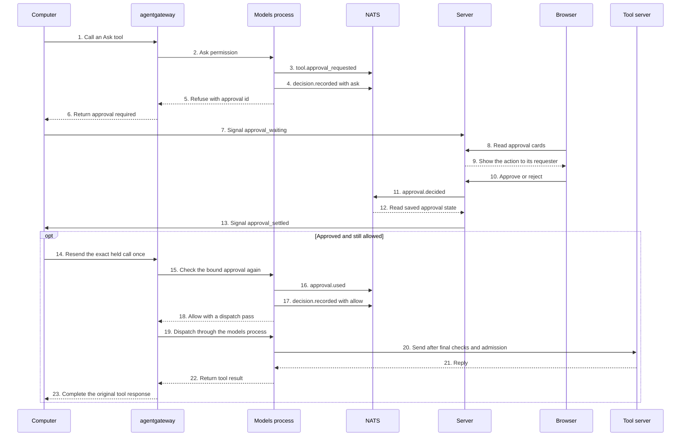

# How requests move through OpenCrane

Start here to see which program handles a request. Read the
[event catalogue](events.md) for event contracts and reactions, and the
[glossary](../../GLOSSARY.md) for the words used here.
The drawings show today's code, including checks that can refuse a request.
They do not claim that every path has passed a live installation test.

## Running programs

A folder holds our code or configuration. For an outside program, the start file
below configures or launches it; its implementation lives outside this repository.
Workers run separately for each job, such as updating chat tables or handling events.
The `models` script in `apps/server/package.json` starts the models process.

| Program | Folder | Start file | Job |
| --- | --- | --- | --- |
| Browser app | `apps/web` | `apps/web/src/main.ts` | Shows chat and settings and talks to the server. |
| Server | `apps/server` | `apps/server/src/main.ts` | Checks browser requests, saves commands and carries chat progress. |
| [Models process](../../GLOSSARY.md#models-process) | `apps/server` | `apps/server/src/models-main.ts` | Checks calls, keeps budgets and starts the gateway. |
| Background worker | `apps/ops` | `apps/ops/src/worker.ts` | Updates read tables and permissions, runs reactions and manages computers. |
| [Bridge](../../GLOSSARY.md#bridge) on each [computer](../../GLOSSARY.md#computer) | `apps/computer` | `apps/computer/src/bridge.ts` | Passes work to Codex and sends reports back to the server. |
| [Codex](../../GLOSSARY.md#codex) | `apps/computer` | `apps/computer/src/bridge.ts` | Runs the assistant's turn and calls models and tools. |
| [agentgateway](../../GLOSSARY.md#agentgateway-ai-gateway) | `libs/models` | `libs/models/src/gateway.ts` | Asks permission before forwarding model and published tool calls. |
| [NATS JetStream](../../GLOSSARY.md#nats) | `infra/nats` | `infra/dev-stack/compose.yaml` | Stores events and delivers them to readers and workers. |
| [PostgreSQL](../../GLOSSARY.md#postgresql-database) | `infra/dev-stack` | `infra/dev-stack/compose.yaml` | Holds read tables built from events. |
| [OpenFGA](../../GLOSSARY.md#openfga-permissions-service) | `infra/dev-stack` | `infra/dev-stack/compose.yaml` | Answers permission questions using records built from events. |

NATS holds the only true record of changes. PostgreSQL tables and OpenFGA records
can be rebuilt. Commands check current access and append to one event stream.
A [pass](../../GLOSSARY.md#pass) proves who is calling and expires shortly.

## A chat turn

This is an ordinary assistant session. The computer was already assigned by
`computer.claimed` after `assistant.created`, in `apps/ops/src/lifecycle.ts`.
If it is asleep, the server records a resume; the worker starts it through Kubernetes
and installs its pass before recording readiness. An already ready computer skips this.

- **1–2:** `message.posted` starts in `apps/server/src/chat/commands.ts`;
  `apps/web/src/app/chat/chat-session.ts` sends it through `apps/server/src/chat/routes.ts`.
- **3–6:** `apps/server/src/chat/bridge-conversation.ts` calls the resume command in
  `apps/ops/src/lifecycle.ts`. That file saves `computer.resumed`, reads lifecycle
  events, starts the computer, installs its pass and saves `computer.ready`.
- **7:** `apps/server/src/chat/bridge-conversation.ts` sends the waiting turn.
- **8–11:** `apps/computer/src/turn-runner.ts` reports `agent.turn_started`.
  `apps/server/src/chat/bridge.ts` records it through `apps/server/src/chat/reports.ts`,
  then calls `apps/server/src/chat/turns.ts` to save `computer.turn_started`.
  `apps/server/src/chat/turn-credentials.ts` supplies the pass after current checks.
- **12–14:** `apps/computer/src/turn-runner.ts` starts Codex, receives text and completion
  and sends `agent.message_delta` and `agent.turn_completed` reports.
- **15:** `apps/server/src/chat/bridge.ts` saves reports through `apps/server/src/chat/reports.ts`.
- **16–17:** `apps/ops/src/worker.ts` runs the conversation projection through
  `libs/projections/src/runner.ts` to update PostgreSQL.
- **18–19:** `apps/server/src/chat/realtime.ts` reads the chat tables and sends rows
  after checking access. Reloading uses `apps/server/src/chat/history.ts`.

## A gateway decision and budget settlement

This drawing follows an ordinary chat model call. The models process checks the computer, active
turn, requester, assistant, grants and paying group before allowing it.
Money is always an integer number of euro cents. A reservation sets money aside;
settlement charges the confirmed cost. Neither a reservation nor an allow decision
alone proves that a call reached the provider.

- **1–2:** `apps/computer/src/proxy.ts` forwards the model request.
  `libs/models/src/gateway.ts` configures agentgateway's `extAuthz` HTTP check;
  `libs/models/src/decision.ts` receives it. This means an outside permission check.
- **3–5:** `libs/models/src/actor.ts` saves `budget.exhausted` on a newly exceeded limit.
  `libs/models/src/decision.ts` saves `decision.recorded` with deny and refuses the call.
  Other access refusals and existing budget stops can deny without a new exhaustion event.
- **6–9:** `libs/models/src/decision.ts` calls `libs/models/src/call-retry.ts`.
  It reserves through `libs/models/src/actor.ts`, records the allow decision, then
  saves `budget.call_dispatch_admitted` before returning permission to the gateway.
- **10–13:** `libs/models/src/gateway.ts` configures the provider route, reply stream
  and usage log. `apps/computer/src/proxy.ts` forwards the streamed reply to Codex.
- **14:** `libs/models/src/gateway.ts` reads usage; `libs/models/src/actor.ts` records
  `effect.observed`. Missing or uncertain usage can instead produce `effect.uncertain`;
  it cannot be treated as a confirmed zero cost.
- **15–17:** `apps/ops/src/worker.ts` registers `libs/models/src/settlement-handler.ts`
  for observed and resolved effects. It calls the models process, where
  `libs/models/src/decision.ts` loads that saved effect and `libs/models/src/actor.ts`
  saves `budget.settled`. `effect.resolved` supports a person's later cost resolution.

## An approval

An Ask tool call waits while its exact action is shown to the requester.
`tool.approval_requested` records that waiting action, including the encrypted review.
`decision.recorded` with outcome `ask` records the gateway decision.
The computer keeps the original Codex tool response open. After approval it renews
its pass and resends that held call once; it does not ask Codex to invent another call.

- **1–6:** `apps/computer/src/mcp-proxy.ts` forwards the call through the route in
  `libs/models/src/gateway.ts`. `libs/models/src/decision.ts` calls
  `libs/models/src/approvals.ts`, which saves `tool.approval_requested`.
  The decision code then saves `decision.recorded` with ask and returns the approval id.
- **7:** `apps/computer/src/turn-runner.ts` sends the waiting signal through
  `apps/computer/src/channel.ts`. A signal is a hint to read saved events, not permission.
- **8–11:** `apps/server/src/chat/approvals.ts` reads cards and checks the requester,
  current access and the browser's write protection. `libs/models/src/approvals.ts`
  records `approval.decided`; some actions also need a recent sign-in confirmation.
- **12–14:** `apps/server/src/chat/bridge-approvals.ts` reads saved state and wakes the
  computer. `apps/computer/src/approval-holds.ts` renews the pass and sends once through
  `apps/computer/src/mcp-proxy.ts`. Rejection, expiry or cancellation ends the wait.
- **15–18:** `libs/models/src/decision.ts` repeats the checks.
  `libs/models/src/approvals.ts` saves `approval.used` by conditional append before
  the allow decision and dispatch pass. The approval binds the requester, turn,
  tool revision, connection and arguments; a changed action cannot use it.
- **19–23:** `libs/models/src/gateway.ts` routes dispatch back to
  `libs/models/src/mcp-dispatch.ts`. It consumes the pass, checks current access and
  policy, saves `mcp.dispatch_admitted` and sends to the tool. The result returns
  through the gateway to the held response in `apps/computer/src/mcp-proxy.ts`.

`libs/models/src/approvals.ts` also records `approval.expired` and `approval.cancelled`
when the wait ends. An uncertain outcome is never an automatic reason to resend.
A separate requester retry needs saved proof that nothing was sent and the original
call still held on the computer. `apps/server/src/chat/approvals.ts` checks that proof
before `libs/models/src/approvals.ts` records `approval.retry_requested`.
`apps/computer/src/approval-holds.ts` allows that separate retry once.
