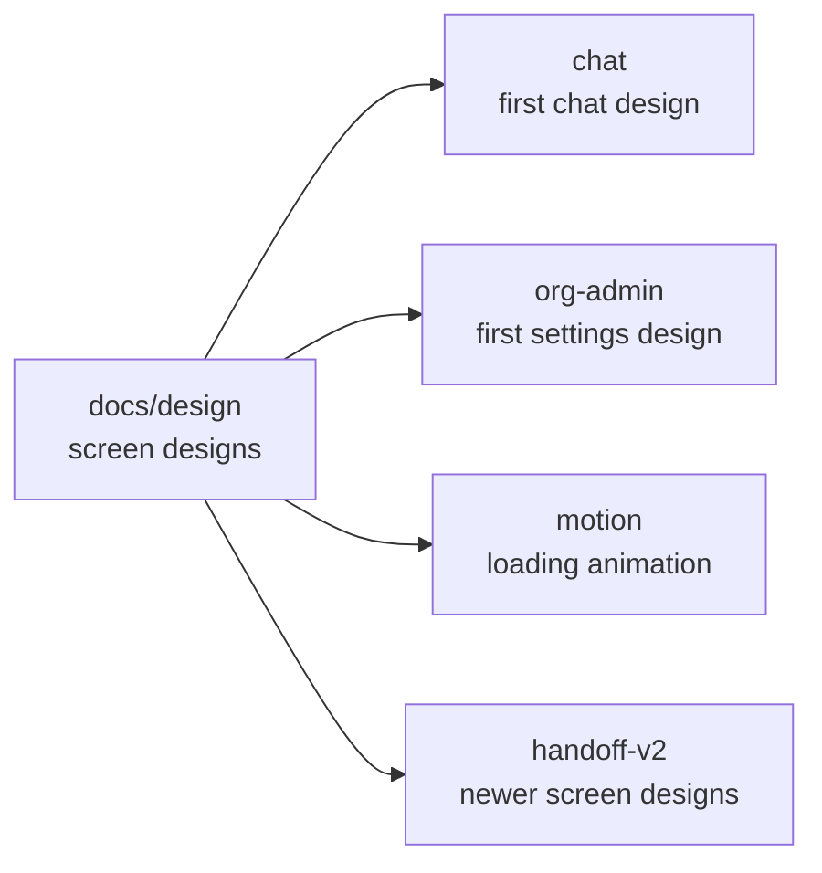

# docs/design

## What this is

This folder holds pictures and notes about how OpenCrane screens should look and work.
The designs are references, not proof that the product behaves that way. The live website
is in [apps/web](../../apps/web/README.md).

## Where it fits

These are design notes beside the working product. The folders below hold the first chat
design, the first organisation settings design, a loading animation and ten newer areas.



## What it is responsible for

- Shows the intended layout and states for screens in the website.
- Shows phone layouts and reduced-motion versions where the designs include them.
- Keeps old design notes and newer designs together for comparison.
- Records where a design has been replaced or has not been built yet.
- Leaves screen code in `apps/web`; the design HTML is not copied into the website.

## Processes it handles

1. **A screen is planned.** A designer records the intended appearance and the states a
   person can reach. The web team builds the screen in `apps/web` and checks it against
   the design. A design alone does not mean the screen works.

## How to run or test it

The design files open in a browser. The visual checks for the built screens run from the
repository root:

```sh
npm run visual:chat
npm run visual:org-admin
npm run visual:fold-loader
```

## Where to read more

- [README.robot.md](README.robot.md): design history and the full index of design areas.
- [Chat design](chat/README.md): the first chat and workspace design.
- [Organisation settings design](org-admin/README.md): the first settings design.
- [Newer screen designs](handoff-v2/README.md): the ten newer areas and what is built.
- [Loading animation](motion/fold-loader/README.md): the folding-paper animation.
- [Website](../../apps/web/README.md): the running screens.
