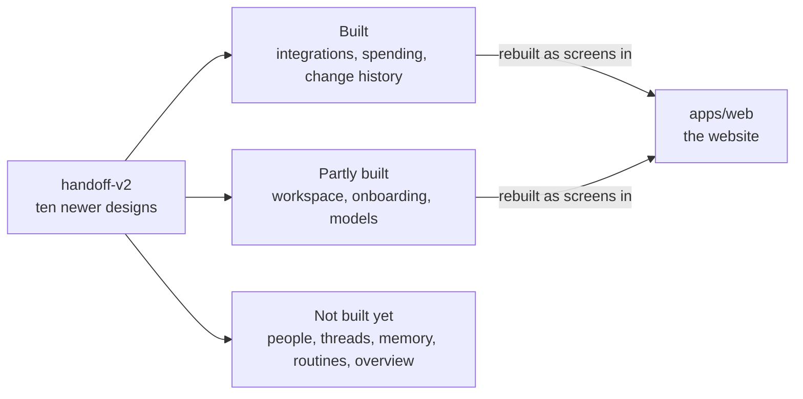

# docs/design/handoff-v2

## What this is

This folder holds ten newer designs for parts of OpenCrane. Each design shows screens and
states that the website may support. They are design references, not proof that a screen
works. The live website is [apps/web](../../../apps/web/README.md).

## Where it fits

The designs sit beside the older chat and organisation settings designs. Their source
pictures were made with a design tool, and the full-size images are kept outside this
repository. Ask the design owner for those files.

## What it is responsible for

- Shows the intended screens for ten areas of the product.
- Asks builders to give every screen a phone layout and a version without animation.
- Makes clear which areas have working screens and which remain design ideas.
- Leaves the website code in `apps/web`; no design HTML runs as part of the product.

| Area | What a person does | What works in `apps/web` |
| --- | --- | --- |
| [Integrations and my tools](01-int/README.md) | Connect tool servers and choose tools. | Integrations work. Personal tool settings are not built yet. |
| [Workspace effects](02-wrk/README.md) | Follow assistant work, approvals, files and screenshots. | The chat workspace works; some designed states are missing. |
| [Spending](03-spd/README.md) | Set a budget and check spending. | The spending page works. |
| [People and groups](04-ppl/README.md) | Invite people, set roles and manage groups. | These pages are not built yet. |
| [Threads and delegation](05-thr/README.md) | Share a conversation and pass work on. | These features are not built yet. |
| [Memory](06-mem/README.md) | See and control what an assistant remembers. | This feature is not built yet. |
| [Onboarding and account](07-onb/README.md) | Sign in and manage personal settings. | Sign-in, the first-owner set-up page and a read-only account page work. The rest is not built yet. |
| [Models and providers](08-mod/README.md) | Choose models and who may use them. | The website lists models. Provider set-up exists in the server but not yet in the website. |
| [Routines](09-rtn/README.md) | Set up repeating assistant work. | This feature is not built yet. |
| [Overview and history](10-ovr/README.md) | See the organisation home page and changes. | Change history works; the home page is not built. |

## Processes it handles

1. **A person needs a product screen.** The design shows the proposed screen and its
   states. The web team builds the screen in `apps/web` and checks it against the
   reference. Some designs describe work that is not built yet.

## How to run or test it

Open each folder's HTML design in a browser. Compare the built chat, settings and loading
screens with their references by running the visual checks from the repository root.

## Where to read more

- [README.robot.md](README.robot.md): designer notes, state counts and build details.
- [Organisation settings design](../org-admin/README.md): the older settings design.
- [Website](../../../apps/web/README.md): the live screens.
