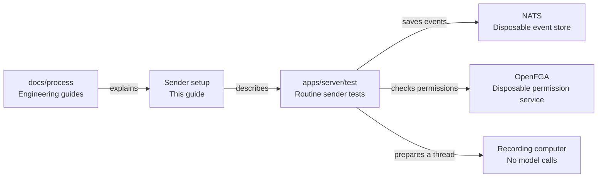

# Routine sender test setup

## What this is

This folder explains how the routine sender tests prepare their services.
The tests use disposable NATS and OpenFGA services and a recording computer.
They check the sender without starting automatic routines.

## Where it fits

This guide belongs to the engineering process documentation. It describes the
server's sender tests and their permission setup.



## What it is responsible for

- Explain why permission setup runs after the session command returns.
- Describe the bounded wait for the saved permission receipt and posting access.
- Keep the measured test results and remaining failures in the companion record.

## Processes it handles

The real preparation command starts an empty private thread and saves its session.
The fixture then applies the saved session to OpenFGA and waits for its permission
receipt and posting access. Input and spending preparation follow with fresh access
checks. Fixture work no longer consumes the session command's write deadline.

A regression advances the clock during permission setup. It checks that preparation
still saves one session, one input and one spending allowance without running a turn.
It leaves the routine clock and the product's write deadlines unchanged.

## How to run or test it

With the test database available, the focused commands are:

```sh
nice -n 10 npx vitest run apps/server/test/routine-sender.test.ts --maxWorkers=1
nice -n 10 npx vitest run libs/events/test/security-rules.test.ts --maxWorkers=1
```

The tests use `PG_TEST_URL` for the test database. The companion record describes
the concurrent fixture runs. Fresh-install live qualification has not been run.

## Where to read more

- [Commands, results and limits](README.robot.md).
- [The server's responsibilities](../../../apps/server/README.md).
- [The testing standard](../standards.md#tests-and-evidence).
