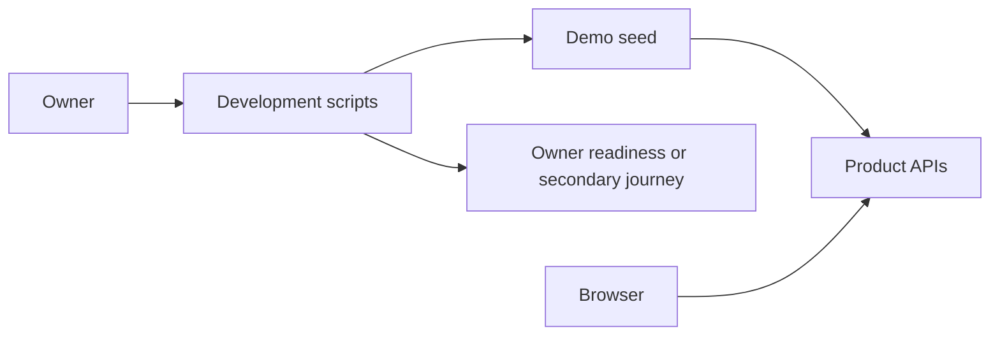

# Preparing the demo

## What this is

This is the owner's refresh and rehearsal guide. The current seed creates two groups
and one shared assistant through authenticated product APIs. It reuses existing people.
PDF seeding, automatic ceiling changes and the three-minute smoke command are not built yet.

## Where it fits

The development scripts start a stack. The seed talks to the same server as the browser.



## What it is responsible for

- Keep Acacia Trading, Kijani Logistics and the Acacia supplier assistant stable on repeats.
- Reuse `jente-rosseel` and the existing `zitadel-member`, without changing cloud accounts.
- Recover original command receipts after an interrupted seed.
- Describe the owner refresh without running it automatically.

Existing display names stay as they are. The join command supports a display name;
there is no rename command for an already joined person. The seed refuses missing people.
It does not invent replacement identities or overwrite a company limit.

## Processes it handles

A secondary start claims a spare stack and runs the existing fresh startup checks.
It uses `DEV_REAL_PROVIDER_FILE`, the path of a private OpenAI key file, and keeps
computers awake for four hours. It then seeds and prints bookmarks. A failure removes
only the secondary whose startup this run attempted. A mismatched claim stops before
startup or cleanup; a successful rehearsal keeps the stack until explicit cleanup.

The seed remembers attempted command ids in private `demo-requests` files. These are
request records, not business state. Reruns read the server's original receipts and
wait for both content and access updates. An unknown outcome stops the seed; deleting
request records is not a recovery step. Assistant creation does not prove readiness.

## How to run or test it

### Secondary rehearsal

Only one live rehearsal uses the shared machine at a time. The refreshed computer image
has passed Stop with the stand-in; Stop with the real model still needs checking. Keep the remaining
allowance for all paid runs together within 2,000 cents per UTC day, including unknown
holds. Startup's 2,000-cent ceiling is per stack; it is not a shared daily counter.

**The secondary launcher uses a fresh start. It wipes the claimed stack's conversations,
files, budgets, service data and computer disks.**

```sh
DEV_STACK_ID=1 \
ZITADEL_KEY_FILE=/home/jente/dev/opencrane-new/.keys/.zitadel-key \
DEV_REAL_PROVIDER_FILE=/home/jente/dev/opencrane-new/.keys/.openai-key \
infra/dev-stack/demo-up.sh
# After rehearsal, remove only the id printed by the launcher.
infra/dev-stack/down.sh --id 1
```

Use id 2 instead when that is the agreed free slot. Missing and owner ids are refused.
Startup currently runs the full existing journey, including its paid checks. It is
not the proposed three-minute smoke. The launcher does not suppress a failed journey.

### OWNER-RUN: refreshing the owner checkout

**A complete real-demo fresh-install PASS is still required before this sequence.**
The owner real-mode command and refreshed image are available. PDF seeding, ceilings
and the timed smoke are still unfinished. There is no qualified owner SHA in this guide.
These commands require an interactive terminal and refuse any `OPENCRANE_FLEET_TASK`
marker, including an empty one. Task launchers export that marker. No task has run
these commands on the owner stack or checked the real phone path.

Before choosing a SHA, confirm that it is merged into `origin/main`, includes both
the real-provider and demo-kit changes, includes the qualified Stop image, and has
an explicit fresh-install PASS. That PASS must include real replies and the demo
checks. A green `ci-ok`, a stand-in nightly or partial real replies cannot substitute.
Owner startup is tested with disposable recording fixtures. It has not been run live.
It checks service health, running processes and listener addresses without sending
chat prompts. Automated journeys refuse the owner id and any fleet marker before
reading configuration. A failed or interrupted real start restores the previous saved
mode and stops services launched by that start. It cannot restore data erased by `--fresh`.

The first command stops existing services from their existing checkout. Keeping that
checkout path avoids transferring its ownership marker. Replace the SHA placeholder
with the full 40-character merged SHA from the fresh-install receipt before proceeding.

`--fresh` wipes the owner's conversations, uploaded files, budgets, local service data
and computer disks, and replaces generated service credentials. Existing cloud sign-in
accounts survive. It is not an upgrade that preserves data. The explicit owner seed
uses product APIs; it does not change the existing owner bootstrap.

```sh
# OWNER-RUN ONLY, after every prerequisite above is satisfied.
cd /home/jente/dev/opencrane-new
infra/dev-stack/down.sh --id owner
export DEMO_SHA=REPLACE_WITH_FULL_QUALIFIED_MERGED_SHA
printf '%s\n' "$DEMO_SHA" | rg '^[0-9a-f]{40}$' || exit 1
git fetch origin
git merge-base --is-ancestor "$DEMO_SHA" origin/main || exit 1
git switch --detach "$DEMO_SHA"
npm ci
export DEV_REAL_PROVIDER_FILE=/home/jente/dev/opencrane-new/.keys/.openai-key
export ZITADEL_KEY_FILE=/home/jente/dev/opencrane-new/.keys/.zitadel-key
export COMPUTER_IDLE_MS=14400000
infra/dev-stack/up.sh --id owner --owner-run --fresh
DEV_STACK_ID=owner node --experimental-strip-types infra/dev-stack/demo-seed-run.ts --owner-run
```

### OWNER-RUN: demo morning

Once a fresh refresh has passed, plain startup preserves the seeded data and renews
its 24-hour computer token. Keep the same qualified SHA and provider file path.
Real mode still requires `--owner-run` and interactive stdin on every start.
The credential is supplied by file path only; it is never placed in a command argument.

```sh
# OWNER-RUN ONLY, after the qualified refresh above.
cd /home/jente/dev/opencrane-new
export DEV_REAL_PROVIDER_FILE=/home/jente/dev/opencrane-new/.keys/.openai-key
export COMPUTER_IDLE_MS=14400000
infra/dev-stack/up.sh --id owner --owner-run
```

Sign in again in separate browser profiles. Open each person's personal chat and the
member's shared assistant, send one short warm-up question, and wait for completion.
Startup, sign-in and waking computers are outside the three-minute warm rehearsal.

### OWNER-RUN: switching the real model off

Stopping the stack ends the running real-mode services. Removing the provider file
setting alone does not stop them. Returning to the stand-in model needs a fresh start.

**The fresh start below wipes the owner's conversations, uploaded files, budgets,
local service data and computer disks, and replaces generated service credentials.**
Cloud sign-in accounts survive. These commands require the same interactive owner
terminal and absent fleet marker as the real start.

```sh
# OWNER-RUN ONLY, after accepting the data wipe above.
cd /home/jente/dev/opencrane-new
infra/dev-stack/down.sh --id owner
unset DEV_REAL_PROVIDER_FILE
infra/dev-stack/up.sh --id owner --owner-run --fresh
```

The final command starts the stand-in model and reports service readiness. It does
not run an automated owner journey. Later stand-in starts keep the provider file
setting unset and omit `--fresh` to preserve their new data.

### Bookmarks and warm rehearsal

The seed prints complete links. Use `/workspace`, `/workspace/direct`, `/workspace/shared`,
`/org/people?tab=groups`, `/org/models`, `/org/spending` and `/org/history`.
Only the owner opens organisation settings. Action history uses the current chat id.

The planned three-minute check covers streaming and reload, a scanned supplier PDF's
fixed total and delivery date plus preview/download, Stop and reload, live direct delivery,
a private shared-assistant reply, and company-limit refusal followed by restoration.
For now those checks are manual and the full timed smoke is **NOT RUN**. Upload only
into a personal chat; shared-assistant uploads are refused. Use plain-sentence prompts
that need no internet, tools or memory. Never show the provider key.

Before a limit demonstration, record the existing company monthly and daily ceilings
in integer euro cents. In Spending, use only the company-wide daily ceiling and today's
charged amount to demonstrate refusal. Restore both recorded values immediately, even
if the member check fails, and verify the saved values before another paid message.
Never raise a limit beyond the remaining shared daily allowance. Unknown holds still count.

Keep the machine quiet during rehearsal and the demo: agree a window without other live
journeys or heavy checks. This guide installs no fleet pause or hold mechanism.
Avoid Account, Memory, Workspace files, Watch your computer, Projects, search, Overview,
Routines, Integrations and the Invitations tab. Create an invite only for display; do not
open its join link. Explain the fixed “OpenCrane 2 Dev” name, raw shared-assistant group ids
and visible setup-test data. Laptop tunnelling and real-phone access remain untested.

## Where to read more

- [Check receipt](../demo-kit/receipt.md): tested source, timings and remaining work.
- [Development stack contract](../../../infra/dev-stack/README.robot.md): settings and cleanup.
- [Real reply receipt](../demo-real-model/receipt.md): the earlier paid results and Stop failure.
