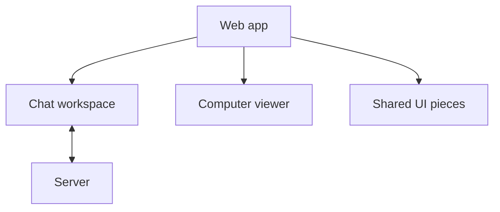

# Shared workspace pieces

The web app contains this chat workspace beside the computer viewer and other
shared UI pieces. The workspace reads chat and file data from the server.

This workspace shows a conversation and its session files. It turns saved chat
events into message rows, file cards and a spending-limit notice. It also shows
an empty conversation and the session Files and Activity views.

The file route serves uploads and screenshots that the signed-in viewer may
read. Assistant workspace paths are not files on that route, so their cards do
not show Download. Deleted workspace paths do not appear as file cards.

The spending-limit notice tells a reader that an Owner or Admin can review the
limit, or that they can wait for the next monthly budget period in UTC. It does
not show a scope, amount, reset date or held amount because the saved decision
does not include those values.

The workspace uses the shared states, drawers, paper details, loaders and
session shell already in the web app. Its tools are read-only details. They do
not offer a retry that would start a new message.

## Visual comparison

[`visual.json`](visual.json) records the browser captures and checks at
1280px, 390px and 320px, with normal and reduced motion.

| Reference | Capture | What the capture shows |
| --- | --- | --- |
| WRK-01 | `empty-workspace-*` | The empty conversation in the existing workspace. |
| WRK-03 and WRK-04 | `workspace-effects-*` | A tool result in the transcript. The tool details stay inline; the reference opens a side drawer or a phone page. |
| WRK-40, WRK-41, WRK-42 and SPD-54 | `workspace-effects-*` | The spending-limit notice. The reference has a “Stopped: limit reached” header chip and a stop tool line; this build has neither. |
| WRK-40, WRK-41, WRK-42 and SPD-54 | `workspace-effects-*` | The reference keeps the title ink-coloured and colours only its glyph red. This build colours the whole title red. |
| WRK-80 | `empty-workspace-*`, `phone-panel-*` | The session Files view and its empty screenshot hint. The reference uses a camera glyph; this build uses the shared empty-state ring. |
| WRK-01 | `empty-workspace-*` | The reference has one “No files yet” state. This build uses one screenshot hint that also tells readers where attached and created files appear. |
| WRK-83 | `workspace-effects-*` | File cards with readable names. The reference says “Captured by Alex”, shows a UTC time and `1440 × 900`, and uses full-width phone actions. This build shows the event time and only offers downloads the route can serve. |
| SPD-54 | `workspace-effects-*` | The phone composer. The reference puts the field and toolbar in one bordered card; this build keeps a separate field above loose buttons. |

The reference budget cards include example people, dollar amounts and reset
dates. Those values are not in the saved decision, so this build does not show
them. The file cards also do not show a separate capture time or image size.

## Checks

Report each check as PASS, FAIL, PARTIAL or NOT RUN. These browser fixtures use
sample data and do not qualify a fresh installation.

| Check | Result | Evidence |
| --- | --- | --- |
| Lint | PASS | `nice -n 10 npm run lint`; six existing warnings in unrelated files and no errors. |
| Typecheck | PASS | `nice -n 10 npm run typecheck` across all workspaces. |
| Event catalogue | PASS | `nice -n 10 npm run check:events`; all 95 event types agree. |
| Angular build | PASS | `nice -n 10 npm run build -w apps/web`; existing bundle, workspace CSS budget and noVNC warnings. |
| Angular tests | PASS | 23 files and 152 tests passed under `nice -n 10`. |
| F1 visual check | PASS | 56 captures. |
| F2 visual check | PASS | 38 captures; Files and file preview actions use their named accessible labels. |
| F3 visual check | PASS | 22 captures. |
| F4 visual check | PASS | 20 captures. |
| F5 visual check | PASS | 18 captures at 1280px, 390px and 320px, with normal and reduced motion. |
| Chat browser | PASS | `nice -n 10 node scripts/check-chat-browser.mjs`; keyboard, streaming, budget, focus and responsive checks. |
| Full root suite | PARTIAL | 1,686 passed and 15 skipped across 108 files; one gateway test timed out. The 81-test gateway file passed alone: 80 passed and one skipped. |
| Fresh-install live qualification | NOT RUN | No live installation is covered by these browser fixtures. |
| Dev-stack budget journey | NOT RUN | Run only through the claimed secondary stack when a budget journey is requested. |
