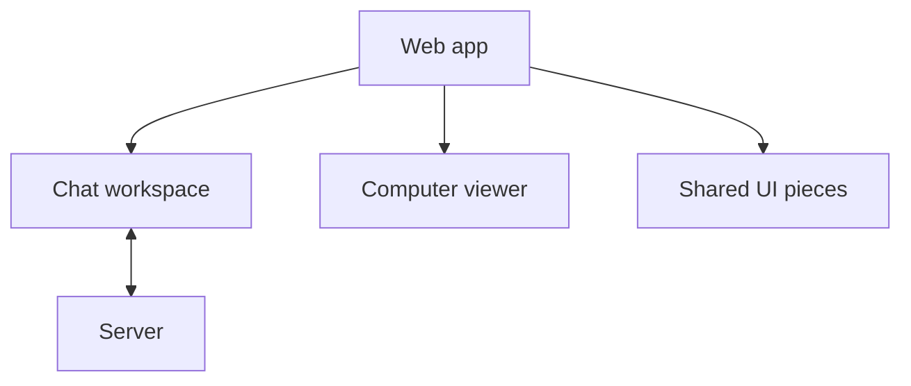

# Shared workspace pieces

Checked on 5 October 2026 from source commit `d1453c4`, rebased onto
`acaf4967905f6535dd8f1faf21e6199c03f8a1ff`. The browser checks use sample data
and a local Chromium browser. They do not qualify a fresh installation.

The web app contains this chat workspace beside the computer viewer and other
shared UI pieces. The workspace reads chat and file data from the server.

This workspace shows a conversation and its session files. It turns saved chat
events into message rows, file cards and a spending-limit notice. It also shows
an empty conversation and the session Files and Activity views.

In an open conversation, Download appears for your own uploads and screenshots.
Another member's ordinary upload and assistant workspace paths do not show
Download. Closed conversations do not offer Download because the file route
refuses reads from them. Deleted workspace paths do not appear as file cards.

The spending-limit notice tells a reader that an Owner or Admin can review the
limit, or that they can wait for the next monthly budget period in UTC. It does
not show a scope, amount, reset date or held amount because the saved decision
does not include those values.

The workspace uses the shared states, drawers, paper details, loaders and
session shell already in the web app. Its tools are read-only details. They do
not offer a retry that would start a new message.

## Visual comparison

[`visual.json`](visual.json) records the browser captures and checks at
1280px, 390px and 320px, with normal and reduced motion.

| Reference | Capture | What the capture shows |
| --- | --- | --- |
| WRK-01 | `empty-workspace-*` | The empty conversation in the existing workspace. |
| WRK-03 and WRK-04 | `workspace-effects-*` | A tool result in the transcript. The tool details stay inline; the reference opens a side drawer or a phone page. |
| WRK-40, WRK-41, WRK-42 and SPD-54 | `workspace-effects-*` | The spending-limit notice. The reference has a “Stopped: limit reached” header chip and a stop tool line; this build has neither. |
| WRK-40, WRK-41, WRK-42 and SPD-54 | `workspace-effects-*` | The reference keeps the title ink-coloured and colours only its glyph red. This build colours the whole title red. |
| WRK-80 | `empty-workspace-*`, `phone-panel-*` | The session Files view and its empty screenshot hint. The reference uses a camera glyph; this build uses the shared empty-state ring. |
| WRK-01 | `empty-workspace-*` | The reference has one “No files yet” state. This build uses one screenshot hint that also tells readers where attached and created files appear. The panel leaves out the placeholder Decisions and People sections to match the reference. |
| WRK-83 | `workspace-effects-*` | File cards with readable names. The reference says “Captured by Alex”, shows a UTC time and `1440 × 900`, and uses full-width phone actions with borders. This build shows the event time and uses full-width, borderless phone actions. In an open conversation, Download appears for your own uploads and screenshots. |
| SPD-54 | `workspace-effects-*` | The phone composer. The reference puts the field and toolbar in one bordered card; this build keeps a separate field above full-width, borderless buttons. |

The reference budget cards include example people, dollar amounts and reset
dates. Those values are not in the saved decision, so this build does not show
them. The file cards also do not show a separate capture time or image size.

## Checks

Report each check as PASS, FAIL, PARTIAL or NOT RUN. These browser fixtures use
sample data and do not qualify a fresh installation.

| Check | Result | Evidence |
| --- | --- | --- |
| Lint | PASS | `nice -n 10 npm run lint`; no errors and six warnings in unrelated files. |
| Typecheck | PASS | `nice -n 10 npm run typecheck`; all workspaces. |
| Event catalogue | PASS | `nice -n 10 npm run check:events`; all 95 event types agree. |
| Angular build | PASS | `nice -n 10 npm run build -w apps/web`; the build reports its existing bundle, workspace CSS and noVNC warnings. |
| Angular tests | PASS | `nice -n 10 npm run test -w apps/web -- --watch=false`; 23 files and 157 tests passed. |
| F1 visual check | PASS | `nice -n 10 npm run visual:f1-foundation`; 56 captures. |
| F2 visual check | PASS | `nice -n 10 npm run visual:f2-drawers`; 38 captures. |
| F3 visual check | PASS | `nice -n 10 npm run visual:f3-org-shell`; 22 captures. |
| F4 visual check | PASS | `nice -n 10 npm run visual:f4-settings`; 20 captures. |
| F5 visual check | PASS | `nice -n 10 npm run visual:f5-workspace`; 18 captures at 1280px, 390px and 320px, with normal and reduced motion. |
| Chat browser | PASS | `nice -n 10 npm run visual:chat`; keyboard, streaming, Stop, reload, offline retry, wake state and scoped frames at 1280px and 390px. |
| Dev-stack upload journey | NOT RUN | No dev stack was started. |
| Dev-stack screenshot journey | NOT RUN | No dev stack was started. |
| Fresh-install live qualification | NOT RUN | These browser checks use sample data and do not qualify a fresh installation. |
| Full root suite | NOT RUN | Left out because this change only touches the web app, scripts and dev-stack journeys. |
